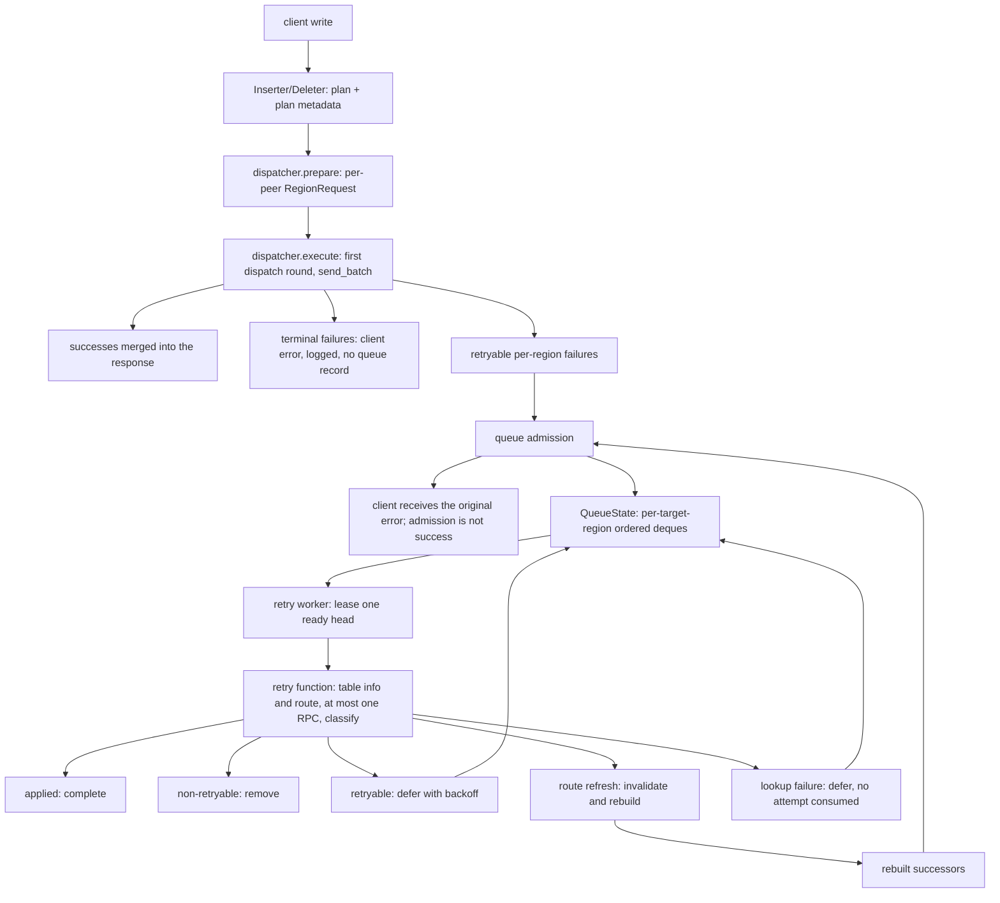

# Summary

This RFC proposes an optional in-memory write retry queue for the frontend, built on the retry layer introduced in #9530 and following the queue-owned lifecycle shape proposed in Issue #8085. The first normal write dispatch stays in the request path. From the first retryable per-region outcome, the queue owns the retry lifecycle: scheduling, backoff and jitter, RPC-attempt budget, TTL, cancellation, and completion. Each queue retry invocation processes one queued work item and returns one classified outcome. It resolves the current route and issues at most one target-region RPC; a classified no-send invocation outcome such as lookup failure, absent topology, or a table-state check issues none. Two pre-invocation task events also issue no RPC and are not outcomes returned by the retry function: `TransientFull` dead-letters the record before issuing an RPC in that task, while decode failure dead-letters `decode_failed`, consumes no attempt, and is not retried. When the response asks for a route refresh, the invocation invalidates the route caches and rebuilds through the existing `TablePartitioner::rebuild_write_requests`, returning either a final result or independent successor work. It never sleeps and never runs its own retry loop.

When the queue is enabled, the dispatcher's inline retry loop (`WriteRetry::retry`) is not entered; the queue is the only retry mechanism on that path. When the queue is disabled, the existing inline loop is unchanged. The SQL/API response shape and the meaning of `affected_rows` are unchanged: the client receives the original error, admission is not success acknowledgment, and `affected_rows` keeps its applied-rows meaning. A retryable replay outcome is never treated as success; the record remains scheduled while the queue is open and its limits allow another attempt. Outside shutdown, a successful RPC response completes the record. Shutdown closes admission and new leases and rejects new send authorizations under the same state lock; a task that has not passed the authorization gate returns pre-send and is left to drain, while a task that has passed it is authorized: its invocation is joined, and any RPC it issues is awaited until it completes or reaches `rpc_deadline`; a successful response settles normally even after close, and any record still present after join is removed by drain rather than rescheduled.

The queue is process-local memory only: Core v1 claims no durable retention, restart recovery, at-least-once delivery, at-least-once application, or exactly-once application, and never reports a replay success to the client.

# Motivation

The dispatcher already retries a per-region write with `max_retries = 3`, exponential backoff with additive jitter, and `initial_backoff = 1.5s`, `max_backoff = 10s`, `backoff_multiplier = 2.0`. The resulting delays are `[1.5,3)`, `[3,6)`, and `[6,12)` seconds: a 10.5 to under 21 second window plus up to four RPCs. The frontend-to-datanode channel has no request timeout, so each RPC can take arbitrarily long.

That loop runs inside the client request and ends at give-up. A datanode restart, region migration, or partition can outlast it, and today only the client can retry. The client has no per-region view: it either replays the whole statement, duplicating regions that succeeded, or drops the failed regions. Extending the loop does not solve this, because a client timeout drops the caller future, `Inserter::do_request` cancels the request, and the detached `execute` stops at its next cancellation check.

Issue #8085 asks for a bounded frontend buffer and for restart survival; Core v1 covers the bounded in-memory queue. The lifecycle shape follows Issue #8085's comment of 2026-10-27: a shared queue per frontend plus a retry function that issues at most one target-region RPC per invocation, so retry execution stays separate from lifecycle management and the system does not acquire a second retry mechanism. Consequently, with the queue enabled the client is told the original error after the first failed round, while the queue continues retrying in the background; the retry window is no longer spent inside the client future.

# Goals

- Make one shared queue per frontend own retry scheduling, backoff and jitter, RPC-attempt budget, TTL, cancellation, and completion.
- Keep the retry function one-shot: each invocation issues at most one target-region RPC and may return a classified no-send outcome; it contains no sleep and no internal retry loop. Reuse the existing route-refresh, repartitioning, and send logic.
- Retain a bounded number of failed per-region writes, with byte, record, per-record size, and separate transient-reservation ceilings.
- Preserve retryable siblings when another sibling is terminal.
- Replay per target region in FIFO order within one Frontend instance, with at most one in-flight record per key; different keys are independent.
- Account for charged payload exactly: reserve before allocation, encode into the reserved size, commit once.
- Keep the client response and `affected_rows` unchanged; never report a queued write as success.
- Make every lifecycle outcome explicit: shed, dead-letter, defer, drain, or lost with the process.

# Non-Goals

- **Durable queue and recovery.** No durable retention, restart recovery, or cross-process recovery.
- **No second retry mechanism on the queue path.** `WriteRetry::retry` is not invoked when the queue is enabled, and the queue never calls it. Core v1 leaves the queue-disabled configuration unchanged.
- **No unit-level completion across a rebuild.** A rebuilt request can fan out into several successor records. They are independent records; there is no parent-child accounting, target-set gate, or unit-level success/failure. Each successor succeeds, defers, or is dropped on its own.
- **Strong replay consistency.** No region-side DDL epoch, atomic send fence, region-side idempotency, client idempotency key, newer-write detection, or stale-replay protection.
- **Exactly-once or acknowledged writes.** A record may be submitted more than once, and a successful replay is not reported to the client.
- **Excluded write paths.** `BulkInsert`, including both pending-rows batchers, never reaches admission because both batchers flush as `BulkInsert`. Instant-TTL inserts never reach the dispatcher's region-write path: they are only mirrored to Flow. Flow source tables are shed at admission. Requests without per-region plan metadata, or that are not exactly one insert or delete region, are shed. Excluded writes are never stored or replayed.
- **Unsupported operations.** No fairness reservations, adaptive replay pacing, queryable dead-letter store or manual replay API, automatic worker restart, or standalone mode. Standalone is rejected by option validation.
- **No SQL/API shape change or new wire discriminator.** The SQL/API response shape, the meaning of a successful response, and the applied-rows meaning of `affected_rows` are unchanged; admission is not a success acknowledgment. Enabling the queue changes failure timing: a failure the inline retry loop could previously absorb may become client-visible, and a later replay success does not alter the error already returned. The queue adds no new client-visible error type, no new protobuf field, and no persisted state. A partition-expression version mismatch is handled through the same `RetryAfterRouteRefresh` route-refresh path as the live dispatcher, so no dedicated status or hint discriminator is required.

# Design

## Architecture

Core v1 is an operator-layer module wired by the frontend. It has three parts:

- **Queue state.** One `Mutex<QueueState>` holding `closed`, charged counters, transient reservation accounting, and per-target-region ordered deques. Admission commits directly under the state lock. The same lock is the send authorization gate: a replay task checks `closed`, checks the record deadline, and records `send_issued` under it, while shutdown sets `closed` under it.
- **Admission.** Once per retryable per-region failure of the first dispatch round: check eligibility, reserve ledger room, encode, commit. A request that is still shared after the first RPC has no owned payload and is a first-round terminal failure, not an admission rejection.
- **Retry worker.** One task on the global runtime. It leases ready heads, spawns bounded per-record tasks, and joins their results. A task reserves transient capacity and decodes the payload before calling the one-shot retry function; the function issues at most one target-region RPC. `TransientFull` and decode failure are pre-invocation task events, not outcomes returned by the retry function.




**Who performs what.** The first send is the existing `send_batch` in the request path; it already splits the partial result per region, so the failures handed to admission are single-region writes. The queue calls the retry function, never `WriteDispatcher::execute`, `WriteDispatcher::finish`, `WriteRetry::retry`, `WriteRetry::enqueue_failures`, or a second dispatcher round. The retry function is one-shot: when called, it issues at most one RPC and reports one classified outcome; it has no sleep and no loop. With the queue enabled, `finish` merges the first round, hands retryable failures to admission, returns the client error, and does not call `WriteRetry::retry`. The only duplicate risk is semantic (a record or a rebuilt successor resends rows), not a second in-process retry loop.

A record moves through four states; the charge owner changes only at commit and removal.

| State | Meaning | Charge owner |
| --- | --- | --- |
| Reserved | Ledger check passed; payload may still be encoding. | Admission guard |
| Stored | The record is at a key. | `QueueState` |
| Leased | A retry task holds the head under a lease token. | `QueueState`; the lease authorizes a transition, not charge release |
| Removed | Completed, dead-lettered, or drained. | Released |

The lease guard authorizes normal settlement; recovery and drain are the only other paths that may resolve a lease. A panicking task leaves its marker for the recovery protocol, and no lease-guard drop releases a record charge. The separate transient RAII guard releases only the transient reservation. Invariants and recovery are defined once in [Queue Invariants and Recovery](#queue-invariants-and-recovery).

## Record and Retry Work Model

A record is one **current single-region request**, not one source-region payload for life. At admission, the payload came from a source region. After a route refresh and rebuild, the same admitted lineage may target a different region, and its successor records carry the rebuilt payload. The record key is always derived from the current payload's single region entry.

| Part | Contents | Source |
| --- | --- | --- |
| Payload | Encoded single-region `RegionRequest` | The body carries the target region id and, when present, `partition_expr_version`; the queue key is derived from the body and is not duplicated in the sidecar |
| Immutable sidecar | Plan-time `TableIdent.version`; row count of the request; lineage admission sequence | The version is captured during planning for first-round records and from the table info used by the rebuild for successors; row count is derived from the single-region request; the sequence is inherited by successors |
| Admission-time metadata | Admission timestamp and record deadline | Generated at admission; `record deadline = admission timestamp + ttl`. Successors inherit the original deadline and do not extend it |
| Mutable queue state | Record id, charge bytes, per-key deque membership, lease token and in-flight marker, `attempts`, `consecutive_failures`, next-ready time | Under `QueueState` |

Plan-time `TableIdent.version` is captured from the `TableInfo` the plan already loads, attached per per-region item, and carried through `prepare` and `send_batch` into the per-region failure. Admission adds the timestamp and deadline. `RegionRequestHeader` cannot carry this sidecar data. The prototype's admission-time version read is replaced by plan-time capture.

**Invocation and attempt boundary.** A queue retry invocation processes one record's decoded request and returns one classified outcome. It issues at most one target Region RPC: an admitted record holds one single-region request, and the queue never combines records into one invocation. A classified no-send invocation outcome such as lookup failure, absent topology, or a table-state check issues none. The pre-invocation events `TransientFull` and decode failure also issue no RPC, but they are not retry-function outcomes; the task handles them before the invocation. Decode failure is terminal: it dead-letters `decode_failed`, does not consume an attempt, and is not rescheduled. Route refresh, topology refresh, and request rebuild are not RPC attempts. A rebuild can produce several independent single-region successor records; a fan-out is not an atomic retry of all affected regions. A successor is a new queue work item, not part of a shared multi-region attempt or a completion unit.

`max_attempts` is a per-work-item-chain budget, not a lineage-wide aggregate. A split copies the parent's RPC-attempt count into every successor, and each successor branch then counts and terminates independently; a fan-out of F successors can therefore issue up to F × remaining RPC attempts. Core v1 chooses this because a shared aggregate across successors would require parent-child accounting, which is outside the in-memory scope. The amplification is bounded by TTL and by the number of destination regions the rows map to.

**Outcomes.** The retry function reports one classified outcome and the queue applies one transition. The task also has two pre-invocation events, `TransientFull` and decode failure, which occur before the retry function is called and are not outcomes returned by it. The outcome and event table in [Retry Scheduling](#retry-scheduling) is the single definition of attempt accounting and settlement for both; this section defines only what a successor is.

**Successors.** Only `RouteRefresh` and `TopologyRefresh` produce successors. Each successor is encoded, charged, and admitted as an independent record. It inherits the lineage's admission sequence, the post-settlement `attempts` count, the post-settlement `consecutive_failures`, and the original record deadline; it does not inherit a parent pointer or the parent's old next-ready time. Its own `next_ready` is computed at admission from the inherited post-settlement `consecutive_failures`, using the queue's backoff function; the retry function never sleeps. Both `RouteRefresh` and `TopologyRefresh` successors wait one corresponding backoff interval, so a rebuild cannot cause an immediate replay loop. If a successor cannot be admitted (closed queue, byte or record budget, per-record size, expired deadline, attempts exhausted), it is dropped and logged, and the lineage loses those rows. That is a data-loss window of the rebuild path and is not compensated. Successor placement is defined in [Consistency](#consistency).

**Rebuild uniqueness.** A rebuild runs only under the original record's lease, and the original is removed in the same settlement. `RouteRefresh` and `TopologyRefresh` are classified by a synchronous classify-and-publish operation: at the moment the retry function classifies the outcome, the task publishes `Rebuilding { rpc_issued, source }` to its completion cell in one atomic, non-allocating, non-fallible state handoff. `RouteRefresh` publishes `rpc_issued: true`; `TopologyRefresh` publishes `rpc_issued: false`. Publication starts from the cell's current state (`Empty` or `Issued`), so a pre-gate `TopologyRefresh` does not have to start from `Empty` and a post-gate classification does not have to start from `Issued`; the lease's `send_issued` is reported separately and is not implied by the cell state. No `await`, cache invalidation, request rebuild, successor admission, allocation, lock acquisition with user code, or other possibly panicking work occurs between classification and publication, so there is no legal execution path on which a classification is committed but the cell still reads as plain `Issued` or `Empty`. The completion cell is the only fact recovery trusts; a locally held classification that was not published is not recovery state. The original's counters are not mutated during rebuild; the successor basis is computed once as `attempts + (rpc_issued ? 1 : 0)` and `consecutive_failures + 1`, so a panic can apply the attempt increment exactly once from the cell. If the task panics after publication, recovery treats the original as terminal `rebuild_interrupted`; it never defers the original and never starts a second rebuild. The original may therefore end without a normal rebuild result, but the same record cannot be rebuilt twice. Successors already admitted remain independent and are neither rolled back nor re-admitted; successors not yet admitted may be lost. Successors are independent: some may apply while another dead-letters or is dropped; no combined result is computed or reported.

## Admission

Admission runs at the end of the first dispatch round, before the client error is returned, once per retryable per-region failure. With the queue enabled, `WriteDispatcher::finish` merges the round's attempts, selects the client error, and hands the retryable writes to admission; it does not run the inline retry loop. A successful write never enters admission, takes no queue lock, allocates no queue record, and encodes nothing; with the queue enabled it may still carry plan metadata, whose success-path cost the implementation measures. The dispatcher installs the retry path when `max_retries > 0` or the queue is enabled, so a queue-enabled configuration with zero retries still reaches `finish` with per-region results.

Eligibility checks may `await` table and flow cache reads. After the last awaited check and before the reserve, admission takes a cancellation checkpoint; reserve, encode, and commit contain no `await` and no user code under the state lock.

| Rejection | Causes |
| --- | --- |
| Ineligible write | `BulkInsert`; not exactly one insert or delete region; missing plan metadata; region or table id mismatch; append-mode table; Flow source or Flow lookup failure; impure default on a dedup key |
| Stale plan | Missing table info; plan-time version changed |
| Size or budget | Record too large; encode panic or size mismatch; deadline overflow; record-id exhaustion; charged-byte or charged-record budget exhausted; closed queue |

Rejection leaves the client error unchanged and is equivalent to not having the queue. Cancellation before admission is not a shed record. A failed request whose `Arc` is still shared after the first RPC (`Arc::try_unwrap` failure) has no owned `RoutedWrite` payload in the current dispatcher: `send_batch` returns a failed attempt with `request: None` on that branch. It is therefore not an admission rejection and is not counted by `write_queue_shed_total`. It remains a first-round terminal failure: the existing first-round logging and client-error selection are preserved, the queue does not claim admission, and no queue record is created. The queue never waits for room and never evicts an older record. Core v1 uses one global byte and record budget with first-come admission and no per-region or per-tenant fairness.

**Flow.** Flow mirroring is detached before region dispatch, so a failed write may already have been mirrored. Replay sends the saved per-region request directly and does not run the mirror path. Core v1 therefore sheds Flow source tables at admission. It also does not re-check the Flow set at replay or backfill mirroring: a Flow created after admission does not see the replayed rows, so a source write can land without a sink entry. Enterprise-only Flow child paths have not been audited; Core v1 does not claim coverage. If they reach the first round, admission applies the same Flow-source eligibility. Confirming the reachable set is an Implementation Validation item, not a claimed guarantee.

**Reserve, encode, commit.** Admission reserves under the state lock by checking `closed`, charged bytes, charged records, and record-id allocation. It encodes outside the lock under `catch_unwind`, into the reserved capacity, then commits under the lock after re-checking `closed`. A panic, a length mismatch, or a closed queue releases the reservation. Cancellation after the checkpoint cannot stop the synchronous commit, so a committed record may exist even if the caller is gone. The guard either releases the reservation or converts it to a stored entry under the same lock as the push.

**Successor admission.** Successors produced by a rebuild use the same reserve, encode, and commit path. Their sidecar version is the table-info version the rebuild used, and their deadline, RPC-attempt count, and consecutive-failure count are inherited from the original record's computed successor basis (`attempts + (rpc_issued ? 1 : 0)` and `consecutive_failures + 1`). Successors are admitted while the original is still charged and leased, after the task has recorded `Rebuilding { rpc_issued, source }`; after all successor admissions complete, the original is removed and its charge released. Each successor's `next_ready` is computed from the inherited `consecutive_failures` and the queue backoff; admission sets it in the same commit, so the scheduler cannot lease the successor before that time. The peak charged bytes of a rebuild therefore include the original payload plus the successors and remain bounded by `max_bytes`, because every successor admission checks the same ledger. A successor rejected for budget is dropped, not retried later.

## Queue Invariants and Recovery

**One removal.** A removal validates ownership before mutating: the lease's record id and token must match the head, or a queue-owned removal such as expiry or drain must find no in-flight lease. It updates the charged-byte and charged-record counters with checked arithmetic; underflow mutates nothing, records `charge_underflow`, fails closed, and drains. The same removal releases record membership, lease state, and key ordering, but it does not release the transient reservation: that reservation is owned only by the task's RAII guard. No `await`, allocation, or fallible code sits between validation and mutation, and drain prevalidates its totals so no record is released twice.

**Lease tokens.** A lease carries the record id it leased. Settlement under the token applies at most one transition and disarms the guard. A stale token never clears a successor's marker and never releases charge.

**Fail-closed and drain.** A lease mismatch, counter underflow, lease-epoch overflow, missing task metadata, or unreadable recovery state is a queue-fatal invariant: set `closed` under the same `QueueState` lock used by the send authorization gate, so no new authorization can pass after the close, then drain. Drain runs after the worker and its children are joined, clears stale markers, and removes every remaining record with one charge release each. A queue-fatal invariant is not process-fatal.

**Recovery protocol.** Recovery has one input: a per-lease completion cell, and one entry point: the worker observing a task panic. A task that returns through an explicit release or normal settlement does not enter recovery.

| Cell state | Set when | Recovery when the task panics |
| --- | --- | --- |
| `Empty` | Task start; no send authorization | No RPC was issued through this commit point. If the queue is open and `now < record.deadline`, clear the marker and defer with backoff (`consecutive_failures += 1`, `attempts += 0`); if open and the deadline has passed, terminal-remove as `ttl_expired_before_attempt` with no increment; if closed, leave the record for drain with outcome `not_sent`. |
| `Issued` | Authorization gate passed, before the requester is called; `send_issued = true` | The RPC may have had a remote effect. If the queue is open and `now < record.deadline`, apply `attempts += 1`, clear the marker, and defer with backoff (`consecutive_failures += 1`); if open and the deadline has passed, apply `attempts += 1` and terminal-remove as `ttl_expired_after_attempt`; if closed, leave the record for drain with outcome `unknown_remote_outcome` and a diagnostic increment. Never send a second RPC. |
| `Succeeded` | First action after the requester returns `Ok` | Apply `attempts += 1` and perform exactly one `Applied` removal; never replay. If the queue is closed, emit teardown outcome `applied` and no dead-letter. |
| `Rebuilding { rpc_issued, source }` | Atomic classify-and-publish at the moment the outcome is classified, from the current cell state (`Empty` or `Issued`) and before any rebuild work or successor admission; `rpc_issued` is true for `RouteRefresh`, false for `TopologyRefresh` | Never defer the original and never rebuild again. If the queue is open, terminal-remove the original through unified removal as `rebuild_interrupted`, releasing its charge and unblocking its key, with `attempts += 1` iff `rpc_issued` and no second increment; if closed, leave it for drain with outcome `rebuild_interrupted` and the same `rpc_issued`-keyed diagnostic increment. Successors already admitted remain independent; unadmitted rows are lost. |
| `Settled` | After normal settlement, deferral, or terminal removal, once the lease is consumed | No recovery action; the record is already resolved. |

`send_issued` records gate authorization, not proof that an RPC was issued. It is true for `Issued` and `Succeeded`; a `Rebuilding` cell carries whatever `send_issued` the lease had at publication (true for a post-gate classification, false for a pre-gate `TopologyRefresh`); it is false for `Empty` and `Settled`. `rpc_issued` records whether the target-region RPC was actually issued: it is true for `Succeeded`, carried explicitly by `Rebuilding`, unknown for an `Issued` panic (conservatively treated as possibly issued), and false for every no-send outcome. A record with `send_issued = false` may have ended through TTL expiry, decode failure, `TransientFull`, cancellation, or shutdown; the recorded reason distinguishes them, so the flag alone does not identify TTL. `Succeeded` means the RPC returned `Ok`. Drain and dead-letter diagnostics report `send_issued` and, where known, `rpc_issued`.

- The task acquires the send authorization gate under the `QueueState` lock. In one critical section it checks `closed`, checks `now < record.deadline`, sets `send_issued = true`, and writes `Issued`; it then releases the lock and calls the requester with no intervening `await`. If `closed` is true, it returns before adopting `Issued` and leaves the record for drain; if the record is both closed and expired, closed wins and the drain outcome is `not_sent`. If the deadline check fails while the queue is open, it takes the terminal `ttl_expired_before_attempt` path with no attempt increment (any prior attempts are retained) and does not send. A separate `load(closed)` followed by `store(send_issued)` is not this protocol and is forbidden.
- After authorization, table and route lookup may still run before the RPC is issued. Every no-send step before the RPC re-checks `now < record.deadline` before it can lead to a send. If the deadline has passed and no RPC was issued, the task settles `ttl_expired_before_attempt` with no attempt increment and no defer, backoff, or reschedule; `send_issued = true` alone never turns that case into an after-attempt result.
- A task that returns `Ok` writes `Succeeded` as its first action, before taking the queue lock, allocating, or doing any other fallible work.
- The `RouteRefresh`/`TopologyRefresh` classification is published to `Rebuilding { rpc_issued, source }` by the synchronous classify-and-publish operation before any rebuild work. The task then checks `now < record.deadline` before starting the rebuild and before each successor admission; if the deadline has passed, it admits no successor and settles the original by `rpc_issued` (after-attempt if true, before-attempt if false). It does not mutate the original's `attempts` during rebuild. It computes the successor counters as `attempts + (rpc_issued ? 1 : 0)` and `consecutive_failures + 1`; these are the values every successor inherits. A normal `RebuildFailed` settlement applies the same count once. A `Rebuilding` recovery therefore knows exactly whether one RPC attempt is outstanding from the original.
- Normal settlement consumes the lease and disarms the guard, then writes `Settled` in the same infallible critical section that performs the transition (removal for terminal outcomes, requeue for a retryable deferral); no allocation, `await`, or fallible call sits between the transition and `Settled`. An explicit early return before adoption for `QueueClosed` or shutdown releases the lease marker without settling; drain later removes the record. A task that has adopted `Issued` does not take this early-return path: shutdown waits for its RPC to complete or reach `rpc_deadline`, and the task settles its result or leaves the record for drain. A guard dropped by unwind leaves the marker armed and never settles or releases charge; the task's transient guard releases the transient reservation independently.
- No task-level `catch_unwind` is required: the worker's join result is the single recovery entry, and the cell is the only fact recovery trusts. If removal cannot be validated in recovery, fail closed and drain.

This preserves the required properties: a successful RPC is never replayed because of a later panic; an `Issued` panic is always treated as possibly applied and either deferred or TTL-terminated according to the record deadline; an empty-cell panic is a no-send event, not an unknown remote outcome; a `Rebuilding` panic is terminal and cannot start a second rebuild. A panic after `send_issued` but before `Succeeded` may duplicate; the duplicate risks in [Consistency](#consistency) cover that case. A panic before `send_issued` cannot have issued an RPC; deferring or TTL-terminating it is a no-send scheduling transition, not a claim that the remote outcome is unknown. `panic = "abort"` or a panic inside recovery is process-fatal. A normal decode error is handled by the terminal `decode_failed` path, not by this panic recovery protocol.

**Shutdown boundary.** Shutdown is not a task panic and does not enter the recovery protocol. It closes admission and new leases and rejects new send authorizations under the same `QueueState` lock, then signals `cancel` for pre-send work. If shutdown closes first, no task can adopt `send_issued` afterward. If a task adopts `send_issued` first, the invocation is authorized: shutdown does not cancel or abort it, waits for its classified outcome or `rpc_deadline` for any issued RPC, and then drains what remains. A task that has not adopted `send_issued` and has not already taken a terminal pre-invocation event returns before send, releases its permit and lease, and leaves the record for drain. A successful authorized RPC is a completed write: it records `Succeeded`, performs the `Applied` settlement and `attempts += 1`, removes the record normally, and is not a dead-letter; teardown records outcome `applied`. An authorized error that would need retry or rebuild is not deferred or rebuilt after close; the task records the actual outcome, returns it to the worker, and leaves the record for drain with that outcome's increment (`rpc_issued` decides whether an RPC was issued) and drain outcome `retryable_at_close`, `route_refresh_aborted`, or `topology_refresh_aborted`. An authorized timeout follows the precedence in [Retry Scheduling](#retry-scheduling); if the queue is closed, it is not rescheduled. A rebuild classification is published synchronously, so an authorized task that has classified a rebuild always leaves a `Rebuilding` cell for drain; shutdown never observes a classified rebuild as a plain `Issued`. After the worker and all child tasks are joined, drain removes the remaining records and charges and records `write_queue_drained_total{reason, outcome}`.

## Memory Accounting

`max_bytes` limits the queue's charged encoded payload; `max_transient_bytes` separately limits the aggregate transient reservation of active replay tasks. Neither is a Frontend RSS bound or a hard cap on memory allocated during replay. Charged payload is booked at encoded length: admission checks the per-record ceiling, reserves the length before the single allocation, `Bytes` owns that buffer, and removal releases the charge once. Bookkeeping is outside `max_bytes`; `max_records` bounds count.

| Quantity | Value | Meaning |
| --- | --- | --- |
| Charged payload | 512 MiB (provisional) | Admission limit for queue-owned encoded payload; successors share the ledger |
| Bookkeeping | `max_records × allowance` | Outside `max_bytes`; allowance provisional |
| Per-task reservation | `requested_reservation = record_len × factor` (provisional) | One task's pre-decode reservation; the factor is intended to cover decode, rebuild, and successor encode |
| Per-task maximum | `per_task_max_reservation = max_record_size × factor` (provisional) | Largest reservation one task can request; computed with checked arithmetic |
| Aggregate maximum | `aggregate_max_reservation = replay_concurrency × per_task_max_reservation` (provisional) | Configuration-time reachability ceiling; not an allocation bound |
| Aggregate active reservation | sum of active per-task reservations, at most `max_transient_bytes` | Actual accounting total |
| `max_transient_bytes` | 128 MiB (provisional) | Independent cap on aggregate transient reservation; must satisfy `0 < max_transient_bytes <= aggregate_max_reservation`; not interchangeable with `max_bytes` |
| Actual process memory | not bounded | Includes the sources listed below |

`factor` is a positive integer multiplier applied to the encoded record length. It is held as an integer (provisional; pinned by the memory measurement); if a fractional form is ever exposed, it is rounded up to the next integer before use, so no reservation rounds down. No floating-point arithmetic participates in the budget check.

A replay task computes `requested_reservation = record_len.checked_mul(factor)`; if the multiplication overflows, it takes `TransientFull` without acquiring a reservation. Under the `QueueState` lock it computes `current_transient_reserved.checked_add(requested_reservation)`; if the addition overflows, the budget check fails closed and the task takes `TransientFull`. If the checked sum exceeds `max_transient_bytes`, or `requested_reservation` alone exceeds the cap, the task takes `TransientFull`: it acquires no transient reservation, issues no RPC, consumes zero attempts, removes the record through unified removal with dead-letter `transient_full`, releases the queue charge, lease, and permit, and unblocks the key. If the check passes, the reservation is acquired atomically and an RAII guard is the sole releaser on success, error, panic unwind, cancellation, shutdown, and queue-fatal drain. Unified removal handles the queue charge, record membership, lease, and key ordering only; it never releases the transient reservation. Consuming the guard explicitly must transfer ownership atomically and disarm `Drop`, so no path releases it twice.

`max_transient_bytes` is separate from `max_bytes`: transient reservation cannot be paid for by reducing charged-payload room, and `max_bytes` cannot absorb transient overrun. Configuration validation computes `per_task_max_reservation = max_record_size × factor` and `aggregate_max_reservation = replay_concurrency × per_task_max_reservation` with checked arithmetic; overflow is a configuration error. It requires `0 < max_transient_bytes <= aggregate_max_reservation` and rejects a cap above that ceiling, which `replay_concurrency` maximum-size tasks could never exhaust. A cap smaller than one maximum-size reservation is accepted; that record takes `TransientFull`. The concurrency test must show that concurrent reservations can actually exhaust the configured cap, and validation must not silently clamp. The reservation is accounting, not an allocation interlock: it does not prevent allocations by decode, rebuild, tonic, compression, or the allocator.

The factor and the 128 MiB cap are provisional and validated by the Implementation Validation memory item. The previous revision's 44x/46x expansion, 64x planning factor, ~256 MiB transient estimate, and ~817 MiB combined model came from a decode-and-send path without rebuild and are not carried over; the new cap is a separate configuration knob, not that old estimate. Rebuild holds the decoded request, rebuilt request structs, and successor encode buffers at once, and its fan-out is not constant; no combined RSS model is claimed.

Actual memory also includes fan-out successor payloads, tonic encode buffers, `uncompression_buf` when compression is enabled, caller-owned request buffers, allocator fragmentation, runtime stacks, connections, and metadata caches. With compression off, tonic starts each encoded request in an 8 KiB `BytesMut`, so a very small record can allocate more than `factor × record_len`; that floor is outside the reservation, with at most one such buffer per active replay task. Compression is off by default and, when enabled, applies Zstd to inserts. Operators size the container above the modeled total.

## Retry Scheduling

The retry worker periodically drains finished tasks, sweeps expired non-leased heads, and tries to acquire an owned permit without waiting (`try_acquire_owned`). If no permit is available it does not lease a record; it returns to its notification/tick wait, continues draining finished tasks and sweeping expiry, and does not spin. Only after a permit is held does it lease a ready head and spawn exactly one task per leased record. A record waiting for a permit is never leased, so there is no `permit wait` no-send path.

The queue performs these checks before a task starts: the queue is open, the record is the head of every key it occupies, no other record on those keys is leased, `attempts < max_attempts`, and `now < deadline`. A closed queue leases nothing further; the worker drains finished tasks and waits for teardown to join it. Failure of the first three leaves the record queued; `attempts >= max_attempts` dead-letters `attempts_exhausted`; `now >= deadline` dead-letters `ttl_expired_before_attempt`. The check and the lease happen under the state lock.

**Attempt execution.** A replay task reserves the transient allowance before decoding the payload. Pre-send asynchronous work may run under `timeout_at(record.deadline)`; synchronous decode is not preemptible, so after it returns the task re-checks the deadline at the authorization gate. If the deadline has passed before authorization, no RPC is issued, the record is terminal `ttl_expired_before_attempt` with no attempt increment (any prior attempts are retained), and no backoff or reschedule occurs. If the queue is closed at the gate, the task returns before adopting `Issued` and leaves the record for drain. The authorization gate is the `QueueState` lock: in one critical section it checks `closed`, checks `now < record.deadline`, sets `send_issued = true`, and writes `Issued`; it then releases the lock and calls the requester with no intervening `await`. A separate `load(closed)` followed by `store(send_issued)` is not atomic and is forbidden. After authorization, table and route lookup may still run before the RPC is issued. These no-send steps re-check `now < record.deadline` before any send; if the deadline has passed and no RPC was issued, the invocation is terminal `ttl_expired_before_attempt` with zero attempt increment and no defer, backoff, or reschedule. `send_issued = true` records only that the gate passed.

At authorization the task computes `client_deadline = now + datanode_client_timeout` with checked arithmetic and `rpc_deadline = min(client_deadline, record.deadline)`. Ties go to `record.deadline`. An `Instant` overflow falls back to `record.deadline` and can only shorten the wait. The task records which deadline is earlier. The RPC is not wrapped in an outer timeout: pre-send work and authorized-RPC waiting are separate. The authorized RPC is waited on with exactly one timeout at `rpc_deadline`; shutdown joins the same future and does not add a second timeout. If the RPC result and the timeout are both ready, the RPC result wins deterministically: the wait uses a biased selection that polls the RPC result first, so classification does not depend on Tokio poll order in an unstated way. If the timeout branch wins, classification uses the recorded earlier deadline:

- `client_deadline` strictly earlier: ordinary RPC wait timeout, `attempts += 1`, and a retryable defer subject to `max_attempts` and TTL. If the record deadline has also passed by settlement, the terminal reason is `ttl_expired_after_attempt`; if the queue is closed, no retry is scheduled and the record is drained. Once authorized, this timeout is never reclassified as a zero-attempt pre-send failure.
- `record.deadline` strictly earlier, or equal: `attempts += 1`, terminal `ttl_expired_after_attempt`, no defer. A remote effect is possible.
- If shutdown closes while the RPC is outstanding, it does not cancel the RPC; the same timeout path classifies the result, and a retry is not scheduled because the queue is closed.

After a `RouteRefresh` or `TopologyRefresh` is classified, the synchronous classify-and-publish operation immediately publishes `Rebuilding { rpc_issued, source }`, before any rebuild work or successor admission. The publication starts from the current cell state and is one atomic, non-fallible handoff; no `await`, cache invalidation, rebuild, allocation, or other possibly panicking work sits between classification and publication. The rebuild is synchronous and not preemptible. Before starting the rebuild and before each successor admission, the task checks the deadline. If the deadline has passed, no successor is admitted; while the queue is open, the original terminal reason is `ttl_expired_after_attempt` with `attempts += 1` when `rpc_issued`, otherwise `ttl_expired_before_attempt` with no attempt increment. If the queue is closed, no successor is admitted; the original is left for drain, where the `Rebuilding` cell classifies it as `rebuild_interrupted`, and any TTL expiry is recorded in the drain log without changing that teardown outcome. A normal rebuild success removes the original after all successor admissions; a normal rebuild failure settles as `RebuildFailed`. The original's `attempts` is not mutated during rebuild; successors receive `attempts + (rpc_issued ? 1 : 0)`.

The table covers retry-invocation outcomes, pre-invocation task events, and lifecycle events. Only the outcome rows are returned by the retry function; `TransientFull` and decode failure occur before it is called. Every row is one settlement under the lease; a row must never be applied twice. In the table, the `attempts` column is the increment this settlement applies, not the record's total; the record retains any prior count. `send_issued` records gate authorization, while `rpc_issued` records whether the target-region RPC was actually issued; a no-send outcome after the gate therefore has `send_issued = true`, `rpc_issued = false`, and no increment. The two pre-invocation events are decided before the gate: if `TransientFull` or decode failure has occurred, the task settles its own terminal dead-letter even when shutdown closes concurrently, and drain does not see that record. A TTL expiry after the gate but before RPC issue is a zero-increment `ttl_expired_before_attempt`; only an issued RPC makes it `ttl_expired_after_attempt`.

| Outcome or event | `attempts` | Transition |
| --- | --- | --- |
| `Applied` | +1 | Remove; no second send |
| `Retryable` | +1 | If `now < record.deadline`, defer with backoff and `consecutive_failures += 1`; if the deadline has passed, terminal `ttl_expired_after_attempt` with no defer |
| `RouteRefresh` | +1 | Classify-and-publish `Rebuilding { rpc_issued: true, source: RouteRefresh }`; before the rebuild and before each successor admission check the deadline; successors receive the parent's prior `attempts + 1` and `consecutive_failures + 1`, set `next_ready` from that value; on success remove original; on rebuild failure settle once as `RebuildFailed`; if TTL expires, admit no successors and terminate as `ttl_expired_after_attempt` (+1) while the queue is open |
| `NonRetryable` | +1 | Remove; dead-letter `non_retryable` |
| `NotAttempted` | 0 | If the queue is open and `now < record.deadline`, defer with backoff and `consecutive_failures += 1`; if the deadline has passed, terminal `ttl_expired_before_attempt` with no increment and no defer |
| `TopologyRefresh` | 0 | Classify-and-publish `Rebuilding { rpc_issued: false, source: TopologyRefresh }`; before the rebuild and before each successor admission check the deadline; successors receive the parent's prior `attempts` and `consecutive_failures + 1`, set `next_ready` from that value; on success remove original; on rebuild failure settle once as `RebuildFailed`; if TTL expires, admit no successors and terminate as `ttl_expired_before_attempt` (0) while the queue is open |
| `TableChanged` | 0 | Remove; dead-letter `table_changed` |
| `RebuildFailed` | +1 iff `rpc_issued` | Remove; dead-letter `rebuild_failed`; counted once, never also as `RouteRefresh` |
| `TransientFull` (pre-invocation event) | 0 | No transient reservation is acquired and no RPC is issued; remove through unified removal; dead-letter `transient_full`; release queue charge, lease, and permit; unblock the key; no guard release because no reservation exists |
| Decode failure (pre-invocation event) | 0 | Terminal removal first, then the task returns; dead-letter `decode_failed`; unified removal releases queue charge, membership, lease, and key ordering; the transient guard releases the transient reservation; no backoff or reschedule; other records unaffected |
| Deadline before `send_issued` | 0 | Remove; dead-letter `ttl_expired_before_attempt`; no RPC |
| Deadline after `send_issued` but before RPC issue | 0 | Remove; dead-letter `ttl_expired_before_attempt`; no RPC and no defer, backoff, or reschedule; prior attempts retained |
| Record deadline reached after RPC issue (RPC wait or settlement) | +1 | Remove; dead-letter `ttl_expired_after_attempt`; a remote effect is possible; this row does not apply before the RPC is issued |
| RPC wait timeout, client deadline strictly earlier | +1 | Retryable defer subject to `max_attempts` and TTL; if TTL has also expired, terminal `ttl_expired_after_attempt`; if queue closed, drain with `rpc_timeout_at_close`; never a zero-attempt pre-send failure |
| RPC wait timeout, record deadline earlier or equal | +1 | Terminal `ttl_expired_after_attempt`; release/dead-letter or drain if closed; a remote effect is possible |
| Shutdown before `send_issued` | 0 (diagnostic accounting) | Gate rejects authorization; release lease and permit; drain removes with `not_sent`; no RPC; no schedulable counter update |
| Shutdown after `send_issued`, outcome is `Applied` | +1 | `Applied` settlement: record `Succeeded`, remove normally, release charge; a completed write, not a dead-letter; teardown outcome `applied` |
| Shutdown after `send_issued`, outcome is `NonRetryable` (RPC issued) | +1 | Record the actual terminal outcome and remove it with teardown outcome `non_retryable_at_close`; no dead-letter; no reschedule |
| Shutdown after `send_issued`, outcome is terminal but no-send (`TableChanged`) | 0 | Record the actual terminal outcome and remove it with teardown outcome `non_retryable_at_close`; no dead-letter; no reschedule |
| Shutdown after `send_issued`, outcome is `Retryable` or `RouteRefresh` (RPC issued) | +1 | No defer, backoff, or successor admission; return the classification and leave the record for drain with `retryable_at_close` or `route_refresh_aborted` |
| Shutdown after `send_issued`, outcome is `NotAttempted` or `TopologyRefresh` (no send) | 0 | No defer, backoff, or successor admission; return the classification and leave the record for drain with `retryable_at_close` or `topology_refresh_aborted` |
| Shutdown after `send_issued`, rebuild fails (`RebuildFailed`) | +1 iff `rpc_issued` | Settle once with teardown outcome `non_retryable_at_close` and no dead-letter, or leave for drain with the same outcome; no reschedule |
| Shutdown after `send_issued`, RPC wait timeout | +1 | Apply the timeout precedence; no reschedule; teardown outcome `rpc_timeout_at_close`, with `ttl_expired_after_attempt` as the log reason when the record deadline won |
| Task panic, cell has `Succeeded` | +1 | Recovery performs one `Applied` removal; no replay |
| Task panic, cell has `Issued` | +1 | If the queue is open and `now < record.deadline`, recovery applies the increment, clears the marker, and defers with backoff (`consecutive_failures += 1`); if open and the deadline has passed, it applies the increment and terminal-removes as `ttl_expired_after_attempt`; a remote effect is possible; if closed, drain with `unknown_remote_outcome`; if removal is unsafe, fail closed and drain |
| Task panic, cell has `Rebuilding` (either source) | +1 iff `rpc_issued` | Terminal `rebuild_interrupted`; never defer or rebuild again; if open, remove original with that reason; if closed, drain with that outcome; admitted successors stay independent; unadmitted rows are lost |
| Task panic, cell is empty | 0 | If the queue is open and `now < record.deadline`, recovery clears the marker and defers with backoff (`consecutive_failures += 1`); if open and the deadline has passed, terminal-removes as `ttl_expired_before_attempt`; no RPC was issued through that commit point; if closed, drain with `not_sent` |
| Task panic, cell has `Settled` | 0 | No recovery action; the record is already resolved |

`RouteRefresh` and `TopologyRefresh` describe an invocation that reaches a rebuild result. If invalidation or rebuild fails, the invocation settles as `RebuildFailed`; it does not apply both rows, and its increment is the one in the `RebuildFailed` row. The combination is counted exactly once; rebuild itself adds no RPC attempt. A `TopologyRefresh` rebuild failure has no RPC and therefore zero. A `Rebuilding` panic does not settle as `RebuildFailed`; it is the separate `rebuild_interrupted` terminal reason.

The shutdown drain rows use diagnostic accounting; an authorized `Applied` or terminal failure settles normally with the normal increment. A task before `send_issued` is rejected by the gate; a task at or after `send_issued` is not cancelled, its invocation is joined, and any RPC it issued is awaited to `rpc_deadline`. A successful RPC settles normally even after close; an error that needs retry or rebuild is drained, not rescheduled. Each row's increment is the outcome's own: an outcome that actually issued an RPC is +1, a no-send outcome is 0, even after the gate. If the RPC is still outstanding at the deadline, the timeout precedence decides. In all drain cases the attempt is counted once and the record is never scheduled again.

`attempts` counts queue-managed RPC attempts for one work-item chain, including attempts before a rebuild. A split copies the count into every successor branch, so this is not a lineage-wide aggregate (see [Record and Retry Work Model](#record-and-retry-work-model)). It is not transport-level RPC invocations and not the dispatcher's first round. The authorization point is `send_issued`; the attempt increment is keyed by `rpc_issued`, whether the target-region RPC was actually issued. A TTL expiry is classified by `rpc_issued`, not by the deadline-crossing time: after authorization but before the RPC is issued it is `ttl_expired_before_attempt` with zero, and after the RPC is issued it is `ttl_expired_after_attempt` with one. Settlement applies the increment under the state lock and never rolls it back; panic recovery applies the same increment before it removes a known success or defers an `Issued` panic; an empty-cell panic adds no attempt. A no-send outcome, including `NotAttempted`, `TopologyRefresh`, `TableChanged`, decode failure, and `TransientFull`, adds zero even when the gate has already authorized the task. An `Issued` panic conservatively adds one because the requester may have issued the RPC before the panic; a timeout adds one. The rebuild path does not increment the original until settlement; `Rebuilding` recovery uses `rpc_issued` to apply the one increment exactly once.

Shutdown is the exception to a schedulable counter update. `attempts` is mutable queue state only while a record exists. Before `send_issued`, shutdown rejects authorization and releases the lease and permit without settling. After `send_issued`, a successful RPC settles normally; a terminal error settles normally; a retry/rebuild outcome is left for drain; and a timeout follows the precedence. The shutdown drain rows therefore use a diagnostic count (prior attempts, plus one iff an RPC was actually issued; conservative for an `Issued` panic) only for records that drain rather than settle. Drain removes the record, and it is never scheduled again.

**Backoff and consecutive failures.** The queue, not the retry function, waits. `consecutive_failures` is a scheduling counter separate from the RPC-attempt budget. Every retryable outcome in the table increments it, including `RouteRefresh` because that RPC failed, even though its successors are new work items. All siblings from one fan-out inherit the same incremented value, and a successor's later deferral continues from it. The counter is never reset within a chain; only removal ends it, so a rebuild cannot reset the backoff. The delay is exponential with equal jitter, using `write_retry.initial_backoff`, `write_retry.max_backoff`, and `write_retry.backoff_multiplier`, capped at 30 seconds. Both `RouteRefresh` and `TopologyRefresh` successors get `next_ready = now + backoff(inherited consecutive_failures)` at admission; neither source permits an immediate replay, and neither inherits the parent's old `next_ready`. The scheduler cannot lease a record before its `next_ready`. `max_attempts` bounds RPC attempts; TTL bounds record age. Attempt-consuming paths terminate on `max_attempts`; `NotAttempted` terminates on TTL; `TopologyRefresh` ends in a rebuild (or at TTL if the rebuild cannot complete), while terminal no-send cases (`TableChanged`, `RebuildFailed`, `TransientFull`, decode failure) settle immediately.

**TTL.** TTL prevents new attempts from starting after the record deadline; it does not bound completion or remote effects of an RPC authorized before that deadline. Authorization is not an attempt: a no-send lookup after the gate that reaches the deadline without issuing an RPC is `ttl_expired_before_attempt` with no increment. Only an issued RPC makes the expiry `ttl_expired_after_attempt`. TTL does not release memory by itself; the charge remains until the terminal outcome or drain. `ttl_expired_before_attempt` means no queue RPC was issued in the final attempt, though the earlier dispatcher round may have had an unknown effect. `ttl_expired_after_attempt` means at least one queue RPC was issued. On no-send paths (metadata or route lookup, absent source region, leaderless, or a decode still in progress), TTL bounds starting an attempt, not stopping one: synchronous decode cannot be preempted, so the record and its key can outlive the deadline until decode returns. The same applies to a synchronous rebuild: it is not preempted, but if the deadline has passed when it finishes, no successor is admitted and, while the queue is open, the original takes the TTL-after-attempt or TTL-before-attempt reason according to `rpc_issued`; if the queue has closed, drain classifies the `Rebuilding` cell as `rebuild_interrupted` and records the TTL expiry in the log. A successor waiting behind a leased head can outlive its inherited deadline and is charged until it reaches the head, where the sweep expires it. The authorization gate and each no-send step before RPC issue re-check the deadline, so a record that spent its deadline decoding or looking up its route is not sent.

## Routing and Layout Changes

The queue key is the target `RegionId` read from the record's single insert or delete request in the `RegionRequest` body. The request header does not contain it: `RegionRequestHeader` has only tracing context, database name, and query context. A `RegionId` encodes a table id, but for a logical table the key carries the logical table id while cached physical routes carry the physical table id. The retry function resolves physical identity before matching.

Each queue invocation re-resolves the route; the record does not carry a route revision and the invocation does not compare one. `PhysicalTableRouteValue.version` covers the whole physical table and increments when the physical table route is rewritten, including a leader move for any region and leader-staging updates. A difference proves only that some route changed, not that this record is invalid; comparing it would dead-letter records that could still be sent to the moved leader. The prototype's route-version dead-letter is removed.

Route outcomes are record-level; none closes the queue:

| Condition | Outcome |
| --- | --- |
| Table or route lookup error | `NotAttempted`; defer with backoff; not treated as absence |
| Target region present with a leader | Send to that leader; a leader move needs no special case |
| Target region absent from the current route | `TopologyRefresh`: invalidate and rebuild; no RPC |
| Region present but leaderless | `NotAttempted`; defer with backoff |
| Response is `RetryAfterRouteRefresh` (staging, region-not-found/not-ready, region-closed/lease-lost, follower state, partition-expression mismatch) | `RouteRefresh`: invalidate and rebuild; no second send of the same payload |
| Table missing or `TableIdent.version` changed | `TableChanged`; dead-letter; no send |
| More than one matching candidate, or a contradictory table id | `TableChanged` or `RebuildFailed` as applicable; dead-letter the record; the queue stays open |
| Invalidation or rebuild error | `RebuildFailed`; dead-letter; other records unaffected |

An absent look does not prove permanent loss. The route comes from `TableRouteCache`, initialized from the metadata store. `InitStrategy::VersionChecked` prevents a dirty value during an invalidate/load race, but a cache hit is not revalidated against the metadata store. The frontend invalidates an entry when a heartbeat carries `Instruction::InvalidateCaches` for the table; the default cache also expires entries after 10 minutes, with a 5-minute idle timeout. Repartition, migration, `ALTER`, `DROP`, and `UNDROP` emit a table invalidation; `TRUNCATE` does not change the route and emits none. A stale negative entry—a cached route that still lacks a target region which now exists—reports absence and triggers `TopologyRefresh`; the rebuild may still use the stale partition rule, so the successor repeats until invalidation or expiry. Heartbeat invalidation delivery latency is not measured, and Core v1 does not assume refresh within the record TTL; the per-attempt rebuild and TTL bound the exposure.

**Route refresh and rebuild.** `RetryAfterRouteRefresh` is the existing trigger the live dispatcher uses to invalidate caches and rebuild. The retry function reuses that logic: it collects the regions, calls `invalidate_routes`, loads the current `TableInfo` through the catalog manager by table id, builds a `TablePartitioner`, and calls `rebuild_write_requests`. `TablePartitioner::rebuild_write_requests` takes ownership of the request and returns `Vec<RegionRequest>`; insert and delete rebuilds emit one single-region body per destination region, so the result is already in the record unit. Requests whose region and partition-expression version still match retain their original payload; rows for a changed region are re-partitioned and stamped with the current version. The function does not resolve peers; the successors resolve their routes on their next attempt.

**Partition-expression version.** Insert and delete requests carry `partition_expr_version` in the body; it is optional, and the datanode checks it only when present. The plan stamps the version from the partition rule; the datanode compares it with the region's expected version and rejects a mismatch with `PartitionExprVersionMismatch` -> `StatusCode::InvalidArguments` (1004) + `RetryHint::RetryAfterRouteRefresh`. The live dispatcher recovers by invalidating caches and rebuilding through `rebuild_write_requests`, which re-partitions rows and stamps the current version. The queue now uses exactly that path.

The wire pair is not unique: `RejectWriteInStaging` -> `StatusCode::StorageUnavailable` (5000) + the same hint, and `RegionNotFound` (`RegionNotFound`, 4005), `RegionClosed` (`Cancelled`, 1005), `RegionLeaseExpired` and `UnacknowledgedWrite` (`RegionNotReady`, 4008), follower `RegionState`, and datanode or metric-engine wrappers also return `RetryAfterRouteRefresh`. Under the old design this ambiguity mattered because a partition mismatch was terminal while staging was retryable. Under this design it does not: every `RetryAfterRouteRefresh` response takes the same refresh-and-rebuild path, exactly as in the live dispatcher. Staging with an unchanged partition expression rebuilds to the same request and is retried after backoff, not mistaken for a repartition. A genuine `InvalidArguments` that carries the hint is also refreshed and retried until the budget or TTL ends it, which is the existing dispatcher behavior. No new status code or retry-hint string is required.

**Split and merge.** Split (`Ordering::Less`) reuses the original region id for one resulting region and allocates new ids only for the extras. Merge (`Ordering::Greater`) retains some sources and deallocates the surplus. A retained source can be sent directly; a split or merge that changes the region's partition expression produces a `RetryAfterRouteRefresh` and the rebuild re-partitions the rows. A deallocated source is absent from the route: the invocation takes `TopologyRefresh`, and the rebuild re-partitions the rows to their new targets without an RPC. This closes the old design's "merge-deallocated source defers until TTL and is lost" window, but it creates fan-out: the rebuilt rows become several successor records, each admitted independently. If a successor is dropped for budget, size, deadline, or attempts, those rows are lost and no unit completion reports it. Per-key FIFO and one-in-flight remain true for each successor key.

## Consistency

**Ordering.** Per-key FIFO applies to records whose current payload targets the same region, within a single Frontend instance only. A key's deque orders records by `(lineage admission sequence, record id)`; successors inherit the lineage sequence. A failed or deferred head blocks its key until it completes, dead-letters, or expires; other keys continue. A successor that arrives at a key with an older sequence than an in-flight head queues behind that head, so the order can invert temporarily; it becomes next when the head settles. There is no global order, no ordering guarantee across Frontend instances, and no ordering relation between different target keys. `prepare` groups requests per peer using a `HashMap`, so cross-peer order is not deterministic across runs; the dispatcher attempt ordinal is diagnostic, not a client or peer ordering promise. The sequence is retained because it keeps older-admitted work ahead of newer work on the target key after a rebuild. Appending successors at the tail would be simpler but would let a successor overtake records already queued on that key, a semantic change rather than a simplification.

**No order against newer live writes.** The queue orders admitted records only against each other. It does not detect, fence, or reorder against a live write that reaches the same key after admission. If the original RPC was slow or lost and a newer live write applies first, a later replay can apply the older row and change the final value. A rebuild can send rows that were admitted earlier than, but re-partitioned after, newer queued records on the destination key. There is no newer-write detection, version vector, per-key epoch, or stale-replay rejection.

**Duplicate risks.** Five risks are distinct:

- The existing first-round path can resend a request that already applied; the queue does not change that.
- Queue replay can resend a request whose original RPC applied but whose response was lost.
- A replay timeout may have applied and cannot be distinguished from "not applied."
- A panic after RPC submission but before `Succeeded` is recorded can leave a request applied while recovery replays it again.
- A rebuild re-partitions rows that may already have been applied at the old target, so a split or merge can duplicate rows at the new target.

A stale lease token prevents a second queue transition and a second charge release; it does not prevent a second remote application. Core v1 adds no unit protocol, deduplication, or idempotency key. Append-mode and impure-dedup-key sheds are the only admission checks motivated by duplicate application. A client retry after the error can also race a pending record; that is not a queue-side duplicate but has the same visible effect.

**Plan-time version check.** The plan captures `TableIdent.version` from the `TableInfo` already loaded. Admission and each invocation compare it against current table info; ALTER bumps the version. Successors capture the version from the table info the rebuild used. The check is a timing window, not an atomic DDL fence:

| Timing | Behavior |
| --- | --- |
| Version changes before admission | Shed `plan_version_changed`; no record |
| Visible after admission, before the attempt's check | Dead-letter `table_changed`; no send |
| Visible after the check, before the RPC takes effect | No fence; ALTER can commit concurrently |
| After the RPC takes effect | Cannot be revoked; a late duplicate or effect is possible |
| Never visible locally because the cache is stale | The check passes; visibility depends on invalidation delivery |

Cache initialization is version-checked, not per-hit revalidated against the metadata store, so a frontend that has not received an invalidation can pass a stale check. `TableInfoValue.version` is a separate metadata-store revision and is not `TableIdent.version`. For a logical table the captured version is the logical table's; a physical-table repartition does not bump it, so the DDL check does not detect that change. The route-refresh rebuild is the effective recovery for that case: a changed partition expression produces a refresh response, and the rebuild stamps the current version.

**TRUNCATE, DROP, UNDROP.** `DROP` is caught as a missing table, and a recreated table has a new table id. `UNDROP` restores stored dropped-table metadata, so a plan-time version check may pass across a drop/undrop gap; Core v1 makes no detection claim. `TRUNCATE` does not update the table-info version, so the version check cannot detect it. Without the queue, the retry loop finishes before the client receives the error, so a client `TRUNCATE` after the error cannot race a frontend retry. With the queue it can: the write fails on the first round, the client truncates, and a replay authorized before the record deadline can later apply old rows. TTL bounds when a new attempt may start, not when an already-authorized RPC takes effect.

## Failure Handling and Client Contract

**First-round give-up.** `merge_attempts` already keeps terminal errors and retryable failures separately. `WriteDispatcher::finish` uses that: with the queue enabled, terminal failures keep one context per region for logging and client selection, retryable writes go to admission, and the client error is the first terminal error in the per-region result order (the flattened attempt vector), otherwise the first retryable error in that order. `prepare` builds peer groups from a `HashMap`, so cross-peer order is not stable across runs; this is not a global order. Terminal failures are logged once and are not dead-lettered, because a dead letter is a queue-record outcome and no queue record exists. Admission is awaited before the error is returned, so admission's eligibility reads are part of the error path's latency.

**Retryable siblings.** The existing inline path uses `?` on a fallible reroute, so one route or re-prepare failure discards every pending write. The queue path isolates them: each retryable per-region failure is admitted independently, one sibling's shed or terminal outcome does not suppress another's record, and a rebuild failure dead-letters only the record whose rebuild failed.

Attempt accounting follows the single table in [Retry Scheduling](#retry-scheduling); no section redefines it.

**Client contract.** A successful write today means the region's leader returned a successful response for the region request; the datanode applies the write to its region engine and owns that region's WAL. It does not promise that an arbitrary later read observes the write; routing and the read path are unchanged. A queued write has no such response. Returning success at admission would report rows that have not been applied and would change `affected_rows` from applied rows to accepted rows; for a delete, the matched-row count is known only after application.

Core v1 therefore chooses compensation, not acknowledgment. The client receives the original error, and the queue may make the write land later. An error already does not mean "not applied," so compensation widens an existing window rather than opening one. `affected_rows` keeps its applied-rows meaning for successful writes and is not returned on error. A client that retries after the error can duplicate rows; a replay is not reported to that client.

**Timing change when the queue is enabled.** A retryable first-round failure is admitted, and the original error is returned without waiting through the inline retry window. This changes client-visible failure timing and may expose errors that the previous inline retry loop could have absorbed. The SQL/API response shape is unchanged, and a successful response still means an applied write; queue admission is never reported as success. A replay that later succeeds does not change the error already returned to the client. The alternative is Question R1.

## Shutdown and Lifecycle

The wrapper owns the `JoinSet`, the task map, and the state; the worker borrows them. One teardown routine handles normal shutdown, a queue-fatal invariant, and a worker panic: acquire the `QueueState` lock used by the send authorization gate, set `closed` under it, release it, and signal `cancel`; tasks that have not adopted `send_issued` return pre-send, releasing their permit and lease; tasks that have adopted `send_issued` do not select on `cancel` for the RPC future and are not aborted; await the worker handle without aborting it while it borrows the task set; join every child, including tasks authorized to send; clear the task map; drain every remaining record, including records leased earlier; log the reason and record `write_queue_drained_total{reason, outcome}`. Because close and authorization use the same lock, a task that acquires the lock first is authorized and shutdown joins it; a task that acquires it after close is rejected and sends nothing. If the worker itself panics, teardown still joins the children and drains; a child cell that no worker recovery observed is classified by drain and is not replayed. The wrapper does not restart the worker.

Shutdown joins authorized invocations rather than cancelling or aborting them. If an authorized invocation issues an RPC, that RPC is awaited until it completes or reaches `rpc_deadline`; a no-send outcome returns without one. If it returns `Ok`, the task records `Succeeded`, performs the normal `Applied` settlement with `attempts += 1`, releases the charge through unified removal, and the record is a completed write, not a dead-letter; teardown records outcome `applied`. If it returns a terminal outcome, the task records the actual classified outcome and settles it with teardown outcome `non_retryable_at_close`, without a dead-letter; the increment is +1 only when the outcome issued an RPC (`NonRetryable`, or `RebuildFailed` with `rpc_issued`), and 0 for a no-send terminal (`TableChanged`, or `RebuildFailed` without an RPC). If it returns an outcome that would need retry or rebuild, the task does not defer, back off, or admit successors; it returns the classified outcome to the worker and leaves the record for drain with that outcome's own increment (`+1` for `Retryable`/`RouteRefresh`, `0` for `NotAttempted`/`TopologyRefresh`) and outcome `retryable_at_close`, `route_refresh_aborted`, or `topology_refresh_aborted`. If the RPC is still outstanding at `rpc_deadline`, the timeout precedence applies and the teardown outcome is `rpc_timeout_at_close`; a client-deadline timeout is not rescheduled, and a record-deadline timeout keeps `ttl_expired_after_attempt` as its log reason. `rpc_deadline` bounds the client-side RPC wait, not the whole shutdown: synchronous decode, rebuild, and other non-preemptible work can still extend teardown, and the frontend has no queue-specific shutdown timeout. A no-send outcome that reaches the deadline before issuing an RPC is not rescheduled; if the queue is closed, drain records its teardown outcome and the TTL expiry in the log. A dropped or timed-out authorized RPC does not prove the datanode did not execute it.

**Lease release and drain.** A task rejected by the gate before `send_issued` releases its permit and lease on return; a task at or after `send_issued` settles its result or leaves its lease for drain after join; a task that settles `TransientFull` or decode failure before the gate removes its record and releases its permit and lease, so drain does not see it. After the worker and every child are joined, no task can mutate the queue; drain clears stale markers and removes every remaining record under the one-removal rule, including records leased earlier, so no charge is left unreachable or released twice. Drain uses the classified outcome returned by a normally-returning authorized task; when the task panicked and left only the cell, `Rebuilding` gives `rebuild_interrupted` (whether the panic or close interrupted it; the drain reason distinguishes them), `Issued` gives `unknown_remote_outcome`, and `Empty` gives `not_sent`. An `Issued` cell whose RPC wait reached the record deadline keeps `ttl_expired_after_attempt` in the log, with teardown outcome `rpc_timeout_at_close`. A shutdown deadline expiry after `send_issued` is accounted as that record's timeout before drain removes it. The task's transient RAII guard releases transient reservation on cancellation, join, or panic; drain never releases it. An outstanding admission reservation is released by its own guard under `closed`; shutdown does not await caller admission futures and never releases that reservation twice. A record removed by a task settlement is absent from drain; drain only sees records still present after join and never counts a task-settled record again.

**Cancellation.** `WriteDispatcher::finish` checks the cancellation token immediately before the admission call, and admission checks it again after all awaited eligibility work and before reserve. If cancelled at either checkpoint, that sibling is not admitted and further siblings are not attempted; siblings committed earlier remain. After the second checkpoint, the synchronous reserve/encode/commit can still race cancellation and commit may win; once committed, a record is independent of the client future. `Inserter::do_request` cancels when the caller is dropped while `execute` continues in a detached task, so these checkpoints are the only admission-time observations of caller cancellation. With the queue enabled the first round is the only round in the request path, so a client whose timeout is shorter than the first round's RPC time can cancel before admission and queue nothing; this is intended.

**Outcome distinctions.** All terminal and deferral outcomes, pre-invocation events, and lifecycle events are the single table in [Retry Scheduling](#retry-scheduling). Shutdown before `send_issued` is rejected by the gate, releases the lease, and leaves removal to drain; shutdown after `send_issued` joins the invocation and either settles a successful or terminal result normally, drains a retry/rebuild or no-send result, or applies the timeout precedence. `QueueClosed` at the gate releases the lease and leaves removal to drain. Recovery either removes a known success, defers an `Issued` panic as possibly applied, defers an empty-cell panic as a no-send event, or terminally removes a `Rebuilding` panic as `rebuild_interrupted` without a second rebuild. These cases are not reported as one another.

## Configuration and Observability

Configuration names and defaults are provisional. The Implementation Validation items determine the measured values; the numbers below are starting points, not performance claims. The proposed default keeps the queue disabled. The five-minute TTL is a starting value, not an SLA; it is not derived from the 120 s migration timeout. Region failover is off by default, so the target case is a datanode restart—cold start plus the time to serve again—not a failover migration. When failover is enabled, the phi-accrual detector triggers it and the 120 s migration timeout bounds the migration, not the restart-to-serving time.

```toml
[write_queue]
enable = false              # off: a retrying client can duplicate a replayed write
max_bytes = "512MiB"        # charged-payload ceiling, not a disk quota
max_records = 100000        # all reserved or charged records, including leased
max_record_size = "512KiB"  # rejected before allocation
max_transient_bytes = "128MiB" # independent cap on aggregate replay reservations; provisional
ttl = "5m"                  # monotonic age from admission; inherited by successors
max_attempts = 10           # queue-managed RPC attempts per work-item chain; a split copies the count
replay_concurrency = 8      # records in flight; at most one RPC each

# Existing general key, not replay-only. The frontend's own datanode
# channel sets timeout = None; the queue reads this option directly as its
# per-RPC client-side deadline and applies it with rpc_deadline.
# [datanode.client]
# timeout = "10s"           # must be > 0 when the queue is enabled
```

With the queue enabled, `write_retry.max_retries` does not apply; the queue's `max_attempts` is the retry budget. The `write_retry.initial_backoff`, `max_backoff`, and `backoff_multiplier` values configure the queue scheduler's backoff, capped at 30 seconds. With the queue disabled, all `write_retry` fields keep their current meaning for the inline loop; Core v1 does not change that path.

Validation rejects zero bounds, `max_record_size > max_bytes`, zero `max_transient_bytes`, zero `ttl`, zero `max_attempts`, zero `replay_concurrency`, and zero `datanode.client.timeout` when the queue is enabled; it does not clamp. It computes `per_task_max_reservation = max_record_size × factor` and `aggregate_max_reservation = replay_concurrency × per_task_max_reservation` with checked arithmetic and rejects any overflow. It requires `max_transient_bytes <= aggregate_max_reservation`; a larger cap cannot be exhausted by `replay_concurrency` maximum-size tasks and is rejected. A cap smaller than one maximum-size reservation is accepted, and such a record takes `TransientFull`. After a datanode recovers, a backlog can drain faster than steady-state traffic, with old timestamps and the original write shape, adding flush and compaction work. Core v1 has no adaptive pacing.

Metrics carry no table or region labels: `write_queue_admitted_total`, `write_queue_shed_total{reason}` (including `successor_dropped`; `shared_request` is not an admission shed), `write_queue_charged_bytes`, `write_queue_charged_records`, `write_queue_transient_reserved_bytes`, `write_queue_attempts_total{result}`, `write_queue_rebuild_total{result,successors}`, `write_queue_dead_letter_total{reason}` for terminal failure removals (including `decode_failed`, `transient_full`, and `rebuild_interrupted`); an authorized terminal outcome settled after close is recorded as drained `non_retryable_at_close` and is not a dead-letter, `write_queue_drained_total{reason,outcome}` for at least `reason = shutdown|queue_fatal|worker_panic` and outcomes `applied`, `retryable_at_close`, `non_retryable_at_close`, `rpc_timeout_at_close`, `unknown_remote_outcome`, `not_sent`, `route_refresh_aborted`, `topology_refresh_aborted`, and `rebuild_interrupted`, `write_queue_task_join_error_total{kind}`, `write_queue_route_refresh_total{result}`, `write_queue_replay_latency_seconds`, `write_queue_inflight`, and `write_terminal_failure_total{stage,status,retry_hint}`. The drained metric counts every record resolved by the close path exactly once, whether an authorized task settled it or drain removed it; a record removed by task settlement is absent from drain and is never counted again; a task-resolved pre-send terminal event such as decode failure or `TransientFull` stays a dead-letter and is not also counted as a drained outcome; successful applied records are counted in the drained metric and are not dead-letters.

Dead-letter logs include record, lineage, table, target region ids, rows, `attempts`, `send_issued`, `rpc_issued` where known, age, reason (including `decode_failed`, `transient_full`, and `rebuild_interrupted`), and the terminal error. Drain logs add drain reason and actual outcome (`applied`, `not_sent`, `unknown_remote_outcome`, `retryable_at_close`, `non_retryable_at_close`, `route_refresh_aborted`, `topology_refresh_aborted`, `rpc_timeout_at_close`, `rebuild_interrupted`) and the same record identity, lineage, target region, `send_issued`, `rpc_issued` where known, diagnostic attempts, and age; a successfully applied shutdown write is not a dead-letter and is not reported as a drain failure. These describe queue history only: first-round per-attempt results are not retained. `send_issued = false` means only that the send authorization gate was not passed; the recorded reason distinguishes TTL expiry, decode failure, transient exhaustion, cancellation, and shutdown. `rpc_issued = false` with `send_issued = true` means the gate passed but no target-region RPC was issued. `rpc_issued` is unknown for an `Issued` panic and conservatively treated as possibly issued. `Succeeded` means the RPC returned `Ok`; `Rebuilding` carries its `rpc_issued` and `source` explicitly. Diagnostics only; no query API and no persistence.

# Implementation Plan

The test matrix below defines the required validation and acceptance criteria for the implementation PR. The existing prototype must be refactored to conform to this specification before implementation can be considered complete. This document is a design proposal, not delivered implementation; no result, benchmark value, or bound in this document is claimed as measured.

1. Dispatcher handoff: `WriteDispatcher::finish` merges the first round, admits retryable per-region failures, returns the client error, and does not call `WriteRetry::retry`; extract the one-shot retry function from `WriteRetry::send` and `reroute_failed_writes`, with no sleep or loop and at most one target-region RPC. The queue-disabled path is unchanged.
2. Admission: reserve/encode/commit, rejection categories (not `shared_request`; a still-shared first-round request remains a first-round terminal failure), sibling retention, plan-metadata propagation through `prepare`/`send_batch`, and cancellation checkpoints.
3. Attempt execution: reserve the transient allowance and decode before invoking the one-shot retry function; `TransientFull` and decode failure are pre-invocation task events; `TransientFull` takes no reservation and issues no RPC; decode failure immediately dead-letters `decode_failed` with no attempt increment, performs terminal removal before task return, and lets the transient RAII guard release its reservation; the unified removal releases queue charge, membership, lease, and key ordering but not transient reservation; at most one target-region RPC per invocation; the send authorization gate under `QueueState` checks `closed` and deadline and writes `Issued`; after authorization, each no-send lookup before the RPC re-checks the deadline, and a pre-RPC expiry settles `ttl_expired_before_attempt` with zero; `rpc_deadline = min(now + datanode.client_timeout, record.deadline)` with record-deadline tie precedence; one RPC wait timeout and no outer timeout; at most one settlement transition, with panic following the recovery protocol and shutdown following [Shutdown and Lifecycle](#shutdown-and-lifecycle).
4. Rebuild: reuse `invalidate_routes`, catalog lookup, `TablePartitioner`, and `rebuild_write_requests`; classify-and-publish `Rebuilding { rpc_issued, source }` atomically before any rebuild work or successor admission, with no `await`, allocation, invalidation, rebuild, or successor admission between classification and publication; check the deadline before the rebuild and before each successor admission; unchanged partition expression returns the same payload, changed expression fans out per destination region; successors inherit the original deadline and computed post-settlement counters and set `next_ready`; the original is removed and released once; a panic after publication is terminal `rebuild_interrupted` and never re-defers or rebuilds. Staging, region-not-found, region-closed, and partition-expression mismatch use the same path with no new discriminator.
5. Topology refresh: an absent target region rebuilds without an RPC and without consuming an attempt; the deadline is checked before the rebuild and before each successor admission; successors wait the inherited backoff and set `next_ready`; split and merge land on the rebuilt targets; successors follow the ordering insertion rule.
6. Ordering and expiry: per-key `(sequence, id)` insertion, one in-flight per key, expiry of non-leased heads, expiry of a queued successor that outlives its inherited deadline, and no lease before `next_ready`.
7. Invariants and recovery: guard ownership, one transition, checked counters, fail-closed and drain, stale-token no-op, no double release, transient reservation released only by its RAII guard, completion-cell states `Empty`, `Issued`, `Succeeded`, `Rebuilding`, and `Settled`, and worker-side join recovery with no task-level `catch_unwind`.
8. Shutdown and drain: set `closed` under the `QueueState` lock that is the send authorization gate, then signal `cancel` to wake pre-attempt work; tasks rejected by the gate release their lease and permit; do not cancel or abort an authorized RPC future, and await it until completion or `rpc_deadline`; settle `Ok` as `Applied`, settle terminal errors normally, and leave retry/rebuild and no-send outcomes for drain without rescheduling; a timeout follows the precedence; join the worker and all child tasks before unified drain; clear stale markers after join, release each charge once, record exactly one `write_queue_drained_total{reason, outcome}` per close-path record, never re-count a task-settled record, and define abrupt-exit behavior.

# Implementation Validation and Testing

The items below are required acceptance criteria for the implementation PR, not results. Provisional values remain unvalidated until their measurement item closes; no passing result, benchmark value, or measured bound is claimed by this document.

| Item | Method | Gates v1 support |
| --- | --- | --- |
| Attempt-count invariant | Fault-inject every outcome and pre-invocation event and assert the accounting in [Retry Scheduling](#retry-scheduling): one increment for `Applied`, `Retryable`, `RouteRefresh`, `NonRetryable`, a client-deadline timeout after RPC issue, a record-deadline timeout after RPC issue, a TTL expiry after RPC issue, an `Issued` panic, a `Rebuilding` panic iff `rpc_issued`, and a `RebuildFailed` with `rpc_issued`; shutdown after send uses a diagnostic increment keyed by `rpc_issued` for drained records and does not update a schedulable counter. Assert zero for `NotAttempted`, `TopologyRefresh`, `TransientFull`, decode failure, pre-send timeout, a TTL expiry after `send_issued` but before RPC issue, a no-send terminal after the gate (`TableChanged`), an empty-cell panic, a `Settled` panic, and a `RebuildFailed` without a preceding RPC, including when `send_issued = true` but `rpc_issued = false`. Assert exactly one settlement and one increment when the RPC result and timeout are both ready. Decode failure additionally asserts the terminal `decode_failed` dead letter with no backoff or reschedule. | Yes |
| Successor inheritance invariant | Assert a split copies the post-settlement `attempts` and `consecutive_failures` into every sibling, that all siblings start equal, that no route refresh or rebuild resets `consecutive_failures`, that each successor's `next_ready = now + backoff(inherited consecutive_failures)`, that the scheduler cannot lease it before `next_ready`, and that a successor with exhausted attempts or an expired deadline is dropped at admission. | Yes |
| Rebuild and fan-out correctness | Unchanged partition expression returns the same payload; changed expression fans out per destination region; partial successor admission drops only the rejected successor; the original is removed once and its charge released once; the same record cannot be rebuilt twice; a `Rebuilding` panic terminates as `rebuild_interrupted` and never re-defers or rebuilds, while already-admitted successors remain independent; unadmitted rows are an explicit data-loss window. Inject panics before classification (recovery must use the prior `Empty`/`Issued` cell), immediately after classification-and-publication (recovery must see `Rebuilding` and terminate `rebuild_interrupted`, never defer as `Issued` and never rebuild again), before the first successor, after one successor, during partial fan-out, and after all successors but before original settlement, for both `RouteRefresh` and `TopologyRefresh`. | Yes |
| Panic recovery | Success-before-panic, `Issued`-before-success panic, empty-cell panic, `Rebuilding` before/after successor admission, and `Settled`-after-settlement panic; assert no record is leasable with an uncounted issued RPC, an empty-cell or `Settled` panic adds no attempt, and a `Rebuilding` panic adds exactly one iff `rpc_issued`. | Yes |
| Send authorization linearization | Force each race deterministically: synchronous decode completes just as shutdown closes; synchronous rebuild completes just as shutdown closes; cancellation is observed after lease but before the gate; shutdown closes after lease but before the gate; task acquires the gate before close; task acquires it after close; queue-fatal close races the gate. Assert a gate-after-close task issues no RPC and drains, a gate-before-close task is authorized and joined, and no path can both observe `closed = true` and adopt `send_issued`. | Yes |
| Timeout precedence | Cover client deadline earlier, record deadline earlier, and equal deadlines; decode that finishes past the deadline; a TTL expiry after authorization but before RPC issue (zero, `ttl_expired_before_attempt`, no defer) and after RPC issue (one, `ttl_expired_after_attempt`); success at the deadline boundary; RPC result and timeout simultaneously ready; shutdown plus timeout. Assert the earlier-deadline winner, the tie rule (record deadline wins), exactly one attempt increment and one settlement, and that no authorized RPC timeout becomes a zero-attempt pre-send failure. | Yes |
| Decode failure terminal path | Inject a decode failure before invocation; assert zero attempts, one `write_queue_dead_letter_total{reason="decode_failed"}`, one structured dead-letter log, the transient reservation and queue charge each released exactly once (the guard and unified removal respectively, never both from one path), the target-region key unblocked, no backoff or reschedule, and other queued records unaffected. Also race shutdown against the decode: the `decode_failed` dead letter settles once and drain does not remove or count the same record again. | Yes |
| `TransientFull` terminal path | With the cap at or below `aggregate_max_reservation`, exhaust `max_transient_bytes` with concurrent maximum-size reservations and force one more request; assert checked multiplication/addition, zero attempts, no RPC, no transient reservation acquired, one `transient_full` dead-letter, queue charge and lease released once, permit dropped, key unblocked, and no guard release for a reservation that was never acquired. Also assert validation rejects a cap above `aggregate_max_reservation` or an arithmetic overflow rather than clamping, and that a single reservation above the cap is `TransientFull`. | Yes |
| Shutdown boundary | With a task blocked before `send_issued`, shutdown rejects it at the gate and its lease and permit are released; with a task after `send_issued`, shutdown does not cancel or abort the RPC future and waits to completion or `rpc_deadline`; assert join completes before unified drain, `Ok` settles as `Applied` with teardown outcome `applied` and is not a dead-letter, a terminal `Err` settles with `non_retryable_at_close` and no dead-letter, a retry/rebuild `Err` drains without reschedule, a no-send outcome after the gate drains with zero increment, a timeout follows precedence with `rpc_timeout_at_close`, `write_queue_drained_total{reason, outcome}` is emitted, no record remains leasable or double-charged, each close-path record produces exactly one drained outcome, a task-settled record is absent from drain and not counted again, and `applied`/`non_retryable_at_close` are not dead-letters. | Yes |
| Memory-shape measurement | Measure decode, rebuild, successor structs, and successor encode for null/small-int/string/binary/list/struct/JSON/empty/mixed shapes and for fan-out across many regions; pin the transient factor; measure tonic and compression buffers including `uncompression_buf`; verify the accounting arithmetic including `per_task_max_reservation` and `aggregate_max_reservation`, that `max_transient_bytes` is independently exhaustible by concurrent max-size reservations, and that no path releases a transient reservation except its RAII guard. Do not reuse the previous 44x/46x/64x or 817 MiB figures. | Yes for the provisional defaults; the queue stays disabled by default until measured |
| Performance matrix | Failure-path p99 no more than 5% worse than the queue-disabled baseline under the same failure injection, with an explicit statement that the enabled path is expected to be faster because the inline retry window is removed; `QueueState` lock wait and hold time at 1, 8, and 64 concurrent writers; successful-path zero queue calls and zero record-buffer allocations, plus CPU and absence of queue locking (no successful-path p99 threshold); admission, attempt, and rebuild latency and successor count. | Yes for the code PR acceptance |
| Restart-to-serving | Measure datanode restart-to-serving separately from migration completion (restart or detection event to the first accepted write) and use it to validate or revise `ttl`; do not treat the 120 s migration timeout as a bound. | Yes for the `ttl` default |
| Write-path exclusion audit | Confirm both pending-rows batchers flush `BulkInsert`, Instant-TTL never reaches the dispatcher, and every Enterprise-only Flow child path either does not reach the first round or is shed by Flow-source eligibility. | No; documents the exclusion boundary rather than claiming coverage |

**Rebuild attempt-count scenarios.** These five cases pin the single-counting rule. Route refresh and rebuild are not themselves RPC attempts.

| Scenario | Expected `attempts` |
| --- | ---: |
| `RouteRefresh` RPC followed by a successful rebuild | +1 |
| `RouteRefresh` RPC followed by rebuild failure | +1 |
| `TopologyRefresh` followed by rebuild failure without an RPC | 0 |
| Panic in `Rebuilding` after a `RouteRefresh` RPC | +1 |
| Panic in `Rebuilding` after a `TopologyRefresh`, no RPC | 0 |

A `RouteRefresh` that ends in `RebuildFailed` is counted once, under `RebuildFailed`; the `RouteRefresh` row does not add a second increment. A successful `TopologyRefresh` rebuild likewise adds zero, but the failure case is the one that competes with the `RebuildFailed` row. A `Rebuilding` panic never settles as `RebuildFailed`: its terminal reason is `rebuild_interrupted`, with the same one-increment rule keyed by `rpc_issued`.

A TTL expiry after `send_issued` uses the row selected by `rpc_issued`: before RPC issue it is `ttl_expired_before_attempt` with zero; after RPC issue it is `ttl_expired_after_attempt` with one. If the queue is closed, the shutdown drain rows decide the teardown outcome and the TTL expiry is recorded in the log; the record is never rescheduled.

# Risks

These are accepted limitations of Core v1, not open questions. Each states its trigger, impact, and what v1 does about it.

- **Retention is process-local; there is no durable delivery or restart recovery.** *Trigger:* frontend restart or crash while a record is admitted, record TTL or attempts exhaustion, or queue close. *Impact:* an admitted row group is never applied, or never attempted, and the client has already received a failure. *Mitigation:* bounded best-effort retention with metrics and dead-letter logs; durable retention, startup recovery, and region-side idempotency are Future Work. No at-least-once or exactly-once claim is made.
- **Client error does not mean admission failed, or that replay succeeded.** *Trigger:* the dispatcher's first round fails for reasons that also make admission ineligible (size, ledger full, terminal context, append mode, unsupported route), or the opposite, a record is admitted that later dead-letters. *Impact:* the client cannot infer whether the write is still queued; some failed writes have no retry, and some queued writes still fail. *Mitigation:* admission is explicitly best-effort; `write_queue_shed_total{reason}` and dead-letter logs report the queue's own decision; no acceptance acknowledgement is returned to the client.
- **Replay can duplicate rows, including after a rebuild.** *Trigger:* the target RPC is applied but the response is lost, times out, or is classified as retryable; or a rebuild fans the record out to a new region. *Impact:* duplicate rows, concurrently with any client retry of the same data. *Mitigation:* disclosed only; v1 has no idempotency key, deduplication, or exactly-once claim. Deduplication and region-side idempotency are Future Work.
- **Replay has no order against newer live writes, and the version check is plan-time only.** *Trigger:* a record is replayed after newer writes, after an `ALTER`/`DROP`/`UNDROP`, or after a `TRUNCATE` that does not change `TableIdent.version`. *Impact:* the later replay can change the final value, and `TRUNCATE` and `UNDROP` are not detected at the region. *Mitigation:* the attempt re-reads current table info and compares the plan-time `TableIdent.version`; the check-to-send race and the `TRUNCATE`-versus-replay race remain timing windows, accepted for v1. A region-side DDL fence and newer-write detection are Future Work.
- **Fan-out successors are independent and have no unit-level completion.** *Trigger:* a post-admission split or merge rebuilds one record into several region requests. *Impact:* one row group can be applied while another is dropped for size, budget, deadline, or attempts; nothing reports partial completion, and the client is not informed. *Mitigation:* each successor is a separate record with its own admission, deadline, RPC-attempt count, and drop accounting; `write_queue_rebuild_total{successors}` and `successor_dropped` are observable. Unit-level accounting is Future Work.
- **A panic during rebuild loses the unadmitted remainder.** *Trigger:* a task panics after the atomic classification-and-publication of `Rebuilding` and before all successors are admitted. *Impact:* the original ends as `rebuild_interrupted`; successors already admitted remain independent, while rows not yet admitted are lost with no retry and no success report. *Mitigation:* the original is never deferred or rebuilt again, so the failure cannot loop or double its attempt; the loss is logged and counted; no rollback or re-admission is attempted. Because publication is a single non-fallible handoff, there is no window in which a classification is committed but recovery still sees plain `Issued`. This is a process-local best-effort data-loss window, not part of the at-least-once claim.
- **Successor drop and expiry are silent to the client.** *Trigger:* a successor is rejected at admission, inherits an expired original deadline, or exhausts attempts while queued. *Impact:* that portion of the split row group is not retried. *Mitigation:* the drop is counted and logged against the successor; no fallback and no cap are added in v1.
- **Per-key ordering can invert temporarily, and there is no cross-key order.** *Trigger:* a successor carrying an older lineage admission sequence arrives at a key whose in-flight head has a newer sequence; split/merge also leaves no ordering relation between the old and new target keys. *Impact:* the final value can invert during the window. *Mitigation:* one in-flight record per key and the successor queues behind the head, so the inversion is temporary; no order is promised across keys or across frontends.
- **Enabling the queue changes client-visible failure timing.** *Trigger:* queue enabled. *Impact:* the client receives the error after the dispatcher's first round rather than after the inline retry window, so a transient failure the old loop might have absorbed becomes a client-visible error even when the queue later applies the write. *Mitigation:* this is the intended trade of the queue-owned lifecycle; the disabled path keeps the old behavior. Whether to keep the inline loop as a fallback is Question R1.
- **Memory accounting is not a RSS cap.** *Trigger:* decode, rebuild, successor metadata, fan-out across many regions, tonic and compression buffers (`uncompression_buf` included), allocator fragmentation, caller-owned buffers, connection buffers, and stacks. *Impact:* actual process memory can exceed the accounting bounds; `max_bytes` limits charged payload and `max_transient_bytes` limits aggregate replay reservation, but neither is a process-memory interlock. *Mitigation:* the charged payload is exact for encoded bytes; transient reservation is accounting bounded by an independent, exhaustible `max_transient_bytes`; the factor and cap are provisional until measured (Implementation Validation); configuration validation computes the reachable aggregate maximum with checked arithmetic and rejects an unreachable or overflowing cap; an 8 KiB `BytesMut` floor sits outside the reservation. No hard RSS bound is claimed.
- **The queue worker's synchronous work is not preemptible.** *Trigger:* shutdown or a worker panic while a rebuild or decode is executing, or while the success cell is being written. *Impact:* later cancellation checks are not reached during a long synchronous section, so teardown can outlast `rpc_deadline`, which bounds only the client-side RPC wait. *Mitigation:* shutdown does not cancel or abort an authorized RPC; it is joined to completion or `rpc_deadline`, then drain resolves the lease and cleanup runs. No unbounded RPC wait is added by the queue itself, and process-fatal shutdown behavior is unchanged.
- **Write paths outside Core v1 are excluded, not covered.** *Trigger:* writes flushed by the pending-rows batchers (`BulkInsert`), Instant-TTL writes that never reach the dispatcher, Enterprise-only Flow child paths, and append-mode tables. *Impact:* these writes are never retained by the queue; for Enterprise Flow the reachable set has not been audited, so no coverage is claimed. *Mitigation:* both batchers are documented as unqueued, Instant-TTL never enters the dispatcher, Flow-source eligibility sheds with `flow_source_table`/`flow_source_lookup_failed`, and append-mode tables are shed at admission. The exclusion audit is an Implementation Validation item.

# Questions for Review

One architectural choice remains for maintainers.

**R1. Accept the client-visible timing change?**
Run the queue-owned lifecycle immediately (the current proposal), or admit only after the inline loop gives up (the previous fallback). The first removes the inline retry window and returns failures sooner; the second preserves current client latency but introduces two schedulers and two retry budgets on the same write. Recommendation: accept the timing change for the queue-enabled path.

The queue-disabled configuration continues to use the existing `WriteRetry` inline loop, so preserving that path is not a pending decision; removing the old implementation is outside this proposal.

# Future Work

- Durable queue and recovery: durable retention, startup recovery, and acknowledged writes with region-side idempotency.
- Duplicate suppression: idempotency keys or region-side deduplication.
- Unit-level rebuild accounting: target sets, per-successor progress, and a completion unit spanning a fan-out, if operational evidence shows dropped successors matter.
- Strong replay consistency: a region-side DDL fence and newer-write detection.
- Operations: adaptive pacing, manual dead-letter replay, and automatic worker restart.

# Alternatives

- **Admission after the inline loop gives up, with the inline loop retained.** The queue becomes a post-retry buffer and `WriteRetry::retry` stays on the write path. It preserves current client latency (the client waits through the inline window) but keeps two schedulers and two budgets on the same write, and it does not follow the queue-owned lifecycle. It also cannot reuse repartitioning on the replay path: replay had to dead-letter a partition-expression mismatch under a dedicated discriminator. Rejected for the queue-enabled path; retained as the alternate in Question R1.
- **One record holding a work set of several requests, with per-target progress and parent-child completion.** It avoids successor admission churn and preserves a unit boundary, but it needs multi-RPC attempts, per-target outcomes, a reassigned attempt unit, and a unit-completion protocol. Core v1 keeps one record per current region request and independent successors instead.
- **Keeping the dedicated partition-expression discriminator and a terminal `partition_expr_changed` outcome.** It was needed only because replay could not rebuild. With rebuild reused, every `RetryAfterRouteRefresh` follows the live path, and the wire ambiguity is harmless. Rejected as unnecessary protocol change.
- **Separate `common-retry-queue` crate with a `QueueStore` trait.** It creates a workspace member and a durable-shaped trait with no v1 caller; operator-local state matches the in-memory scope.
- **Bounded channel plus writer task.** It decouples admission latency from the lock but adds an admitted-but-not-yet-stored state, channel capacity, closed-channel failure, and a panic release path; direct commit is a short mutex section.
- **Region-side DDL fence.** It closes the `TRUNCATE`/`UNDROP` window but adds a proto field, a manifest field, and a region path before the queue core is validated; Core v1 accepts the documented timing window.
