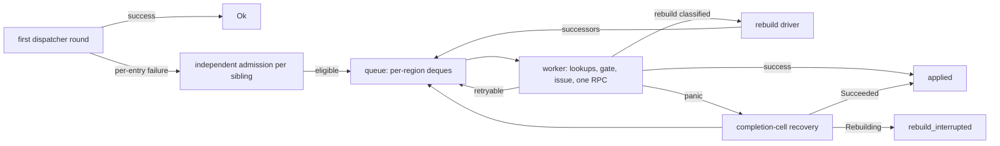

# Summary

This RFC proposes an optional in-memory retry queue owned by one Frontend. Core
v1 covers ordinary inserts whose first dispatcher round fails per entry
(`Error::PartialRegion`), including eligible Prometheus remote write; that round
stays in the request path, and admission runs in `WriteDispatcher::finish`
before the client error is returned. Each per-region failure is evaluated
independently: a terminal sibling is returned and never queued, an eligible
retryable sibling is admitted, and an ineligible sibling is dropped without
suppressing an eligible one.

With the queue enabled, it is the only retry lifecycle owner: `finish` does not
call `WriteRetry::retry`, a rejection does not re-enter the inline loop, and the
disabled path is unchanged. A worker issues at most one target-region RPC per
invocation, with per-region FIFO and lineage-aware successors. The queue is
process-local: it claims no durability, restart recovery, at-least-once
delivery, or exactly-once application. A replay success is never reported to the
client and does not change the error already returned.

`send_authorized` is only a gate flag. An invocation is `NotIssued`, `Unknown`,
or `Issued` by whether the RPC can have been sent, and `attempts` is a
conservative replay budget charged for `Issued` and `Unknown`, not a count of
confirmed RPCs. `replay_not_sent` is only a queue-phase scope; the first round
may already have applied the write.

# Motivation, Goals and Non-goals

The dispatcher retries a failed per-region write inside the caller future with
`write_retry.max_retries = 3`, jittered backoff, and no endpoint timeout on the
Frontend-to-datanode channel. The three delays total about 10.5s to under 21s
plus RPC time. A datanode restart, migration, or partition can outlast that, and
a client without a per-region view duplicates or drops regions. Issue #8085 asks
for a bounded Frontend buffer after the first round; rejection keeps today's
client wait.

**Goals:** one bounded queue per Frontend; a failed first round never returns
`Ok`; reuse `write_retry` backoff, `TableRouteCache`, `TablePartitioner`, and
`RetryAfterRouteRefresh`; no second payload copy; one lookup set and one RPC
deadline per invocation; supervisor-owned close, join, and drain; disabled by
default; no response-shape or `affected_rows` change.

**Non-goals:** no durability, restart recovery, exactly-once, or at-least-once;
no error proves non-application; no first-round timeout rescue, live-write
ordering, or atomic DDL fence; no record-level `not_sent`; no RSS or
allocation-interlock claim (`max_bytes` and `max_transient_bytes` are accounting
ceilings); no new wire field; no Flow consistency.

# Design

## Architecture

The queue is an operator-layer component owned by the Frontend, shared by the
builder's dispatchers. It never calls `WriteDispatcher::execute`, `finish`,
`WriteRetry::retry`, or a second dispatcher round. Successful writes take no
queue lock, allocate no record, and skip admission; plan-metadata cost must be
measured during validation.



Queue-enabled `finish` merges the round, selects the client error, admits each
eligible retryable sibling independently, and returns. The error is the first
terminal (no retained request) failure in flattened per-region order, otherwise
the first retryable failure; admission cannot change it. `prepare` groups peers
in a `HashMap`, so cross-peer order is per-run; queue-disabled `finish` keeps
the inline path.

The dispatcher must install the retry path (per-entry capture) when
`max_retries > 0` or the queue is enabled; otherwise no `RoutedWrite` is
retained to admit. Current `with_retry` installs `WriteRetry` only above zero,
so queue-enabled zero retries is an implementation prerequisite: it must still
capture per-region failures and admit eligible siblings. The queue uses its own
`max_attempts`, not `write_retry.max_retries`.

## Record Model and Admission

A record represents one single-region insert and holds queue identity, target
`region_id`, the retained `RoutedWrite`, `deadline`, plan-time
`TableIdent.version`, `partition_expr_version` when present, `may_have_applied`,
`attempts` (consumed replay budget), `confirmed_rpc_issues`, `issue_unknown`,
`consecutive_failures`, and lineage ordering. `RoutedWrite` is
`{ peer, request: Arc<RegionRequest> }`; retaining it keeps that `Arc` and its
allocation, with no encode, decode, or second payload copy. `may_have_applied`
is true from admission because the first round reached a datanode; it is not a
queue-replay scope, and it stays true even when every queue invocation is
`NotIssued`.

Three versions are distinct: `TableIdent.version` is the logical table version;
`TableInfoValue.version` is a metadata-store revision; `partition_expr_version`
covers request and route-refresh/rebuild partitioning. A physical repartition
need not bump the logical version and is caught only by a partition-expression
mismatch through route refresh or rebuild. The v1 design captures
`TableInfo.ident.version` during planning, attaches it per per-region item, and
preserves it through `prepare`, `send_batch`, peer merging, and the handoff into
`finish`; replay uses it, never a fresh admission-time lookup. **Implementation
prerequisite (feasibility unverified):** `RegionRequestHeader` cannot carry this
sidecar and peer-merge or `split_request` propagation does not exist in the
current implementation.

Admission runs in `finish` after client-error selection and before the error is
returned; admission cannot change the selected error. An attempt is eligible
only if it is `Body::Inserts` with one `InsertRequest` from the per-entry
`PartialRegion` branch, has consistent ids, `flow_source` false, targets
`mito`/`mito2`/`metric`, is not append mode or instant TTL, and has
`owners: None`; the queue must be open and the record must fit the limits.
Eligibility may `await` table and Flow cache reads; reserve and commit happen
under the state lock with no `await` or user code, after a cancellation
checkpoint.

| Sibling | Result | Queue effect |
| --- | --- | --- |
| A: terminal failure | Returned to client | Not queued |
| B: eligible retryable | Admitted independently | Replayed if recorded |
| C: ineligible or rejected retryable | Not admitted | Only C is lost; B is unaffected |
| A + B + C | A returned; B admitted; C rejected | No sibling suppresses another |

A terminal sibling never suppresses an eligible one. An admission rejection
returns the original client error unchanged and does not re-enter inline retry;
the queue-enabled path has no second retry mechanism. Admission is best-effort,
not success acknowledgment, and does not verify dedup. A whole-RPC failure,
including a single-entry tonic error, is not admitted: the per-entry outcome is
unknown.

## Issue State and Attempt Budget

An invocation records one issue state:

| State | Meaning |
| --- | --- |
| `NotIssued` | The RPC future was never polled; no target-region RPC can have been sent. |
| `Unknown` | The first poll was reached or conservatively assumed; no response was observed, and the RPC may have reached the datanode. |
| `Issued` | A response or RPC error was observed; the datanode may still not have applied the write. |

Calling the async requester returns an unpolled future with no send side
effect; the issue commit point is its **first poll**. The worker marks
`Unknown` immediately before that poll and drives the RPC in the same poll; a
panic in that window leaves it conservatively `Unknown`. A
constructed-but-never-polled future, or a drop before the first poll, is
`NotIssued`; a local timeout, a drop after the first poll, or a panic while
waiting is `Unknown`. Only an observed success or RPC error sets `Issued`; a
timeout or cancellation never does.

`attempts` is the cumulative replay budget, excluding the first dispatcher
round. It increments by one for `Issued` and one for `Unknown`; `NotIssued`
adds zero, including a gate pass without a polled RPC. `attempts` is therefore a
conservative budget, not a confirmed RPC count. `confirmed_rpc_issues` increments
only on `Issued`, and `issue_unknown` is set by any `Unknown`. One invocation
adds at most one to each counter. Exhaustion uses `attempts >= max_attempts`; an
`Unknown` invocation may consume the last slot even though no response was seen.

`consecutive_failures` is separate: a deferral increments it, so rebuild never
resets backoff. Settlement charges the parent's final invocation exactly once.
Successors inherit the resulting counts: a route-refresh rebuild is `Issued` and
has already added one to `attempts` and `confirmed_rpc_issues`; a topology
rebuild is `NotIssued` and adds none. `issue_unknown` and
`consecutive_failures + 1` are copied. Rebuild neither resets nor double-counts
the parent's last attempt, and a successor never re-inherits the same issue.

Replay scope follows cumulative issue history, not the lease or
`send_authorized`: `replay_issued` if `confirmed_rpc_issues > 0`, otherwise
`replay_issue_unknown` if `issue_unknown`, otherwise `replay_not_sent`, which
means no queue RPC is confirmed or possibly issued. The first round may have
applied; there is no record-level `not_sent`.

## Scheduling and Replay

One invocation performs all table, route, leader, and client lookups before
authorization, bounded by a 5s
`lookup_deadline = min(record.deadline, invocation_start + LOOKUP_TIMEOUT)`
(provisional);
lookup failure reinserts with backoff while open, and deadline expiry settles.
Only then does the worker take the state lock, check `closed` and the deadline,
set `send_authorized`, and release. No `await` or further lookup sits between
the gate and the RPC poll; lookup after authorization is forbidden.

TTL bounds **starting a new invocation**, not an RPC already issued. At the
gate, a record past `deadline` settles `unknown_remote_outcome` as
`ttl_expired_before_attempt` with zero budget; prior issue history keeps its
cumulative scope. Once polled, `record.deadline` no longer cancels the RPC,
which waits only to `rpc_deadline = send_start + datanode.client.timeout` (an
existing option, default 10s, positive when enabled); shutdown adds no second
timeout. Dropping a timed-out future stops only the client wait; the invocation
is `Unknown` and charges one budget. A success after `record.deadline` still
settles `applied`.

| Pre-issue condition | Outcome |
| --- | --- |
| Table missing, id mismatch, contradictory target, or `TableIdent.version` changed from plan time | `table_changed`; no RPC; zero budget |
| Route lookup error, or region present without a leader | `NotAttempted`; defer |
| Target region absent from the physical route | `TopologyRefresh`; rebuild without an RPC; zero budget |
| `RetryAfterRouteRefresh` response, including a partition-expression mismatch | Rebuild; the response is `Issued` and charges one budget |
| Transient reservation fails (`TransientFull`) | Dead-letter `transient_full`; no RPC, zero budget |

Classification reuses `error.retry_hint()`: `Retryable` reschedules while open,
within TTL, and within the budget; `RetryAfterRouteRefresh` rebuilds;
`NonRetryable` dead-letters. Backoff is exponential with jitter, capped at 30s,
and reuses the `write_retry` settings. A retryable result observed after
`record.deadline` is not rescheduled; it settles
`unknown_remote_outcome` with reason `ttl_expired_after_attempt`, because the
RPC was issued. The budget is `max_attempts` (currently 3) against cumulative
`attempts` (confirmed plus unknown), checked before lease.

## Rebuild

Rebuild invalidates routes, loads current `TableInfo`, builds a
`TablePartitioner`, and must use a bounded rebuild path. The current
implementation has no such path:
`TablePartitioner::rebuild_write_requests` returns
`Result<Vec<RegionRequest>>`, `rebuild_insert_requests` builds the full `Vec`,
and `RowSplitter::split` materializes all destination rows before returning;
there is no early stop or cancellation. A bounded helper is an implementation
blocker. Until it exists, the queue cannot claim a rebuild memory bound.

**Implementation requirement.** Add a bounded/streaming helper that enforces the
successor count and transient reservation before materializing the peak, never
calls the existing unbounded helper for inserts, and shares the
partition-expression and row-routing logic. `MAX_SUCCESSORS_PER_RECORD = 256`
is a provisional design constant, not a measured or source-derived value;
validation must establish that 256 is appropriate. A partial emission reports
how many successors were admitted.

The transient reservation is acquired before rebuild work. Before any rebuild
work, the outcome is classified and `Rebuilding { issue_state, source }` is
published atomically to the completion cell, with no `await`, allocation, cache
invalidation, or fallible call in between. Publication is the single rebuild
decision: recovery never starts a second rebuild. Successors are generated and
independently admitted; each has its own charge, lease, and lineage. A parent
removed after a successful rebuild is `rebuilt`; admitted successors remain
independent and unadmitted rows are lost.

Publication is per successor, not an atomic multi-record commit. If the task
panics after B and C are admitted but before D, B and C remain, the parent is
removed once as `rebuild_interrupted`, and D is lost; the parent is never
rebuilt again. A panic during a successor's reserve or commit releases that
admission reservation without rolling back admitted successors. Parent charge,
lease, and transient reservation are released once; the transient reservation
is released by its RAII guard, not by parent removal. No successor is published
twice, and admitted successors are not rolled back; process crash and
supervisor panic remain outside the guarantee.

## Worker Completion and Recovery

The completion cell belongs to the lease and is the only state recovery trusts;
it is separate from the record lifecycle (`Ready`/`Leased`/`Rebuilding`/
`Removed`) and the lease state (`Held`/`Released`).

| Cell | Set when | Recovery after a task panic |
| --- | --- | --- |
| `Empty` | First poll not reached; independent of whether the gate passed | Requeue while open and before the deadline, TTL-settle, or leave for drain; budget 0 |
| `IssueUnknown` | First poll reached or conservatively assumed; no response observed | Charge one budget and defer, TTL-settle, or drain unknown; never claim a confirmed issue |
| `Issued` | A response or RPC error observed; classification not published | Charge one budget and one confirmed issue; defer or terminal-settle; never rebuild from recovery |
| `Succeeded` | First non-fallible action after the requester returns `Ok` | Charge the issued increment once and perform one `applied` removal; never replay |
| `Rebuilding { issue_state, source }` | Atomic classify-and-publish before rebuild | Remove the parent once as `rebuild_interrupted`; admitted successors remain; no second rebuild |
| `Settled` | Same non-fallible critical section as normal removal or requeue | No action |

Transitions: `Empty -> IssueUnknown` at the commit write before the first poll;
`IssueUnknown -> Issued` on error or `Succeeded` on `Ok`; a non-`Rebuilding`
cell -> `Settled` on settlement or requeue; `Empty|Issued -> Rebuilding` (a
topology refresh is `NotIssued` from `Empty`); `Rebuilding` never returns to
`Issued` or `Empty`; `Settled` is absorbing. A transition and its `Settled`
write share one non-fallible critical section. `Rebuilding` carries `Issued` for
a route-refresh response and `NotIssued` for a topology refresh, never `Unknown`.

The recovery invariants are:

1. A successful RPC is never replayed: `Succeeded` is the first non-fallible
   action after `Ok`, before the queue lock, allocation, or other fallible work.
2. A panic before that write remains `IssueUnknown`; it is conservatively
   budgeted and may duplicate, but is never confirmed success.
3. A published rebuild decision is never executed twice, and admitted
   successors are not rolled back by a later parent panic.
4. Settlement and resource release happen at most once. The worker owns normal
   settlement under `Held`; the supervisor owns recovery after join with the
   cell as its only input; a `Settled` cell makes recovery a no-op; drain
   removes only records still present. Supervisor panic, an unjoinable task, or
   an invalid cell has no final-settlement guarantee and does not restart the
   worker.

## Failure and Outcome Semantics

Every removal settles `applied` or `unknown_remote_outcome`, and a rebuilt
parent is `rebuilt`. The issue state and budget increment follow the definitions
above; the table below is the single list of terminal reasons.

| Terminal path | Outcome | Issue state (last invocation) | Budget increment | Reason |
| --- | --- | --- | --- | --- |
| Replay success | `applied` | `Issued` | +1 | Replayed rows |
| TTL expired before the first poll | `unknown_remote_outcome` | `NotIssued` | 0 | `ttl_expired_before_attempt` |
| Retryable result after the deadline | `unknown_remote_outcome` | `Issued` | +1 | `ttl_expired_after_attempt` |
| Attempts exhausted before lease | `unknown_remote_outcome` | Last `Unknown`/`Issued`, or `NotIssued` before any queue invocation | +1 for a prior `Unknown`/`Issued`; 0 for `NotIssued`; no new charge at removal | `attempts_exhausted` |
| Table missing, id/version changed, or contradictory target | `unknown_remote_outcome` | `NotIssued` | 0 | `table_changed` |
| Transient reservation fails | `unknown_remote_outcome` | `NotIssued` | 0 | `transient_full` |
| Non-retryable response | `unknown_remote_outcome` | `Issued` | +1 | `non_retryable` |
| RPC timeout, cancellation, or panic after the first poll | `unknown_remote_outcome` | `Unknown` | +1 | `rpc_timeout` or `rpc_unknown` |
| Rebuild failure | `unknown_remote_outcome` | `Issued` after route refresh, `NotIssued` after topology refresh | +1 iff `Issued` | `rebuild_failed` |
| Rebuild interrupted by a panic | `unknown_remote_outcome` | `Issued` or `NotIssued` | +1 iff `Issued` | `rebuild_interrupted` |
| Drained record whose last invocation was `NotIssued` | `unknown_remote_outcome` | `NotIssued` | 0 | `shutdown` |
| Drained record whose last invocation was `Unknown` or `Issued` | `unknown_remote_outcome` | `Unknown` or `Issued` | +1 | `shutdown` |
| Rebuilt parent | `rebuilt` | `Issued` or `NotIssued` | +1 iff `Issued` | Carried into the successor basis |

A rejected successor is not a queue record: it increments
`successor_rejected_total` and loses its rows. A parent stopped at the successor
limit or deadline after admissions is `rebuilt`; before any admission it takes
the TTL reason matching its issue state.

No error proves non-application. `UnacknowledgedWrite` may have applied and
carries `RetryAfterRouteRefresh`; `NonRetryable` is also recorded unknown. A
record with prior replay attempts keeps `unknown_remote_outcome` even if a later
table check fails; it is never a safe `not_sent` stop.

## Memory, Shutdown and Flow

`max_bytes`, `max_records`, and `max_record_size` bound retained estimates and
count, not RSS: the charged estimate is `encoded_len()` of the retained
`RegionRequest` plus fixed overhead for `RoutedWrite` and its `Arc`; it is not a
second allocation or actual RSS. `max_record_size` constrains queue admission,
not the first-round dispatcher allocation; `max_bytes` covers only retained
queue records. `max_transient_bytes` separately bounds replay and rebuild
reservations and is not part of `max_bytes`.

| Quantity | What it counts | Bound |
| --- | --- | --- |
| Per-record estimate and ledger | `encoded_len()` plus fixed overhead per retained `RoutedWrite`; no decode copy; summed over records | Charged once; above `max_record_size` (512 KiB, provisional) admission rejects |
| Transient request | `record_len.checked_mul(factor)`, positive integer `factor` | One reservation per active task; checked arithmetic; no numeric factor is fixed or measured |
| Transient aggregate | Sum of active task reservations | `max_transient_bytes`; independent of `max_bytes` |
| Validation ceiling | `per_task_max = max_record_size × factor`; `aggregate_max = replay_concurrency × per_task_max` | Checked; requires `0 < max_transient_bytes <= aggregate_max` |
| Actual RSS | Allocator, tonic, compression, runtime, connection buffers, metadata cache | Not bounded by either accounting ceiling |

A task acquires its transient reservation under the state lock before rebuild
materialization, successor construction, or replay buffers outside the retained
record. Overflow or an aggregate above `max_transient_bytes` fails closed as
`TransientFull`: no reservation, no RPC, no budget increment, and dead-letter
`transient_full`. An RAII guard is the sole releaser; unified removal never
releases it, and explicit consumption atomically disarms `Drop`. The reservation
is accounting, not an allocation interlock, and does not prevent allocations by
rebuild, tonic, compression, runtime, connection buffers, or the allocator.
Until the bounded helper exists, the rebuild peak is not bounded and the
reservation does not cover it. `WriteProgress`/`WriteAttribution`, if present,
require their own resource, quota, and lifetime validation and are not part of
the queue ledger.

**Shutdown.** Close rejects new admission, leases, and send authorization under
the state lock and stops scheduling. A task before the gate sends nothing,
releases its lease and permit, and leaves the record for drain. A task past the
gate is joined; if it has not reached the first poll it releases, otherwise its
RPC is awaited to completion or `rpc_deadline`, and TTL does not shorten that
wait. Success writes `Succeeded` and settles `applied` after close; a terminal
error is recorded; a retryable or rebuild result is not deferred and admits no
successor. After joins, drain removes remaining records; a worker-settled record
is absent, so settlement and release happen at most once. Supervisor panic or an
unjoinable task has no final-settlement guarantee.

**Flow.** `Inserter::do_request` materializes impure defaults, then
`FlowMirrorTask::new(...).await?` snapshots the source set before
`dispatcher.prepare`; the mirror is detached before dispatch and never
repeated, so a snapshot table is excluded from the queue. A later Flow is
invisible: the table can be queued, neither pass is mirrored, and the new sink
misses both. No consistency is guaranteed.

## Configuration, Metrics and Validation

```toml
[write_queue]
enable = false              # off by default; enabling changes failure timing
max_bytes = "512MiB"        # retained-estimate ledger, not RSS
max_records = 100000
max_record_size = "512KiB"  # provisional admission bound, not an RSS cap
max_transient_bytes = "128MiB"  # provisional; independent of max_bytes
ttl = "5m"                  # maximum record age; bounds new invocations
max_attempts = 3            # conservative replay budget per chain
replay_concurrency = 8      # in-flight records, at most one RPC each
```

An opt-in deployment sets `enable = true`; the default stays `false` because a
replay can duplicate rows and changes client-visible timing. The queue reuses
`write_retry.initial_backoff`, `max_backoff`, and `backoff_multiplier`; when
enabled, `max_attempts` controls replay rather than `write_retry.max_retries`.
Configuration rejects zero bounds, `max_record_size > max_bytes`, a
`max_transient_bytes` above the aggregate ceiling or arithmetic overflow, and
zero `datanode.client.timeout` when enabled; it does not clamp. A cap below one
maximum-size reservation is accepted and that record takes `TransientFull`.

TTL and the budget are independent: TTL bounds new invocations and does not
cancel an issued RPC; `Issued`/`Unknown` charge budget, so three retryable RPC
failures exhaust the default budget before 5m, while no-send failures charge
none but remain TTL-bounded. `attempts_exhausted` and `ttl_expired_*` are
distinct terminal reasons. The current `max_attempts = 3` is a design default,
not a measured availability guarantee; its operational adequacy is a validation
requirement.

Metrics use the `greptime_write_queue_` prefix, with no table/region labels:
`admitted_total`, `shed_total{reason}`, `charged_bytes`, `charged_records`,
`transient_reserved_bytes`, `attempts_total{issue_state}`,
`rebuild_total{result,successors}`, `dead_letters_total{reason}`,
`settled_total{outcome,replay_scope}`, `successor_rejected_total`,
`drained_total{reason,outcome}`, `replay_latency_seconds`, `inflight`.
`attempts_total{issue_state}` uses `issued`, `issue_unknown`, and `not_issued`;
`replay_scope` uses `replay_issued`, `replay_issue_unknown`, or
`replay_not_sent`.

Every terminal removal increments `settled_total` once, except a rebuilt parent
(`rebuild_total{result="rebuilt"}`); each successor is a new admission. A
rejected successor increments `successor_rejected_total{reason}` and loses its
rows; a parent stopped at the successor limit is `rebuilt`, not a dead-letter.

These are validation requirements, not measured results. The transient factor
remains a validation input. Validation must show:

- independent A/B/C sibling admission and the documented client-error selection
  order;
- queue-enabled capture and admission when `max_retries = 0`;
- `NotIssued`/`Unknown`/`Issued` accounting, conservative budget charging, TTL
  versus budget separation, and the six completion cells with the
  success-before-panic and partial-rebuild-publication recovery invariants;
- shutdown joining authorized invocations and at-most-once settlement;
- plan-time `TableIdent.version` propagation through `prepare`, `send_batch`,
  peer merging, and the failure handoff into `finish`;
- the bounded rebuild helper enforcing successor and transient-memory limits
  before materialization, without falling back to the existing unbounded path;
- actual replay and rebuild memory shape sufficient to establish the transient
  factor and to validate the provisional `max_record_size = 512 KiB`,
  `max_transient_bytes = 128 MiB`, and `MAX_SUCCESSORS_PER_RECORD = 256`;
- the operational adequacy of the provisional 5s lookup deadline;
- operational adequacy of `max_attempts = 3` under prolonged datanode restarts
  and migrations, without treating 3 as a measured availability guarantee;
- transient exhaustion with at-most-once RAII release;
- performance, resource overhead, and success-path plan-metadata cost under
  representative workloads.

No implementation is claimed.

# Risks

- **Process-local loss.** Restart or crash drops records; no recovery claimed.
- **Duplicates and unknown application.** Applied-but-lost responses, retryable
  `UnacknowledgedWrite`, timeouts, rebuilds, and successor fan-out can duplicate
  rows; an error never proves non-application, and dedup is unverified.
- **DDL timing and ordering.** The plan-time version check is a timing check,
  not an atomic fence: `ALTER` can land between the check and the replay RPC,
  and cache hits are not revalidated. `TRUNCATE` does not bump
  `TableIdent.version`; `DROP` is a missing table and a recreated table has a
  new id, but `UNDROP` restores dropped-table metadata. A replay can also apply
  after a newer live write; there is no newer-write detection, per-key epoch, or
  stale-replay protection.
- **Best-effort boundaries.** Accounting is not RSS; authorized RPCs join only
  to `rpc_deadline`; and supervisor panic, an unjoinable task, or an invalid
  cell has no final-settlement guarantee and does not restart the worker.
- **The bounded rebuild helper is an implementation blocker.** The current
  implementation returns a fully materialized `Vec`, and `RowSplitter::split`
  materializes all destination rows. Without the streaming helper, the
  successor limit is checked after the peak and the transient bound is not real.
- **Excluded paths stay excluded.** Whole-RPC, single-entry tonic,
  `BatchRequest`, `External`, `BulkInsert`, both pending-rows batchers, instant
  TTL, and delete are deferred; Flow coverage is not claimed.

# Open Questions

**DDL risk acceptance:** Are the documented DDL and stale-replay risks
acceptable for v1 without an atomic fence? The v1 design already omits the
fence; only acceptance of the disclosed risk is open.
