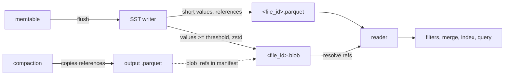

# Summary

Let a string or binary field column keep its long values outside the SST. A column declared with

```sql
payload BINARY STORAGE WITH (type = 'external', threshold = '64KiB')
```

keeps values shorter than `threshold` in the Parquet column. Each longer value is compressed and appended to a sidecar object `<file_id>.blob` written next to the SST, and the Parquet column stores a short reference in its place. Readers resolve references right after decoding, so queries, filters, indexes, and merges see the original values.

Sidecars have their own lifetime in the region manifest. Compaction copies references instead of values, and rewrites a sidecar only when half of its bytes are no longer referenced. This is key-value separation as in WiscKey and RocksDB BlobDB, applied to an LSM tree whose files are Parquet.

# Motivation

Some observability data carries large opaque values next to small queryable columns: CPU profiles, serialized query plans, LLM prompts and responses, raw request bodies. These values range from 64 KiB to tens of MiB. Queries rarely filter or aggregate on them; they fetch them for the few rows that the small columns select.

mito2 stores such a value inline in a Parquet column, and several parts of the storage path scale with its size:

- Compaction rewrites every value on every compaction, although large values never change after they are written. On object storage this is a full download and upload of the payload per compaction.
- An SST that holds 4 GiB of payload is a 4 GiB object. On a metadata cache miss the write cache downloads the whole SST, so a query that reads only small columns downloads the payload too.
- Footers, the metadata cache, and compaction memory admission are sized by the whole file, not by the columns a query reads.

A separate change, which applies to every table, bounds row group bytes and drops statistics on large columns. With it, scans of 1 MiB values no longer overflow Arrow's `i32` offsets, compaction memory drops from 8–12 GiB to about 2 GiB in our tests, and footers no longer carry whole values. The payload still lives in the SST, though: compaction still rewrites it, and the write cache still downloads it. These costs grow with the amount of payload, and only moving the values out of the SST removes them.

# Goals

- Queries that do not select a large column neither read nor download its values.
- Compaction does not read, decompress, or rewrite large values that are still live.
- Space held by deleted or expired values is reclaimed without a separate scan of the table.
- Results are identical with and without the option, including filters on the large column.
- Opt-in per column. Tables without the option keep their current SST and manifest formats.

# Non-goals

- Separation in the WAL or memtable. Values move out of line when an SST is written.
- Sharing sidecars across regions. A reference always points into the region that owns the SST.
- Streaming or range access to a single value (`substring` without materializing the value).
- Late materialization in the query engine. "Latest N rows with payload" still materializes the payload for every row the TopK sees; that is a query-engine change and is independent of this one.
- Changing the option on an existing column.

# Architecture



The design makes three decisions:

1. **One sidecar per SST, written at flush and compaction.** The writer that produces an SST also produces its sidecar under the same file id. The WAL, the memtable, and the ingest path are unchanged.
2. **References stay inside the Parquet column.** The column keeps its Arrow type; a reference is a byte string with a reserved prefix. The footer declares which columns are external, which makes the prefix unambiguous.
3. **Sidecar lifetime is tracked by references, not by the owning SST.** `FileMeta` lists the sidecars a file references. A region deletes a sidecar when no file of its version references it and no reader holds it.

# Design

## Column option

`STORAGE WITH (type = 'external', threshold = '64KiB')` is accepted on `STRING` and `BINARY` field columns in `CREATE TABLE` and `ALTER TABLE ADD COLUMN`. `type` defaults to `'external'`, `threshold` to 64 KiB. The option is experimental. The option is stored in column metadata under `greptime:storage` and is carried through SQL, gRPC, and `SHOW CREATE TABLE`. Tag, time index, and primary key columns reject it: they are compared and sorted, and their statistics drive pruning.

The threshold is per column because the right value depends on the medium and the access pattern. Lance keeps values up to 64 KiB inline (`INLINE_MAX` in its blob writer); CockroachDB configures Pebble to separate values of 256 bytes or more on local SSDs. A threshold well below the size of one object store request turns a scan into many small requests, so the default is 64 KiB.

## Write path

When a writer encodes a batch, every value of an external column that is at least `threshold` long is compressed with zstd and appended to the SST's sidecar, and the Parquet column receives a reference:

```
\0greptime-blob:<blob_file_id>:<offset>:<compressed_len>:<len>
```

Values are compressed one by one so that each can be read with one range request. The sidecar is created for the first long value of a file and is finished before the SST, so an SST never points at a sidecar that does not exist. Which values move out depends only on the column option and the value length, so flush and compaction lay out the same data the same way.

External columns write no Parquet statistics. Their min and max values would be whole payloads or references, neither useful for pruning.

Row group sizing counts external values at their decoded length. Readers resolve a row group's references after decoding it, so the decoded length is what a reader holds in memory.

## Telling references from values

A reference is an in-band value: the column keeps its Arrow type, and every operator, cache, and codec that handles the column today handles references unchanged. The cost is that a user value can look like a reference. Two rules remove the ambiguity:

- A value that starts with the prefix is always stored externally, whatever its length. In an SST with external columns, a value of such a column starts with the prefix if and only if it is a reference.
- Every SST of a region with external columns lists them in its footer (`greptime:blob_column:<name>`). Only listed columns are resolved. An SST written before the column became external has no entry, and its values are read as written. For example, after `ADD COLUMN` with a default that starts with the prefix, older SSTs return that default as a literal.

## Read path

The Parquet reader decodes a row group, then resolves the references of the selected external columns before the batch reaches filters, merges, or index builders. Resolution works in chunks of at most 128 MiB of decoded values, coalesces adjacent references into one range request, and keeps a bounded number of requests in flight.

A query that does not select an external column never opens the sidecar. Predicates on an external column are evaluated on resolved values: files with sidecars skip the field prefilter, which would otherwise compare references.

On object storage, the write cache handles a sidecar like its SST: the sidecar is written locally with the SST, uploaded before it, and downloaded in the background on a miss. `region_engine.mito.write_cache_blobs = false` keeps sidecars out of the local cache.

## Lifetime and compaction

If a sidecar lived and died with its SST, compaction would have to resolve every value and write it into the output's own sidecar, which costs as much as compacting inline values. Tracking sidecars by reference lets compaction skip that work.

`FileMeta.blob_file_size` records the size of an SST's own sidecar, and `FileMeta.blob_refs` lists the sidecars of other SSTs in the same region that the SST references, with each sidecar's size and the bytes the SST references in it. The region version keeps a lifetime for every referenced sidecar:

- An SST's own sidecar is not deleted with the SST. After an edit removes files, a sidecar that no remaining file references is marked deleted and purged when the last reader holding it finishes.
- Sidecars of files shared with other regions after repartition are left to global GC, like the files themselves.
- Global GC keeps a `.blob` object while any file in the manifest references it.

Compaction keeps references when it can. Readers leave references of external columns unresolved, the writer copies them into the output, and the output's `blob_refs` records the bytes it references in each input sidecar. Compaction resolves and copies values instead when:

- the input comes from another region;
- an index or the partition rule reads the column;
- an input does not declare the column external in its footer;
- an input of the output references a sidecar that is being rewritten. The output then keeps no references at all, including references into healthy sidecars.

Garbage is reclaimed by rewriting. The referenced bytes of a sidecar, summed over the current files that reference it, tell how much of it is live. A value becomes garbage when a compaction drops its row, for example because a newer row overwrites it, and the output records fewer referenced bytes. When 50% or more of a sidecar is garbage, the next compaction of each file that references it resolves the values into the output's own sidecar. When no regular compaction is due, the compaction picker selects the files that reference such sidecars, one output per file. Once no file references the old sidecar, it is purged.

## Worked example

A table stores one 8 MiB profile per row. Four flushes write `f1` to `f4`, each with 16 values, 128 MiB, in its sidecar.

```
f1.parquet -> f1.blob (128 MiB)        manifest
f2.parquet -> f2.blob (128 MiB)          f1..f4: blob_refs = []
f3.parquet -> f3.blob (128 MiB)
f4.parquet -> f4.blob (128 MiB)
```

Compaction merges `f1` to `f4` into `f5`. It reads only the small columns and the references, and writes a small Parquet file and no sidecar:

```
f5.parquet -> f1.blob, f2.blob, f3.blob, f4.blob
manifest: f5.blob_refs = [(f1, size 128 MiB, referenced 128 MiB), ... (f4, ...)]
```

`f1` to `f4` leave the version, but their sidecars stay because `f5` references them. A query for `count(*)` reads `f5.parquet` only. A query for one profile reads one footer, one row group, and one range of one sidecar.

Next, 10 rows of `f1` and 10 rows of `f2` are overwritten. A flush writes them to `f6` with its own 160 MiB sidecar. Until a compaction merges `f5` and `f6`, `f5` still claims all of `f1.blob` and `f2.blob`. That compaction drops the overwritten rows and keeps references:

```
f7.parquet -> f1.blob (48 of 128 MiB live), f2.blob (48 of 128 MiB live),
              f3.blob, f4.blob, f6.blob
f5, f6 leave the version; their sidecars stay
```

`f1.blob` and `f2.blob` are now 62.5% garbage. The next compaction of `f7`, picked by the fallback if nothing else is due, resolves every value of `f7` into the sidecar of its output `f8`: 48 + 48 + 128 + 128 + 160 = 512 MiB. Afterwards only `f8` remains, and the sidecars of `f1`, `f2`, `f3`, `f4`, and `f6` are purged once their last reader finishes. The healthy sidecars are copied too, because they share an output with garbage ones; see Open questions.

Time-to-live expiration works the same way: dropping expired SSTs removes their references, and a sidecar is purged once nothing references it.

## Evidence

Apple M4 Max, release builds, MinIO behind a proxy that adds 20 ms per request and limits each connection to 100 MB/s. Each comparison runs in A B B A order.

Sidecars without reference copying, measured on one build with the same table without and with the option, row group bounding active in both: 512 random 8 MiB values written in four flushes, then compacted. The local cache is emptied before each query.

| | Without the option | With the option |
|---|---|---|
| Small-column aggregate | 0.85 s, 67 MiB in 52 GETs | 0.19 s, 0.2 MiB in 18 GETs |
| Latest rows of one series | 6.4 s | 1.8 s |
| Full scan of the payload | 38.9 s, RSS +5.8–6.1 GiB | 12.7 s, RSS +1.4–1.5 GiB |
| Compaction | 34.7 s, peak RSS 2.2–2.4 GiB | 11.6 s, peak RSS 1.2 GiB |

Compaction copying values versus copying references: 8 MiB values appended in 8 rounds of 64 rows, compaction after every 2 rounds.

| | Values copied | References copied |
|---|---|---|
| Compaction time, total | 16.2 s | 0.27 s |
| Sidecar bytes uploaded by compaction | 10.7 GB | 0 |
| Compaction peak RSS | 1.2 GiB | 0.35 GiB |

When rows are overwritten in place (1 MiB JSON, the same keys written six times), compaction drops from 6.3 s to 0.40 s with the same 0.13 GB of live sidecar bytes on both sides.

# Benefits and drawbacks

Benefits:

- The SST shrinks to the size of its small columns. Footers, metadata caches, region open, and the write cache work with that size.
- Compaction cost does not grow with the payload. Live values are written at flush and copied again only when an output references a sidecar that is mostly garbage.
- Queries that skip the column skip its bytes, on local disks and on object storage.
- The column type does not change, so the SQL surface, indexes, and query engine are unchanged.

Drawbacks:

- Persisted format changes: sidecar objects, footer keys, and two `FileMeta` fields. SSTs of regions with external columns store the region metadata under the footer key `greptime:metadata_external` instead of `greptime:metadata`, so versions without the feature refuse to read them instead of returning references as values. The option must be enabled only after every datanode is upgraded, and such a region cannot be downgraded.
- Sidecars hold about twice the live values in steady state: a sidecar stays until it is 50% garbage, and a value counts as garbage only after a compaction drops its row.
- Up to twice as many objects, and one more request when a query reads a value that is not in the local cache.
- A rewrite copies every value of the outputs involved, including values in healthy sidecars.
- Field prefiltering is disabled for files with sidecars, for predicates on any field column.
- After many compactions one SST can reference many sidecars, so a scan of the payload reads from many objects. The design does not bound this (see Open questions).

# Implementation plan

1. Bound row group bytes and drop statistics on large columns. No format change; applies to every table.
2. The `STORAGE` column option in SQL, gRPC, and column metadata.
3. Per-SST sidecars with their own SST's lifetime, behind the option.
4. Sidecar lifetimes in the manifest; must ship in the same release as step 3, because a version that has sidecars but ignores `blob_refs` deletes sidecars that other files still reference.
5. Reference copying in compaction and garbage-driven rewrites.
6. Before the option leaves experimental status: view and large Arrow types (`Utf8View`, `BinaryView`, `LargeUtf8`, `LargeBinary`), sidecars in compaction picking and size statistics, resolved values in the query memory tracker.

# Alternatives

## Keep values inline and bound row groups

Bounding row group bytes and dropping statistics on large columns fixes the scan failures and the footer size without a format change, for every table. It keeps rewriting payloads on every compaction and keeps them in every SST download. It is a prerequisite for this design, not a replacement: columns slightly below the threshold still need bounded row groups.

## A reference column of a different type

Store references in a struct column (`{blob_id, offset, len}`) or as the Parquet `FILE` logical type, and let the reader expose the original column. Typed references need no prefix rule, and external Parquet readers could interpret `FILE`. But the Parquet column type would then differ from the table's column type, and every path that maps SST columns to table columns, every codec, and every index builder would need a special case. `FILE` is also missing from the arrow-rs version the project depends on. The in-band reference keeps all of those paths unchanged, at the cost of the prefix rule and the footer declaration.

## Separate on ingest

Write large values to object storage before the WAL. Every write request then waits for an object store PUT, and WAL replay and failure handling must learn about blobs that were uploaded but never committed. RocksDB BlobDB by default, Titan, and Pebble separate at flush and compaction. RocksDB's `enable_blob_direct_write` writes blobs in the foreground, is marked experimental, and its WAL replay does not support blob files that a flush has not made visible yet.

## Copy values on every compaction

Delete a sidecar with its SST and let compaction copy live values into its output, as Lance does by default. It needs no reference tracking, but compaction then costs as much as with inline values, which removes most of the benefit.

## Shared blob files with an indirection table

Pebble maps a logical blob file id to a physical file, so a rewritten blob file does not require rewriting the SSTs that reference it. Once values are out of line, mito2's SSTs are small, and rewriting the SSTs that reference a sidecar costs little; the indirection would add a mapping to the manifest to save that rewrite.

# Open questions

- Reference depth. Pebble limits how many blob files an SST may reference and rewrites values once the limit is exceeded. Whether mito2 needs such a limit depends on how scans of the payload degrade as sidecars accumulate, which has not been measured.
- Per-sidecar rewrites. An output that references a sidecar being rewritten resolves every value, so healthy sidecars are copied with the garbage ones. Keeping references into healthy sidecars needs the reader and the writer to agree on a per-sidecar choice instead of a per-column one.
- Whether the 50% garbage threshold should be a table option.
- Naming. A column option named `STORAGE` is close to the table option `storage`, which selects an object store.

# Future work

- Range reads of a single value without materializing it.
- Packing small values of several SSTs into one sidecar on object storage.
- Late materialization of large columns after TopK and filters.

# References

- Lu et al., "WiscKey: Separating Keys from Values in SSD-conscious Storage", FAST 2016: https://www.usenix.org/system/files/conference/fast16/fast16-papers-lu.pdf
- RocksDB BlobDB: https://github.com/facebook/rocksdb/wiki/BlobDB
- TiKV Titan: https://docs.pingcap.com/tidb/stable/titan-overview/
- Pebble value separation: https://www.cockroachlabs.com/blog/value-separation-pebble-optimization/
- Lance blob storage: https://github.com/lance-format/lance/blob/main/docs/src/format/table/blob.md and `INLINE_MAX` in https://github.com/lance-format/lance/blob/main/rust/lance/src/dataset/blob/write.rs
- RocksDB `enable_blob_direct_write`: https://github.com/facebook/rocksdb/blob/main/include/rocksdb/advanced_options.h
- Parquet `FILE` logical type: https://github.com/apache/parquet-format/blob/master/LogicalTypes.md#file
- Arrow `i32` offset overflow on large byte arrays: https://github.com/apache/arrow-rs/issues/7973
