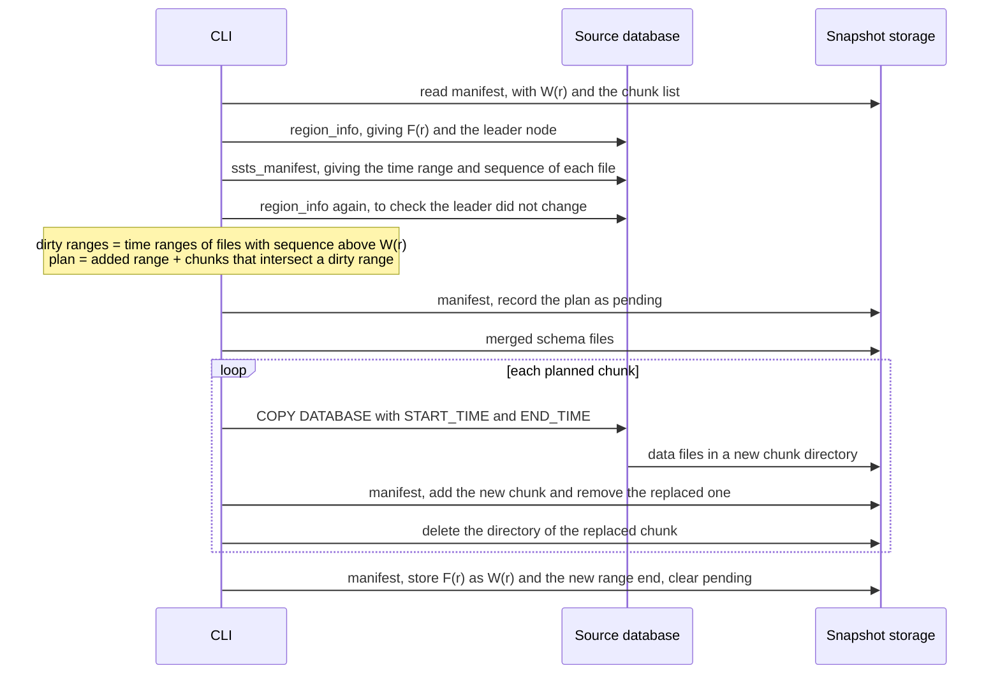
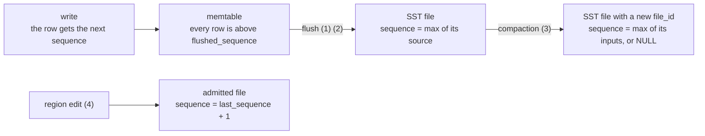

# Summary

Export V2 partitions data by time-index value and never reads a completed chunk
again. A row written after its chunk was exported, with a timestamp inside that
chunk, is never exported.

This RFC adds an incremental mode to `export-v2 create`. Each run finds the time
ranges that were written since the previous run and exports the chunks that
intersect them again, in full, replacing the old chunks. Detection uses the
per-region flushed sequence and the SST file metadata that the server already
exposes over SQL. It needs no server change and works for every Mito table type,
including append-mode tables and Metric tables in the default and the packed
layout.

Sequences are used only to decide which time ranges changed. The unit of export
remains the time chunk, and data is still restored by `COPY DATABASE FROM`.

Incremental snapshots use `manifest.version = 3`. Importers that know version 3
read versions 1, 2 and 3. Older importers, and older exporters resuming a
snapshot, reject version 3 before any side effect.

# Motivation

A chunk is a half-open time range exported with
`COPY DATABASE ... WITH (START_TIME, END_TIME)`. Running `export-v2 create` on an
existing snapshot is a resume: it requires the same time range and chunk plan,
skips completed chunks, and returns immediately when the manifest is complete.
A later snapshot with a later range filters on the time index only.

Consider a chunk covering 01:00 to 02:00 that completed at 02:05. A row with
timestamp 01:30 that arrives at 03:00 is in no snapshot and will never be. The
lateness of such rows has no upper bound, so delaying the export or re-exporting
a fixed trailing window does not close the gap.

## Goals

- Every row written to a source table is contained in the snapshot after some
  later run, however late it arrives.
- All Mito table types are covered: last-row and last-non-null tables,
  append-mode tables, and Metric tables in both layouts.
- No server change. The CLI keeps talking SQL over HTTP.
- A snapshot can be imported after any completed run and after an interrupted
  run, with the limits stated in [Run lifecycle](#run-lifecycle-and-interruption).

## Non-goals

- Row-level change capture. See [Rationale and alternatives](#rationale-and-alternatives).
- Propagating removals. A chunk that is exported again is rebuilt from the
  merged view, so deletes visible at that time are reflected. Nothing triggers
  that export when a removal leaves no file behind: TTL expiry, `TRUNCATE`, and
  a delete whose tombstone was flushed and compacted away between two runs such
  that no remaining file covers the deleted timestamps. A dropped table likewise
  stays in the snapshot with the data of the chunks that are not exported again.
- Import idempotency. Import already inserts at least once: a retried task or a
  second import of the same snapshot duplicates rows in append-mode tables. This
  RFC neither fixes nor worsens that. An updated snapshot must be restored into
  a target that does not already hold the earlier data of its append-mode tables.
- A consistent point-in-time snapshot. Chunks are still exported by separate
  queries at different times.

# Guide-level explanation

```bash
greptime cli data export-v2 create \
  --addr 127.0.0.1:4000 \
  --to s3://bucket/snapshots/prod \
  --start-time 2026-11-01T00:00:00Z \
  --chunk-time-window 1h \
  --incremental
```

The first run creates the snapshot and exports every chunk from `--start-time`
to the end of the range. Each later run of the same command:

1. extends the range to the new end and exports the chunks of the added range;
2. exports again every existing chunk whose time range was written since the
   previous run;
3. replaces each such chunk in the manifest and deletes its old files.

Rules for the flags:

- `--incremental` requires `--start-time` and `--chunk-time-window`, which fix
  the chunk grid for the life of the snapshot. It cannot be combined with
  `--schema-only`.
- `--end-time` is optional on every run and defaults to the current time of the
  CLI host. It must be later than `--start-time` and not earlier than the end of
  the previous run. A concrete `END_TIME` is always sent to the server. Rows with
  a timestamp at or after the end are exported by a later run, once the range
  reaches them.
- On later runs `--start-time`, `--chunk-time-window`, `--schemas`, `--format`
  and `--pack-metric-data` must match the snapshot or be omitted. The set of
  schemas is fixed when the snapshot is created: a schema created later is not
  added, and a run fails if a schema of the snapshot no longer exists.
- `--force` deletes the snapshot and starts over, as today.
- Running `--incremental` against a snapshot that was created without it is
  rejected. Such a snapshot cannot be converted.

Each run reports the number of chunks it exported again and the tables whose
writes caused it.

# Reference-level explanation

## Terms

- **Watermark** `W(r)`: for region `r`, the flushed sequence recorded by the
  previous completed run.
- **Dirty range**: a closed time range `[lo, hi]` that may contain rows not yet
  in the snapshot.
- **Open chunk**: the last chunk of the snapshot when its end is the end of the
  range and not a grid boundary.
- **Pending run**: a run whose plan is recorded in the manifest and that has not
  committed its watermarks yet.

## Overview

The figure shows one region. Each box is an SST file, placed horizontally by
the time range of its rows and vertically by its file sequence. The chunk grid
is one hour wide. The previous run ended at 03:00 and this run ends at 04:00.

```text
sequence
      ^
      |                               [ memtable ] in a memtable: found by a later run
      + - - - - - - - - - - - - - - - - - - - -    F(r) = 160, read by this run
 160  |            [ E ]                           late rows, flushed after the previous run
 150  |                              [   D   ]     rows of the added range
      + - - - - - - - - - - - - - - - - - - - -    W(r) = 100, stored by the previous run
 100  |                    [   C   ]
  70  |          [   B   ]                         exported by an earlier run
  40  |[   A   ]
      +---------+---------+---------+---------+--> time index
    00:00     01:00     02:00     03:00     04:00
      | chunk 1 | chunk 2 | chunk 3 | chunk 4 |
          kept    replaced    kept     added
```

- Files A, B and C have a sequence at or below `W(r)`. Their rows were exported
  by an earlier run.
- File E has a sequence above `W(r)`, so its time range is a dirty range. It
  lies in chunk 2, which is exported again in full and replaced.
- File D is also above `W(r)`. Its chunk belongs to the added range and is
  exported in any case.
- Chunks 1 and 3 intersect no dirty range. They are kept and not read.
- Rows in a memtable belong to no file yet. A later run finds them once they
  are flushed.
- When the run completes, `F(r)` is stored as the watermark of the next run.

A run performs these steps. [Detection](#detection) and
[Run lifecycle](#run-lifecycle-and-interruption) give the rules.



## Server interfaces used

The CLI reads these existing tables through the default `greptime` catalog:

- `information_schema.region_info`: `region_id`, `table_id`, `region_group`,
  `region_sequence`, `state`, `role`, `flushed_sequence`, `node_id`.
- `information_schema.ssts_manifest`: `region_id`, `table_id`, `file_id`,
  `min_ts`, `max_ts`, `sequence`, `visible`, `node_id`.
- `information_schema.tables` and `information_schema.region_peers`, to resolve
  tables and their regions.

The queries are restricted by `table_id`. For `ssts_manifest` the datanodes use
that predicate to skip the manifests of other regions. `region_info` builds an
entry for every open region on each datanode and filters afterwards, so the CLI
reads it for all tables in scope at once, not once per table. The CLI does not
filter on `sequence` in SQL, because it also needs the files whose sequence is
`NULL`. Listing reads in-memory manifest metadata and does no object-store IO.

Before modifying the snapshot, the CLI checks that these tables can be queried
on the source and fails otherwise.

## Regions in scope

For an ordinary table, the regions in scope are the regions of its table route,
read from `information_schema.region_peers` for that table.

A Metric logical table has no Mito region. Its `region_peers` rows combine the
logical table id with physical region numbers and must not be used as Mito
region ids. The CLI reads the physical table name from `on_physical_table` in
`information_schema.tables.create_options`, resolves that table's id, and takes
the regions of the physical table's route. The Mito data region of each has the
same table id and region sequence with `region_group = 0`. Metadata regions are
ignored.

## Detection

Detection is read-only. It runs these steps in order, each for all regions in
scope before the next one starts:

1. Read every region's leader row from `region_info`. Record `F(r)`, its
   `flushed_sequence` with `NULL` read as 0, and the reporting `node_id`.
2. List every region's files from `ssts_manifest`, one query per table, keeping
   only the rows reported by the region's leader node.
3. Read every region's leader row from `region_info` again.
4. Compute the dirty ranges of each region:
   - `[min_ts, max_ts]` of every file with `sequence > W(r)`;
   - `[min_ts, max_ts]` of every file with a `NULL` sequence whose `file_id` is
     not in the stored list of known `NULL`-sequence files of `r`;
   - a region without a stored watermark contributes the range of every file.

   A `NULL` bound is unbounded on that side.

The leader row is the single row of the region whose `role` starts with
`Leader`. Detection fails when:

- a region in scope has no leader row, or more than one, in step 1 or step 3;
- the `state` of that row is not `Leader(Writable)` in step 1 or step 3. This
  includes staging, editing, altering, truncating and downgrading states;
- the leader's `node_id` differs between step 1 and step 3.

A failed detection changes nothing and can be retried.

A region that is closed or still reopening during step 2 returns no rows, which
looks the same as a region without files. An empty listing is accepted directly
only when `F(r) = W(r)`, with a missing watermark read as 0. The watermark then
does not move, so a file that was not listed is still above it, or still
unknown, in the next run. When the listing is empty and `F(r) > W(r)`, the
region was truncated or lost all of its files, or it was not listed, and
advancing the watermark could hide a file. The CLI then repeats steps 1 to 3 for
that region after a pause and accepts the empty listing only if the repeat gives
the same leader node, the same `F(r)` and again no file.

The new watermark is the `F(r)` of step 1. The new list of known
`NULL`-sequence files is the set of listed files with a `NULL` sequence and
`visible = true`.

Rows still in a memtable are not detected by this run. They are exported anyway
if their chunk is exported for another reason; otherwise a later run detects
them after they are flushed. Running `ADMIN FLUSH_TABLE` before a run shortens
that delay but is not required for correctness.

## Why no write is missed

The argument rests on four properties of Mito:

1. When a flush starts, the mutable memtable is frozen and the committed
   sequence is captured in the same worker step. The flush records that value as
   `flushed_sequence` and installs the new files, the new `flushed_sequence` and
   the memtable removal in one version change. Every row in a memtable therefore
   has a sequence greater than `flushed_sequence`.
2. The sequence of a flushed file is the maximum sequence of its source. Any
   flush that happens after `F(r)` was read produces files with a sequence
   greater than `F(r)`.
3. The sequence of a compaction output is the maximum over its inputs, or `NULL`
   if any input is `NULL`, and the output always has a new `file_id`.
4. A file added by a region edit, including the files admitted when a
   repartition is applied, gets the sequence `last_sequence + 1`. The edit raises
   the committed sequence only, never `flushed_sequence`.

The sequence of a file therefore comes from one of three places:



Take a row with sequence `s` that the snapshot does not contain. If `s > W(r)`,
the row is in a memtable or in a file whose sequence, by (2) and (3), is at
least `s`, or `NULL` with a `file_id` that the previous run did not record. In
the second case the file's time range is dirty and its chunk is exported after
the listing, when the row is visible to the scan. If `s <= W(r)`, the row was in
a file when the previous run read its watermark; by induction that run or an
earlier one exported its chunk.

Reading the watermark before listing the files matters. A file flushed between
the two steps is listed in this run and has a sequence above the new watermark,
so it is also detected in the next run. It is exported twice, never zero times.

The watermark must be `flushed_sequence`, not the largest file sequence. By (4),
an admitted file can carry a sequence above rows that are still in a memtable.

## Cases that need care

| Case | Handling |
| --- | --- |
| A datanode's registration expired and its regions are absent from the result | The region has no leader row; detection fails |
| Follower rows for the same region | Only rows from the leader's node are used |
| The region is closed or reopening while its files are listed | An empty listing with `F(r) > W(r)` is not accepted without a repeat |
| `min_ts` or `max_ts` is `NULL` (the value does not fit in nanoseconds) | Unbounded on that side |
| `NULL`-sequence file that is listed but not yet visible to scans | Not recorded as known, so it stays dirty in the next run |
| Staging files listed with `visible = false` | Counted like any other file; the files admitted later get a sequence above the watermark |
| Files written before `FileMeta.sequence` existed (releases before v0.12.0) | Dirty once; each compaction that includes one produces a new `NULL` file that is dirty once |
| Repartition creates regions | No watermark, so all of their files are dirty |
| Repartition reuses a region id | Admitted files carry a sequence above the watermark |
| Region leader moves, or the region is being edited or altered, during detection | Detection fails and is retried |

## Tables that appear, disappear or change

A chunk that is not replaced keeps the files of the run that exported it, so
the DDL of the snapshot must keep describing every table that any chunk holds.
The rule is that the DDL only grows: each run writes the current definition of
every table that exists, and keeps the last exported definition of every table
that no longer does. The CLI merges by table name, parsing the previous DDL
files the way the importer does. Views hold no data and are taken from the
latest run only.

The incremental state records, for each region of an ordinary table, the schema
and table name it was exported under.

- **Created table.** Its regions have no watermark, so every file of the table
  is dirty and the chunks that hold its data are exported. Chunks that are kept
  have no file for it, which is valid: it had no data there.
- **Dropped table.** Its definition stays in the DDL and its data stays in the
  chunks that are kept. A chunk that is exported again no longer contains it.
- **Renamed table.** A rename keeps the table id and region ids, but the
  recorded name no longer matches, so the regions are treated as having no
  watermark and the whole history is exported under the new name. The old name
  stays as a dropped table. A Metric physical table owns no chunk files, so its
  recorded name is not compared; a Metric logical table cannot be renamed.
- **Table dropped and created again under the same name.** The new table has
  new region ids and no watermark. Chunks that are kept still hold rows of the
  old table under that name, which is a removal that is not propagated.
- **Column changes.** Kept chunks hold files written with the earlier columns.
  Import matches columns by name. See
  [Decisions still requiring implementation review](#decisions-still-requiring-implementation-review).

## Planning a run

The chunk grid is `start + n * window`. Chunks are half-open `[a, b)`. A chunk
intersects a dirty range `[lo, hi]` when `lo < b` and `hi >= a`. Dirty ranges
are clipped to `[start, E)`.

A run with range end `E` and previous end `E0` plans:

- the open chunk `[g, E0)`, if there is one, replaced by `[g, min(g + window, E))`;
- every grid chunk from the first boundary at or after `E0` up to `E`, the last
  one clamped to `E`;
- every other existing chunk that intersects a dirty range.

With `E == E0` only the third item applies. The first run has no previous end,
so every chunk of `[start, E)` is planned. Chunk time ranges stay contiguous and
non-overlapping after every replacement.

A chunk covers all schemas of the snapshot, so a dirty range from one table
causes that time range to be exported again for every schema.

## Replacing a chunk

A chunk that is exported again gets a new chunk id and is written to its own
directory, `data/<schema>/<new_id>/`. Ids come from a counter stored in the
manifest and are never reused. When the export of the new chunk is complete, a
single manifest write adds the new chunk and removes the chunk it replaces. In
the default layout the new chunk is `Completed`, or `Skipped` when the range no
longer has rows. In the packed layout it is always `Completed`, because a pack
index with zero-row streams is always written. The directory of the replaced
chunk is deleted afterwards.

A reader therefore sees either the old chunk or the new one. Writing to a new
directory also avoids overwriting files in place, which would leave files of
dropped tables behind and, in the packed layout, would require emptying a
completed chunk before rewriting it.

This relies on rewrites of existing objects being atomic, for the manifest and
for the schema files. A single `PUT` is atomic on the supported object stores.
The local file backend currently writes in place; for incremental snapshots it
must write to a temporary file and rename.

Chunk ids stop being contiguous and stop following time order. Import schedules
tasks by chunk id and does not depend on either.

The storage layer needs two operations it does not have today: delete all
objects under a chunk prefix regardless of file names, and list the chunk
directories of a schema. Both layouts use the first to clear the directory of a
chunk before exporting it.

## Manifest

Incremental snapshots use `manifest.version = 3`. `data_layout` is absent for
the default layout and `metric-parquet-packs` for the packed layout. The
existing rule that a required decoding or integrity feature must change the
manifest version applies: version 3 changes how the packed index is checked
against the DDL, and it carries state that a tool must not drop when it rewrites
the manifest.

| Tool and snapshot | Behavior |
| --- | --- |
| New tool, version 1 or 2 | Unchanged |
| New importer, version 3 | Import with the rules in [Import](#import) |
| Older importer, or older `export-v2 create` without `--force`, version 3 | Reject the unsupported version before DDL, data writes or resume cleanup |
| Older `export-v2 create --force` and `export-v2 delete`, version 3 | Delete the snapshot, as they do for any version |

Code that keys off the version today must change with it: `validate_layout`
gains the two version-3 layouts and applies the version-2 structural checks to
them, `from_json` requires the `chunks` and `files` arrays for version 3 too,
and `is_packed()` must test `data_layout`, since version no longer implies the
layout. For version-3 snapshots the resume validation against a freshly
generated chunk plan and the early return on a complete manifest are replaced by
the rules of this RFC.

```json
{
  "version": 3,
  "time_range": { "start": "2026-11-01T00:00:00Z", "end": "2026-11-26T10:00:00Z" },
  "chunks": [ "..." ],
  "incremental": {
    "chunk_time_window_secs": 3600,
    "next_chunk_id": 614,
    "regions": {
      "4398046511104": {
        "schema": "public",
        "table": "app_logs",
        "flushed_sequence": 18234,
        "null_sequence_files": []
      }
    },
    "pending": {
      "range_end": "2026-11-26T11:00:00Z",
      "regions": { "...": "same shape as above, the state to commit" },
      "chunks": [
        { "id": 612, "time_range": { "start": "...", "end": "..." }, "replaces": [588] },
        { "id": 613, "time_range": { "start": "...", "end": "..." }, "replaces": [] }
      ]
    }
  }
}
```

`chunks` only ever contains `Completed` and `Skipped` chunks; chunks being
exported live in `pending`. `regions` is keyed by region id; `schema` and
`table` are recorded for regions of ordinary tables. `pending` is `null` between
runs.

## Run lifecycle and interruption

1. Read the manifest. If `pending` is present, continue at step 4 with the
   recorded plan and ignore `--end-time`.
2. Run detection and planning. Nothing has been written so far.
3. Write `pending` and the advanced `next_chunk_id` in one manifest write.
4. Write the merged schema files. From here on the DDL describes every table
   that a kept or a new chunk can hold.
5. For each planned chunk not yet committed: clear its directory, export it,
   then commit the replacement as described above and remove it from `pending`.
   Chunks may be exported concurrently under `--chunk-parallelism`; commits are
   serialized.
6. Commit the new `regions` and the range end, drop the entries of regions that
   are no longer in scope, and clear `pending`.

After finishing a pending run, the same invocation starts a new run. The first
run follows the same steps with an empty previous state.

After the manifest is read, chunk directories that belong neither to `chunks`
nor to `pending` are deleted. They are left over from a replacement whose
cleanup was interrupted.

A run interrupted before step 3 leaves the snapshot unchanged. A run interrupted
later is finished by the next invocation without detecting again. The recorded
watermarks stay valid, because exporting later than planned only reads more
data.

A snapshot with a pending run can be imported. It is then incomplete: the added
range, the dirty chunks, and the data of tables created or renamed since the
previous run may not have been exported yet.

The rule that one snapshot path belongs to one export task at a time still
applies. `export-v2 verify` treats the directories of pending chunks as in
progress, not as unexpected files.

## Packed Metric layout

Packed export honors `START_TIME` and `END_TIME`, and a replaced chunk is
written to a new directory with its own pack index, so the rules for file paths
and for the index covering its objects hold unchanged.

Detection works per physical data region. A late row in any logical table makes
the range dirty for every logical table on that physical table. This adds no
cost in practice, because a chunk is already exported per schema.

Version 2 requires the table set of every chunk's pack index to equal the table
set of the DDL. Across runs that cannot hold: a kept chunk lacks the tables
created after it was written, and a new chunk lacks the tables dropped before it
was written. Version 3 requires a subset instead; see below. No kept chunk can
list a table that the DDL lacks, because the DDL only grows.

## Import

Version-3 snapshots are imported like their layout's earlier version, with these
differences:

- In the packed layout, the table set of a chunk's pack index must be a subset
  of the table set of the DDL. A table of the DDL that is not in the index has
  no data in that chunk. An index that names a table the DDL lacks is still
  rejected, and the index is still validated against its own objects. An index
  that wrongly omits a table is no longer caught by this check.
- The importer reads the manifest again when it finishes and fails if the set of
  chunk ids or any chunk's `files` changed during the import; `incremental` and
  `updated_at` are ignored. Without this, a chunk directory deleted by a
  concurrent export run lists as empty on object stores and the task completes
  with no rows. The check only reports the problem. The target then holds a
  mixture of two snapshot states and must be discarded together with the import
  state file.
- An import that was interrupted before the snapshot was updated cannot be
  resumed against the updated snapshot, because the set of chunk ids differs.

Importing an updated snapshot into a target that already imported an earlier
state of it inserts the replaced chunks again. Tables with last-row or
last-non-null semantics converge. Append-mode tables get duplicate rows, as they
do today when the same snapshot is imported twice.

# Cost

- **A single late row.** Until compaction, the dirty range is the time span of
  the flushed file that holds the row. Flush writes files per memtable time
  partition, which is one compaction window wide, or one day before a window is
  known. A row that is late by less than that shares a file with current rows,
  and every chunk between the late row and the newest row in that partition is
  dirty. A row late by more than that is flushed into a file of its own
  partition, and only the chunks that file spans are dirty.
- **After compaction.** The dirty range is the union of the input file ranges.
  That is normally one compaction window, but it reaches further back when an
  input file carries older rows, since a file is assigned to a window by its
  latest timestamp.
- **In-order ingestion.** Files of the active compaction window have sequences
  above the watermark, so every run exports that window again. Compaction of
  files that are all below the watermark does not make anything dirty.
- **Chunk width.** The CLI does not enforce a relation between
  `--chunk-time-window` and the compaction window: the compaction window is per
  region, may be unset until the first compaction, and differs between tables of
  one schema. A chunk width at least as large as the compaction window of the
  largest tables keeps the number of chunks exported per run small. The per-run
  report makes a poor choice visible.
- **Schema fan-out.** A dirty range from one table exports that range again for
  every schema of the snapshot.
- **Table changes.** A renamed table is exported again in full.
- **Detection queries.** Two `region_info` reads for the whole run and one
  `ssts_manifest` read per table, all served from memory. `region_info` is
  evaluated on every datanode for all of its open regions.

# Drawbacks

- A snapshot is no longer immutable after creation. The export/import V2 RFC
  states that snapshot content never changes and that successful chunks are
  never exported again; both statements stop holding for incremental snapshots.
- Released tools cannot read an incremental snapshot.
- The amount exported again depends on compaction, which the user does not
  control directly.
- Removals are not propagated, so a restored table can contain rows that the
  source has since expired or truncated, and a restore re-creates tables that
  were dropped at the source.

# Rationale and alternatives

## Export rows by sequence

Exporting the rows with a sequence in `(W, H]` would move only new rows. It is
not available for ordinary tables. Flush overwrites row sequences with the
maximum sequence of each flushed source, except for last-non-null tables, and
the engine refuses an exact sequence range unless the region has
`preserve_row_sequence`, which is valid only together with `append_mode` and is
off by default. No ingestion path enables it, including the log and trace tables
that are append-mode by default. On a table that had data before the option was
enabled, a late file compacted with an older file yields an output the engine no
longer trusts, which is the case this RFC is about. Deletes, TTL and `TRUNCATE`
are invisible to such a scan, a sequence is meaningful only inside one region,
and the watermark cannot be returned to an HTTP SQL client today.

## Delay the export or re-export a trailing window

Both are simple and need no detection, but they only bound lateness. They do not
help when lateness is unbounded.

## Detect dirty ranges on the server

Mito could compute the changed time ranges from its manifest, report removals,
and answer consistently without the checks in [Detection](#detection). That is a
larger change. The SQL-based detection is sufficient for writes and can be
replaced by a server interface later without changing the snapshot format.

## Keep manifest version 1 or 2 and add an optional field

Readers ignore unknown manifest fields, so the chunk list alone would be
readable by released importers. It is not safe. A released exporter that resumes
an interrupted first run rewrites the manifest without the field and loses the
incremental state, and the packed layout needs a different index check.

## Overwrite a chunk in place

Rejected for the reasons given in [Replacing a chunk](#replacing-a-chunk).

# Decisions still requiring implementation review

1. **Two inferred engine properties.** That writes are stalled while a region
   edit is applied, and that the manifest time range of a flushed file covers
   every row in it, including delete tombstones, were inferred from the code and
   not confirmed by a test. Both are covered by the acceptance tests below.
2. **The closed-region check.** Repeating the listing makes a missed region
   very unlikely but does not exclude it: the region would have to be closed
   during both listings and open at all four reads around them. Reporting the
   number of SST files in `region_info` would let the CLI compare it with the
   listing and close the gap. That is a small server change and the only one
   this design would benefit from.
3. **Column changes between runs.** Whether `COPY DATABASE FROM` accepts a file
   written before a column was added, dropped or retyped must be confirmed for
   each kind of change. The same question arises for a table that was dropped
   and created again with different columns. A change that import does not
   accept must be handled by exporting the table again in full.
4. **Pending WAL tails.** Tail replay publishes files with sequences that can be
   at or below a stored watermark. No code path in this repository creates
   pending tails. A deployment that has them needs a guard that fails detection
   while a region has pending tails.
5. **Replacement granularity.** Replacing a chunk for all schemas is simple but
   exports schemas that did not change. Per-schema replacement would need chunk
   metadata per schema.

# Acceptance

- A late write into a completed chunk is exported by the next run, in each of
  these states: still in the memtable, flushed, and compacted with older files.
- The same for an append-mode table, a last-non-null table, and a Metric logical
  table in the default and the packed layout.
- A late delete is reflected when its tombstone file is still present at the
  next run, both when rows remain in the range and when none do.
- A write during repartition staging, flushed after the staging manifest is
  applied, is exported.
- Detection fails without changing the snapshot when a region in scope has no
  leader row and when its leader changes between the two reads. A truncated
  region, which has an advanced flushed sequence and no files, is accepted after
  the repeat.
- A table created, dropped, renamed, and dropped and created again between runs
  each leaves a snapshot that imports successfully and contains the expected
  tables, in both layouts. The same for a created and a dropped Metric logical
  table.
- A run interrupted after `pending` is written, one interrupted after the schema
  files are written, and one interrupted between a manifest replacement and the
  directory deletion are each completed by the next invocation, and `verify`
  passes afterwards.
- A fresh import of an updated snapshot equals the source for the exported
  range, for tables without removals.
- An import fails when the manifest changes while it runs.
- Version-1 and version-2 snapshots behave as before. A released importer and a
  released `export-v2 create` without `--force` reject a version-3 snapshot
  before any side effect.

# Future possibilities

- A server interface that reports changed time ranges together with removals.
- An idempotent import for append-mode tables, which would also allow applying
  an updated snapshot to a target that holds its earlier state.
