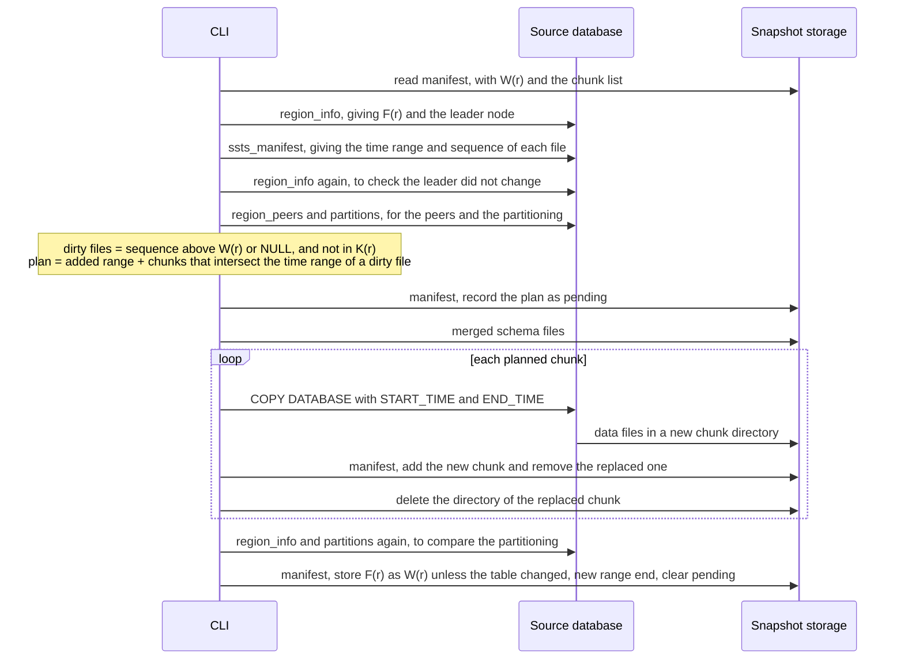
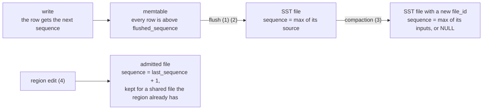

# Summary

Export V2 partitions data by time-index value and never reads a completed chunk
again. A row written after its chunk was exported, with a timestamp inside that
chunk, is never exported.

This RFC adds an incremental mode to `export-v2 create`. Each run finds the time
ranges that were written since the previous run and exports the chunks that
intersect them again, in full, replacing the old chunks. Detection uses the
per-region flushed sequence and the SST file metadata that the server already
exposes over SQL, so the mode needs no server change. It works for every Mito
table type, including append-mode tables and Metric tables in the default and
the packed layout.

Sequences are used only to decide which time ranges changed. The unit of export
remains the time chunk, and data is still restored by `COPY DATABASE FROM`.

Incremental snapshots use `manifest.version = 3`. Importers that know version 3
read versions 1, 2 and 3. Older importers, and older exporters resuming a
snapshot, reject version 3 before any side effect.

# Motivation

A chunk is a half-open time range exported with
`COPY DATABASE ... WITH (START_TIME, END_TIME)`. Running `export-v2 create` on an
existing snapshot is a resume: it requires the same time range and chunk plan,
skips completed chunks, and returns immediately when the manifest is complete.
A later snapshot with a later range filters on the time index only.

Consider a chunk covering 01:00 to 02:00 that completed at 02:05. A row with
timestamp 01:30 that arrives at 03:00 is in no snapshot and will never be. The
lateness of such rows has no upper bound, so delaying the export or re-exporting
a fixed trailing window does not close the gap.

## Goals

- Every row that a scan of a source table returns, with a timestamp in the
  snapshot range, is contained in the snapshot after some later run, however
  late it was written. This holds under the assumptions stated in
  [What the argument assumes](#what-the-argument-assumes), and it excludes a row
  that becomes readable again through a removal, as described under Non-goals.
- All Mito table types are covered: last-row and last-non-null tables,
  append-mode tables, and Metric tables in both layouts.
- No server change is required. The CLI keeps talking SQL over HTTP. What only
  a server change can guarantee is listed in
  [Decisions still requiring implementation review](#decisions-still-requiring-implementation-review).
- A snapshot can be imported after any completed run and after an interrupted
  run, with the limits stated in [Run lifecycle](#run-lifecycle-and-interruption).

## Non-goals

- Row-level change capture. See [Rationale and alternatives](#rationale-and-alternatives).
- Propagating removals. A chunk that is exported again is rebuilt from the
  merged view, so deletes visible at that time are reflected. Nothing triggers
  that export when a removal leaves no file behind: TTL expiry, `TRUNCATE`, and
  a delete whose tombstone was flushed and compacted away between two runs such
  that no remaining file covers the deleted timestamps. A dropped table likewise
  stays in the snapshot with the data of the chunks that are not exported again.
  A removal can also reveal a row: when a file that holds only delete tombstones
  is removed while the file with the deleted row remains, the row is readable
  again, and detection does not see it.
- Import idempotency. Import already inserts at least once: a retried task or a
  second import of the same snapshot duplicates rows in append-mode tables. This
  RFC neither fixes nor worsens that. An updated snapshot must be restored into
  a target that does not already hold the earlier data of its append-mode tables.
- A consistent point-in-time snapshot. Chunks are still exported by separate
  queries at different times.

# Guide-level explanation

```bash
greptime cli data export-v2 create \
  --addr 127.0.0.1:4000 \
  --to s3://bucket/snapshots/prod \
  --start-time 2026-11-01T00:00:00Z \
  --chunk-time-window 1h \
  --incremental
```

The first run creates the snapshot and exports every chunk from `--start-time`
to the end of the range. Each later run of the same command:

1. extends the range to the new end and exports the chunks of the added range;
2. exports again every existing chunk whose time range was written since the
   previous run;
3. replaces each such chunk in the manifest and deletes its old files.

Rules for the flags:

- `--incremental` requires `--start-time` and `--chunk-time-window`, which fix
  the chunk grid for the life of the snapshot. It cannot be combined with
  `--schema-only`.
- `--end-time` is optional on every run and defaults to the current time of the
  CLI host. It must be later than `--start-time` and not earlier than the end of
  the previous run. A concrete `END_TIME` is always sent to the server. Rows with
  a timestamp at or after the end are exported by a later run, once the range
  reaches them.
- On later runs `--start-time`, `--chunk-time-window`, `--schemas`, `--format`
  and `--pack-metric-data` must match the snapshot or be omitted. The set of
  schemas is fixed when the snapshot is created: a schema created later is not
  added, and a run fails if a schema of the snapshot no longer exists.
- `--force` deletes the snapshot and starts over, as today.
- Running `--incremental` against a snapshot that was created without it is
  rejected. Such a snapshot cannot be converted.

Each run reports the number of chunks it exported again and the tables that
caused it.

# Reference-level explanation

## Terms

- **Watermark** `W(r)`: for region `r`, the flushed sequence recorded by the
  previous completed run.
- **Known files** `K(r)`: the ids of the files of region `r` that the last run
  that listed files for `r` saw as visible to scans and that have a `NULL`
  sequence or a sequence above `W(r)`. That run or an earlier one exported their
  time ranges.
- **Dirty range**: a closed time range `[lo, hi]` that may contain rows not yet
  in the snapshot.
- **Open chunk**: the last chunk of the snapshot when its end is the end of the
  range and not a grid boundary.
- **Pending run**: a run whose plan is recorded in the manifest and that has not
  committed its watermarks yet.

## Overview

The figure shows one region. Each box is an SST file, placed horizontally by
the time range of its rows and vertically by its file sequence. The chunk grid
is one hour wide. The previous run ended at 03:00 and this run ends at 04:00.


- Files A, B and C have a sequence at or below `W(r)`. Their rows were exported
  by an earlier run.
- File E has a sequence above `W(r)`, so its time range is a dirty range. It
  lies in chunk 2, which is exported again in full and replaced.
- File D is also above `W(r)`. Its chunk belongs to the added range and is
  exported in any case.
- Chunks 1 and 3 intersect no dirty range. They are kept and not read.
- Rows in a memtable belong to no file yet. A later run finds them once they
  are flushed.
- When the run completes, `F(r)` is stored as the watermark of the next run.

A run performs these steps. [Detection](#detection) and
[Run lifecycle](#run-lifecycle-and-interruption) give the rules.



## Server interfaces used

The CLI reads these existing tables through the default `greptime` catalog:

- `information_schema.region_info`: `region_id`, `table_id`, `region_group`,
  `region_sequence`, `state`, `role`, `flushed_sequence`, `region_options`,
  `node_id`.
- `information_schema.ssts_manifest`: `region_id`, `table_id`, `file_id`,
  `min_ts`, `max_ts`, `sequence`, `visible`, `node_id`.
- `information_schema.tables` and `information_schema.region_peers`, to resolve
  tables, their regions and the peers of each region.
- `information_schema.partitions`: `greptime_partition_id` and
  `partition_description`, the partition rule of each region.

The `region_info` and `ssts_manifest` queries are restricted by `table_id`. For
`ssts_manifest` the datanodes use that predicate to skip the manifests of other
regions. `region_info` builds an entry for every open region on each datanode
and filters afterwards, so the CLI reads it for all tables in scope at once, not
once per table. `region_peers` has no `table_id` column and resolves the routes
of every table before it filters, so the CLI also reads it once for all tables.
`partitions` is read per table, with `table_schema` and `table_name` given. Both
are served from caches of the frontend, which a route change refreshes by a
broadcast from the metasrv or, failing that, when the entry expires, by default
ten minutes after it was loaded. The CLI does not
filter on `sequence` in SQL, because it also needs the files whose sequence is
`NULL`. Listing reads in-memory manifest metadata and does no object-store IO.

Before modifying the snapshot, the CLI checks that these tables can be queried
on the source and fails otherwise.

## Regions in scope

For an ordinary table, the regions in scope are the regions of its table route,
read from `information_schema.region_peers` for that table.

A Metric logical table has no Mito region. Its `region_peers` rows combine the
logical table id with physical region numbers and must not be used as Mito
region ids. The CLI reads the physical table name from `on_physical_table` in
`information_schema.tables.create_options`, resolves that table's id, and takes
the regions of the physical table's route. The Mito data region of each has the
same table id and region sequence with `region_group = 0`. Metadata regions are
ignored. The peers of a data region are likewise read from the `region_peers`
rows of the physical table.

## Detection

Detection is read-only. It runs these steps in order, each for all regions in
scope before the next one starts:

1. Read every region's leader row from `region_info`. Record `F(r)`, its
   `flushed_sequence` with `NULL` read as 0, and the reporting `node_id`.
2. List every region's files from `ssts_manifest`, one query per table, keeping
   only the rows reported by the region's leader node.
3. Read every region's leader row from `region_info` again.
4. Compute the dirty ranges of each region. A file is dirty when its `sequence`
   is greater than `W(r)` or `NULL`, and its `file_id` is not in `K(r)`. The
   dirty ranges are the `[min_ts, max_ts]` of the dirty files. A region without
   a stored watermark has no `K(r)` either, so all of its files are dirty.

   A `NULL` bound is unbounded on that side.

The leader row is the single row of the region whose `role` starts with
`Leader`. Detection fails when:

- a region in scope has no leader row, or more than one, in step 1 or step 3;
- the `state` of that row is not `Leader(Writable)` in step 1 or step 3. This
  includes staging, editing, altering, truncating and downgrading states;
- the leader's `node_id` differs between step 1 and step 3;
- the `region_info` result of step 1 or step 3 shows the region, in any role,
  on a node that the `region_peers` result does not list as a peer of the
  region. Such a node can be a migration candidate that is not in the route
  yet, or a node that lost the region and can still answer a scan from its
  older state.

A failed detection changes nothing and can be retried.

Detection also records the partitioning of each table: the regions that
`region_info` reports for it and the `partition_description` of each, with a
`NULL` description kept as such. For a Metric logical table this is the
partitioning of its physical table. The check after the export compares against
it; see [Run lifecycle](#run-lifecycle-and-interruption).

A region that is closed or still reopening during step 2 returns no rows, which
looks the same as a region without files. A run therefore never advances a
region on an empty listing. When step 2 returns no file for a region from its
leader node, the run keeps the stored state of that region as it is: its
watermark, its known files, its recorded `append_mode` and its recorded table
name. A region without stored state stays without it. The next run then judges
every file against the same watermark and the same known files. A region that
really has no files, after a `TRUNCATE` for example, keeps its old watermark at
no cost, because every file it gets later has a sequence above it.

One case overrides this. When the recorded table name or the recorded
`append_mode` of a region differs from the current one, the stored state of the
region is discarded even if its listing is empty; see
[Tables that appear, disappear or change](#tables-that-appear-disappear-or-change).
Keeping it would let a later run find the old name or value again and treat the
files as exported.

For every other region, the new watermark is the `F(r)` of step 1, and the new
`K(r)` is the set of listed files with `visible = true` and a sequence that is
`NULL` or greater than that `F(r)`. `K(r)` is rebuilt from each listing, so a
file that is no longer listed leaves it.

`K(r)` matters for files that stay above the watermark. A flush of an empty
memtable does nothing, so the files admitted by a repartition stay above
`flushed_sequence` until the region is written and flushed again. Without `K(r)`
a table that is repartitioned and not written afterwards would be exported again
by every run.

Rows still in a memtable are not detected by this run. They are exported anyway
if their chunk is exported for another reason; otherwise a later run detects
them after they are flushed. Running `ADMIN FLUSH_TABLE` before a run shortens
that delay but is not required for correctness.

## Why no write is missed

The argument rests on four properties of Mito:

1. When a flush starts, the mutable memtable is frozen and the committed
   sequence is captured in the same worker step. The flush records that value as
   `flushed_sequence` and installs the new files, the new `flushed_sequence` and
   the memtable removal in one version change. Every row in a memtable therefore
   has a sequence greater than `flushed_sequence`.
2. The sequence of a flushed file is the maximum sequence of its source. Any
   flush that happens after `F(r)` was read produces files with a sequence
   greater than `F(r)`.
3. The sequence of a compaction output is the maximum over its inputs, or `NULL`
   if any input is `NULL`, and the output always has a new `file_id`.
4. A file newly added by a region edit, including the files admitted when a
   repartition is applied, gets the sequence `last_sequence + 1`. The edit raises
   the committed sequence only, never `flushed_sequence`. The exception is a
   file that the region already holds at the shared level with a sequence: it
   keeps that sequence when it is imported again.

The sequence of a file therefore comes from one of three places:



Take a row that the snapshot does not contain. While it is in a memtable, it
waits for a flush. By (1) and (2) that flush writes a file whose sequence is
above every watermark stored so far, and the file is in no `K(r)` because no run
has listed it.

Once the row is in a file, take a run that lists the file. If the file is dirty,
its time range is exported after the listing, when the row is visible to the
scan. If it is not dirty, one of two things holds:

- Its sequence is at or below `W(r)`. By (2), (3) and (4) a file with such a
  sequence holds only rows that were in files when the previous run read its
  watermark. By induction that run or an earlier one exported them.
- It is in `K(r)`. An earlier run listed this file as visible to scans, and a
  file does not change once it is written. The file was dirty in that run, or
  already known to it. By induction that run or an earlier one exported its
  rows.

A dirty range is clipped to the range end. The part of a file at or after the
end is exported when the range reaches it, because the added range is always
planned and the end never moves back.

Reading the watermark before listing the files matters. A file flushed between
the two steps is listed in this run and has a sequence above the new watermark.
It becomes a known file if it was already visible to scans. Otherwise it is
dirty again in the next run. It is exported at least once.

A watermark is stored only by a run that listed files for the region. The
listing of a region is taken from one view of its manifest, so it is complete
whenever it is not empty. A run with an empty listing keeps the stored state of
the region or discards it, and the next run compares the files with the older
watermark and the older known files, or with none. File ids are not reused, so
this can make more files dirty but cannot hide one.

The watermark must be `flushed_sequence`, not the largest file sequence. By (4),
an admitted file can carry a sequence above rows that are still in a memtable.

### What the argument assumes

The argument assumes that an export scan that succeeds returns the rows of
every listed file as the table holds them, for every scan of a run, including
the scans of a pending run that is resumed later. The CLI cannot verify this
over SQL. Plain Export V2 relies on the same assumption, where a violation gives
one incomplete snapshot. Here a missed row stays missed until its chunk is
exported again for another reason, because its file is at or below the
watermark, or known, from then on. Two things are known to break the
assumption:

- **A scan answered by an older copy of a region.** Detection asks every
  registered datanode, but the export scan is routed by the route cache of the
  frontend. A frontend with a stale cache can send the scan to a node that lost
  the region's leadership and still has the region open, to a follower that has
  not caught up, or to the regions of a route from before a split. The check
  in detection for a region on a node that is not a peer fails a run in which
  the two `region_info` reads show such a node. It says nothing about a node
  that is not registered, about a follower peer, or about the time between
  detection and the scans.
- **A table that changes while a run exports it.** The regions of a table are
  scanned separately. A repartition that takes effect between two of those
  scans can move a row from a region that is scanned later to one that was
  already scanned, so that neither returns it, or the other way round, so that
  both do. A scan of a region that a merge removes can still succeed until the
  node drops the region. A rename during the run exports rows under a name they
  do not belong to. Tables in scope must not be repartitioned or renamed while
  a run is in progress.

A row that a repartition made the export miss is exported by a later run only
if a dirty file covers its chunk. The files of a region that is new are dirty,
and so is a file that a region newly admits and does not know. A file that the
region already knows is not, whatever its sequence. Whether the row is repaired
therefore depends on where its file ended up.

The check after the export covers part of this. It compares the partitioning
that detection recorded with the partitioning after the last chunk, and a table
for which the two differ loses its state, so that all of its files are dirty in
the next run. The two can be equal although the partitioning changed in
between:

- the cache of the frontend held the same route at both reads;
- both reads saw a route that the metasrv had published and the regions had not
  applied yet;
- two different partition rules have the same description text;
- the change was reversed before the second read.

They can also differ although nothing relevant changed, which costs one more
export of the table.

A snapshot with a missed row that no later run repairs can only be repaired by
creating it again with `--force`, which deletes it first.

## Cases that need care

| Case | Handling |
| --- | --- |
| A datanode's registration expired and its regions are absent from the result | If it held the leader, the region has no leader row and detection fails |
| Follower rows for the same region | Only rows from the leader's node are used |
| The region is closed or reopening while its files are listed | The listing is empty, so the watermark does not move and a later run finds the files |
| `min_ts` or `max_ts` is `NULL` (the value does not fit in nanoseconds) | Unbounded on that side |
| A file above the watermark, or with a `NULL` sequence, that is listed but not yet visible to scans | Not added to `K(r)`, so it stays dirty in the next run |
| Files admitted by a region edit into a region that is not flushed afterwards | They stay above the watermark and are in `K(r)` after the first run that lists them as visible |
| A node that lost the region still has it open and answers scans from its older state | Detection fails while `region_info` shows the region on a node that is not a peer; see [What the argument assumes](#what-the-argument-assumes) for what this does not catch |
| A table is repartitioned while a run exports it | The check after the export resets the table when the partitioning it reads differs from the one detection recorded; it must not happen during a run |
| A table is renamed while a run exports it | Not reliably detected; it must not happen during a run |
| The `append_mode` of a table changes | The region is treated as having no watermark and no known files |
| Staging files listed with `visible = false` | Counted like any other file; the files admitted later get a sequence above the watermark |
| Files written before `FileMeta.sequence` existed (releases before v0.12.0) | Dirty once; each compaction that includes one produces a new `NULL` file that is dirty once |
| Repartition creates regions | No watermark, so all of their files are dirty |
| Repartition reuses a region id | Newly admitted files carry a sequence above the watermark |
| The region is not `Leader(Writable)` on the same node at both reads of detection | Detection fails and is retried |

## Tables that appear, disappear or change

A chunk that is not replaced keeps the files of the run that exported it, so
the DDL of the snapshot must keep describing every table that any chunk holds.
The rule is that the DDL only grows: each run writes the current definition of
every table that exists, and keeps the last exported definition of every table
that no longer does. The CLI merges by table name, parsing the previous DDL
files the way the importer does. Views hold no data and are taken from the
latest run only.

The incremental state records, for each region of an ordinary table, the schema
and table name it was exported under.

- **Created table.** Its regions have no watermark, so every file of the table
  is dirty and the chunks that hold its data are exported. Chunks that are kept
  have no file for it, which is valid: it had no data there.
- **Dropped table.** Its definition stays in the DDL and its data stays in the
  chunks that are kept. A chunk that is exported again no longer contains it.
- **Renamed table.** A rename keeps the table id and region ids, but the
  recorded name no longer matches, so the regions are treated as having no
  watermark and no known files, and the whole history is exported under the new
  name. The old name stays as a dropped table. A Metric physical table owns no
  chunk files, so its recorded name is not compared; a Metric logical table
  cannot be renamed.
- **Changed `append_mode`.** `ALTER TABLE ... SET 'append_mode' = 'true'`, the
  only direction allowed, makes rows readable that deduplication hid before,
  and no existing file changes. It is the only option settable by `ALTER TABLE`
  that changes which rows a scan returns. The incremental state records the
  `append_mode` of each region, read from `region_options`. When it differs from
  the current value, the region is treated as having no watermark and no known
  files.
- **Changed partitioning.** A repartition between two runs needs no rule of its
  own. New regions have no watermark. In a region that is reused, newly admitted
  files are above the watermark, and a shared file that the region already had
  with a sequence holds rows that were exported for the table before. For a
  repartition while a run exports, see
  [What the argument assumes](#what-the-argument-assumes).
- **Table dropped and created again under the same name.** The new table has
  new region ids and no watermark. Chunks that are kept still hold rows of the
  old table under that name, which is a removal that is not propagated.
- **Column changes.** Kept chunks hold files written with the earlier columns.
  Import matches columns by name. See
  [Decisions still requiring implementation review](#decisions-still-requiring-implementation-review).

## Planning a run

The chunk grid is `start + n * window`. Chunks are half-open `[a, b)`. A chunk
intersects a dirty range `[lo, hi]` when `lo < b` and `hi >= a`. Dirty ranges
are clipped to `[start, E)`.

A run with range end `E` and previous end `E0` plans:

- the open chunk `[g, E0)`, if there is one, replaced by `[g, min(g + window, E))`;
- every grid chunk from the first boundary at or after `E0` up to `E`, the last
  one clamped to `E`;
- every other existing chunk that intersects a dirty range.

With `E == E0` the first two items do not apply, and an open chunk is treated
in the third item like every other existing chunk. The first run has no previous
end, so every chunk of `[start, E)` is planned. Chunk time ranges stay
contiguous and non-overlapping after every replacement.

A chunk covers all schemas of the snapshot, so a dirty range from one table
causes that time range to be exported again for every schema.

## Replacing a chunk

A chunk that is exported again gets a new chunk id and is written to its own
directory, `data/<schema>/<new_id>/`. Ids come from a counter stored in the
manifest and are never reused. When the export of the new chunk is complete, a
single manifest write adds the new chunk and removes the chunk it replaces. In
the default layout the new chunk is `Completed`, or `Skipped` when the range no
longer has rows. In the packed layout it is always `Completed`, because a pack
index with zero-row streams is always written. The directory of the replaced
chunk is deleted afterwards.

A reader therefore sees either the old chunk or the new one. Writing to a new
directory also avoids overwriting files in place, which would leave files of
dropped tables behind and, in the packed layout, would require emptying a
completed chunk before rewriting it.

This relies on rewrites of existing objects being atomic, for the manifest and
for the schema files. A single `PUT` is atomic on the supported object stores.
The local file backend currently writes in place; for incremental snapshots it
must write to a temporary file and rename.

Chunk ids stop being contiguous and stop following time order. Import schedules
tasks by chunk id and does not depend on either.

The storage layer needs two operations it does not have today: delete all
objects under a chunk prefix regardless of file names, and list the chunk
directories of a schema. Both layouts use the first to clear the directory of a
chunk before exporting it.

## Manifest

Incremental snapshots use `manifest.version = 3`. `data_layout` is absent for
the default layout and `metric-parquet-packs` for the packed layout. The
existing rule that a required decoding or integrity feature must change the
manifest version applies: version 3 changes how the packed index is checked
against the DDL, and it carries state that a tool must not drop when it rewrites
the manifest.

| Tool and snapshot | Behavior |
| --- | --- |
| New tool, version 1 or 2 | Unchanged |
| New importer, version 3 | Import with the rules in [Import](#import) |
| Older importer, or older `export-v2 create` without `--force`, version 3 | Reject the unsupported version before DDL, data writes or resume cleanup |
| Older `export-v2 create --force` and `export-v2 delete`, version 3 | Delete the snapshot, as they do for any version |

Code that keys off the version today must change with it: `validate_layout`
gains the two version-3 layouts and applies the version-2 structural checks to
them, `from_json` requires the `chunks` and `files` arrays for version 3 too,
and `is_packed()` must test `data_layout`, since version no longer implies the
layout. For version-3 snapshots the resume validation against a freshly
generated chunk plan and the early return on a complete manifest are replaced by
the rules of this RFC.

```json
{
  "version": 3,
  "time_range": { "start": "2026-11-01T00:00:00Z", "end": "2026-11-26T10:00:00Z" },
  "chunks": [ "..." ],
  "incremental": {
    "chunk_time_window_secs": 3600,
    "next_chunk_id": 614,
    "regions": {
      "4398046511104": {
        "schema": "public",
        "table": "app_logs",
        "flushed_sequence": 18234,
        "append_mode": true,
        "known_files": []
      }
    },
    "pending": {
      "range_end": "2026-11-26T11:00:00Z",
      "regions": { "...": "same shape as above, the state to commit" },
      "tables": {
        "1024": { "partitions": { "4398046511104": "host < m", "4398046511105": "host >= m" } }
      },
      "chunks": [
        { "id": 612, "time_range": { "start": "...", "end": "..." }, "replaces": [588] },
        { "id": 613, "time_range": { "start": "...", "end": "..." }, "replaces": [] }
      ]
    }
  }
}
```

`chunks` only ever contains `Completed` and `Skipped` chunks; chunks being
exported live in `pending`. `regions` is keyed by region id; `schema` and
`table` are recorded for regions of ordinary tables. `pending.regions` holds the
state to commit for every region in scope. For a region whose listing was empty
that is its unchanged entry, or no entry when it had none or when its recorded
name or `append_mode` no longer matches. `pending.tables` holds the partitioning
that detection recorded, keyed by the id of the table that owns the regions, the
physical table for a Metric table. Each region id maps to its partition
description, or to `null` when the description is `NULL`. `pending` is `null`
between runs.

## Run lifecycle and interruption

1. Read the manifest. If `pending` is present, continue at step 4 with the
   recorded plan and ignore `--end-time`.
2. Run detection and planning. Nothing has been written so far.
3. Write `pending` and the advanced `next_chunk_id` in one manifest write.
4. Write the merged schema files. From here on the DDL describes every table
   that a kept or a new chunk can hold.
5. For each planned chunk not yet committed: clear its directory, export it,
   then commit the replacement as described above and remove it from `pending`.
   Chunks may be exported concurrently under `--chunk-parallelism`; commits are
   serialized.
6. Check the partitioning. Read the regions of every table from `region_info`
   and their partition rules from `partitions` again, and compare them with
   `pending.tables`. Tables are looked up by id, so that a rename does not hide
   them. A table that differs, that no longer exists, or whose regions do not
   match loses its state: the run stores no entry for its regions, so the next
   run finds them without a watermark and without known files, and all of their
   files are dirty. This step also runs when a resumed run has no chunk left to
   export.
7. Commit the remaining `regions` and the range end, drop the entries of regions
   that are no longer in scope, and clear `pending`, in one manifest write.

After finishing a pending run, the same invocation starts a new run. The first
run follows the same steps with an empty previous state.

After the manifest is read, chunk directories that belong neither to `chunks`
nor to `pending` are deleted. They are left over from a replacement whose
cleanup was interrupted.

A run interrupted before step 3 leaves the snapshot unchanged. A run interrupted
later is finished by the next invocation without detecting again. The plan and
the recorded state are used as they are, which rests on the assumption in
[What the argument assumes](#what-the-argument-assumes). A long interruption
gives a table more time to change, and step 6 compares against the partitioning
that detection recorded before it. Chunks that were committed before a table
lost its state stay as they are until a later run replaces them.

A snapshot with a pending run can be imported. It is then incomplete: the added
range, the dirty chunks, and the data of tables created or renamed since the
previous run may not have been exported yet.

The rule that one snapshot path belongs to one export task at a time still
applies. `export-v2 verify` treats the directories of pending chunks as in
progress, not as unexpected files.

## Packed Metric layout

Packed export honors `START_TIME` and `END_TIME`, and a replaced chunk is
written to a new directory with its own pack index, so the rules for file paths
and for the index covering its objects hold unchanged.

Detection works per physical data region. A late row in any logical table makes
the range dirty for every logical table on that physical table. This adds no
cost in practice, because a chunk is already exported per schema.

Version 2 requires the table set of every chunk's pack index to equal the table
set of the DDL. Across runs that cannot hold: a kept chunk lacks the tables
created after it was written, and a new chunk lacks the tables dropped before it
was written. Version 3 requires a subset instead; see below. No kept chunk can
list a table that the DDL lacks, because the DDL only grows.

## Import

Version-3 snapshots are imported like their layout's earlier version, with these
differences:

- In the packed layout, the table set of a chunk's pack index must be a subset
  of the table set of the DDL. A table of the DDL that is not in the index has
  no data in that chunk. An index that names a table the DDL lacks is still
  rejected, and the index is still validated against its own objects. An index
  that wrongly omits a table is no longer caught by this check.
- The importer reads the manifest again when it finishes and fails if the set of
  chunk ids or any chunk's `files` changed during the import; `incremental` and
  `updated_at` are ignored. Without this, a chunk directory deleted by a
  concurrent export run lists as empty on object stores and the task completes
  with no rows. The check only reports the problem. The target then holds a
  mixture of two snapshot states and must be discarded together with the import
  state file.
- An import that was interrupted before the snapshot was updated cannot be
  resumed against the updated snapshot, because the set of chunk ids differs.

Importing an updated snapshot into a target that already imported an earlier
state of it inserts the replaced chunks again. Tables with last-row or
last-non-null semantics converge. Append-mode tables get duplicate rows, as they
do today when the same snapshot is imported twice.

# Cost

- **A single late row.** Until compaction, the dirty range is the time span of
  the flushed file that holds the row. Flush writes files per memtable time
  partition, which is one compaction window wide, or one day before a window is
  known. A late row that falls into the same partition as current rows shares
  a file with them, and every chunk between the late row and the newest row in
  that partition is dirty. A late row in an older partition is flushed into a
  file of its own, and only the chunks that file spans are dirty.
- **After compaction.** The dirty range is the time range of the output file,
  which spans all of its inputs. That is normally one compaction window, but it
  reaches further back when an input file carries older rows, since a file is
  assigned to a window by its latest timestamp.
- **In-order ingestion.** Files flushed since the previous run have sequences
  above the watermark, so every run exports the chunks they span again, which
  are normally those of the active compaction window. Compaction of files that
  are all below the watermark does not make anything dirty.
- **Chunk width.** The CLI does not enforce a relation between
  `--chunk-time-window` and the compaction window: the compaction window is per
  region, may be unset until the first compaction, and differs between tables of
  one schema. A chunk width at least as large as the compaction window of the
  largest tables keeps the number of chunks exported per run small. The per-run
  report makes a poor choice visible.
- **Schema fan-out.** A dirty range from one table exports that range again for
  every schema of the snapshot.
- **Table changes.** After a rename or a change of `append_mode`, every file of
  the table is dirty and every chunk that holds its data is exported again.
  After a repartition the same holds for the newly admitted files.
- **Known files.** `K(r)` is stored in the manifest, one file id per entry. It
  is normally empty or holds the few files flushed while a run was listing.
  After a repartition it can hold every file of the affected regions, until a
  flush raises the watermark above them or compaction replaces them. Files with
  a `NULL` sequence stay in it until compaction replaces them.
- **Detection queries.** Three `region_info` reads and one `region_peers` read
  for the whole run, and one `ssts_manifest` read and two `partitions` reads per
  table. `region_info` is evaluated on every datanode for all of its open
  regions, and `region_peers` resolves the routes of every table of the
  catalog.

# Drawbacks

- A snapshot is no longer immutable after creation. The export/import V2 RFC
  states that snapshot content never changes and that successful chunks are
  never exported again; both statements stop holding for incremental snapshots.
- Released tools cannot read an incremental snapshot.
- The amount exported again depends on compaction, which the user does not
  control directly.
- Removals are not propagated, so a restored table can contain rows that the
  source has since expired or truncated, and a restore re-creates tables that
  were dropped at the source.

# Rationale and alternatives

## Export rows by sequence

Exporting the rows with a sequence in `(W, H]` would move only new rows. It is
not available for ordinary tables. Flush overwrites row sequences with the
maximum sequence of each flushed source, except for last-non-null tables, and
the engine refuses an exact sequence range unless the region has
`preserve_row_sequence`, which is valid only together with `append_mode` and is
off by default. No ingestion path enables it, including the log and trace tables
that are append-mode by default. On a table that had data before the option was
enabled, a late file compacted with an older file yields an output the engine no
longer trusts, which is the case this RFC is about. Deletes, TTL and `TRUNCATE`
are invisible to such a scan, a sequence is meaningful only inside one region,
and the watermark cannot be returned to an HTTP SQL client today.

## Delay the export or re-export a trailing window

Both are simple and need no detection, but they only bound lateness. They do not
help when lateness is unbounded.

## Detect dirty ranges on the server

Mito could compute the changed time ranges from its manifest, report removals,
and answer consistently without the checks in [Detection](#detection). That is a
larger change. The SQL-based detection is sufficient for writes under the
assumptions in [What the argument assumes](#what-the-argument-assumes), and can
be replaced by a server interface later without changing the snapshot format.

## Keep manifest version 1 or 2 and add an optional field

Readers ignore unknown manifest fields, so the chunk list alone would be
readable by released importers. It is not safe. A released exporter that resumes
an interrupted first run rewrites the manifest without the field and loses the
incremental state, and the packed layout needs a different index check.

## Overwrite a chunk in place

Rejected for the reasons given in [Replacing a chunk](#replacing-a-chunk).

# Decisions still requiring implementation review

1. **An inferred engine property.** That the manifest time range of a flushed
   file covers every row in it, including delete tombstones, was inferred from
   the code and not confirmed by a test. It is covered by the acceptance tests
   below.
2. **Column changes between runs.** Whether `COPY DATABASE FROM` accepts a file
   written before a column was added, dropped or retyped must be confirmed for
   each kind of change. The same question arises for a table that was dropped
   and created again with different columns. A change that import does not
   accept must be handled by exporting the table again in full.
3. **Pending WAL tails.** Tail replay publishes files with sequences that can be
   at or below a stored watermark. They are the only such files: a file written
   later by a flush, a compaction or a region edit, on the same leader or on a
   later one, has a sequence above the watermark or holds only rows that were
   already exported. No code path in this repository creates pending tails, and
   `region_info` does not report them. A deployment that has them needs a guard
   that fails detection while a region has pending tails, which requires
   exposing them.
4. **Scans answered by an older copy of a region.** The first assumption in
   [What the argument assumes](#what-the-argument-assumes) can only be enforced
   by the server, for example by a datanode that rejects a scan for a region it
   does not lead unless the request asks for a follower read. The check on the
   client side misses an old leader whose registration expired, a follower peer
   that has not caught up, and a route from before a split. See
   [#10719](https://github.com/GreptimeTeam/greptimedb/issues/10719).
5. **Tables that change during a run.** No datanode reports the partition rule
   of a region over SQL, and `information_schema.partitions` is served from the
   route cache of the frontend, so the check after the export can miss a
   repartition. A counter in `region_info` that advances whenever a region
   installs a new partition rule, compared before detection and after the last
   scan, would make it reliable. A rename leaves no trace on the regions at
   all.
6. **Replacement granularity.** Replacing a chunk for all schemas is simple but
   exports schemas that did not change. Per-schema replacement would need chunk
   metadata per schema.

# Acceptance

- A late write into a completed chunk is exported by the next run that lists
  its file, whether or not it was compacted with older files in between. While
  it is still in a memtable, it is exported only if its chunk is exported for
  another reason.
- The same for an append-mode table, a last-non-null table, and a Metric logical
  table in the default and the packed layout.
- A late delete is reflected when its tombstone file is still present at the
  next run, both when rows remain in the range and when none do.
- A write during repartition staging, flushed after the staging manifest is
  applied, is exported.
- A table that is repartitioned and not written afterwards is not exported
  again by every run.
- A table loses its state when the partitioning read after the export differs
  from the one detection recorded, and the next run exports its files again.
- A table whose `append_mode` changes between two runs is exported again,
  including the rows that deduplication hid before.
- Detection fails when a `region_info` read shows a region in scope on a node
  that `region_peers` does not list as a peer.
- A region whose table was renamed loses its stored state even when its listing
  is empty.
- Detection fails without changing the snapshot when a region in scope has no
  leader row and when its leader changes between the two reads.
- A region whose listing is empty keeps its stored watermark while its recorded
  name and `append_mode` match, and a file that was flushed before that run is
  exported by the next run that lists it. A truncated region is exported
  correctly after it is written again.
- A table created, dropped, renamed, and dropped and created again between runs
  each leaves a snapshot that imports successfully and contains the expected
  tables, in both layouts. The same for a created and a dropped Metric logical
  table.
- A run interrupted after `pending` is written, one interrupted after the schema
  files are written, and one interrupted between a manifest replacement and the
  directory deletion are each completed by the next invocation, and `verify`
  passes afterwards.
- A fresh import of an updated snapshot equals the source for the exported
  range, when all rows were flushed before the run, the source did not change
  during it, and nothing was removed.
- An import fails when the set of chunk ids or the files of a chunk change
  while it runs.
- Version-1 and version-2 snapshots behave as before. A released importer and a
  released `export-v2 create` without `--force` reject a version-3 snapshot
  before any side effect.

# Future possibilities

- A server interface that reports changed time ranges together with removals.
- An idempotent import for append-mode tables, which would also allow applying
  an updated snapshot to a target that holds its earlier state.
