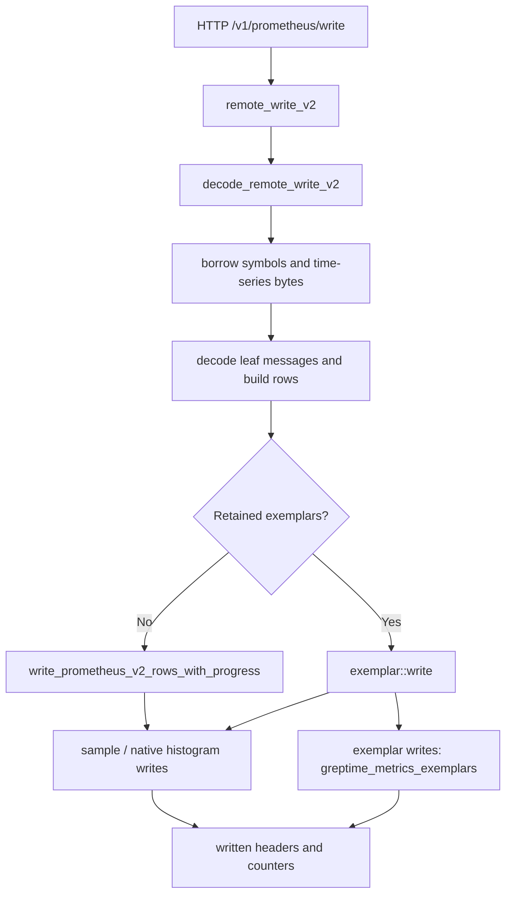

# Prometheus Remote Write

This module decodes Prometheus remote write requests and converts them into
Greptime row insert requests.

## Remote Write V2

Remote write v2 enters through `remote_write_v2` in
`src/servers/src/http/prom_store.rs`.

The `decode` codec metric covers decompression and the borrowed request
envelope. The `convert` metric covers per-series scans, leaf prost decoding,
validation, and row construction.

The conversion step produces sample and histogram `ContextReq`s plus validated
`ExemplarRequests`:

- samples keep the existing sample table name and can use the metric-engine
  physical table path and pending rows batcher;
- native histograms keep the existing metric table name;
- exemplars are grouped by database and written through `exemplar::write`, which
  prepares their source metric tables and tracks progress for each kind of write.

Accompanying source sample and histogram writes must succeed before exemplars
are written. A source write failure skips the request's exemplars while unrelated
metric writes proceed independently. Exemplar-only inputs remain supported for
existing logical metric tables.

Exemplar persistence requires metric-engine ingestion and logical metric-engine
source tables. Exemplars are stored in the target database's
`greptime_metrics_exemplars` table using ordinary Mito storage with sparse primary
keys and append mode. Remote Write v1 uses the same exemplar write path.

Exemplar-owned labels are stored in a JSON2 field named
`<default_column_prefix>_exemplar_labels`. The default name is
`greptime_exemplar_labels`; an empty prefix produces `exemplar_labels`.

Native histogram rows follow the same metric-engine switch as samples. They do
not use the pending rows batcher yet because the batcher assumes the classic
timestamp + Float64 value + string tags shape.

Each histogram row stores one Struct field named
`<default_column_prefix>_native_histogram`. The default name is
`greptime_native_histogram`; an empty prefix produces `native_histogram`.

- common scalar children: `schema`, `zero_threshold`, `sum`, `reset_hint`,
  `start_timestamp`;
- count children: `count_i64` / `zero_count_i64` or `count_f64` / `zero_count_f64`;
- list children for custom values, spans, and positive/negative buckets;
- original Prometheus labels as Greptime tags.

The v2 response reports sample, histogram, and exemplar counts in Prometheus
remote-write headers. Exemplar counts reflect confirmed storage writes, including
partial writes on error. Invalid exemplar observations are dropped during
conversion and excluded from the exemplar count.
